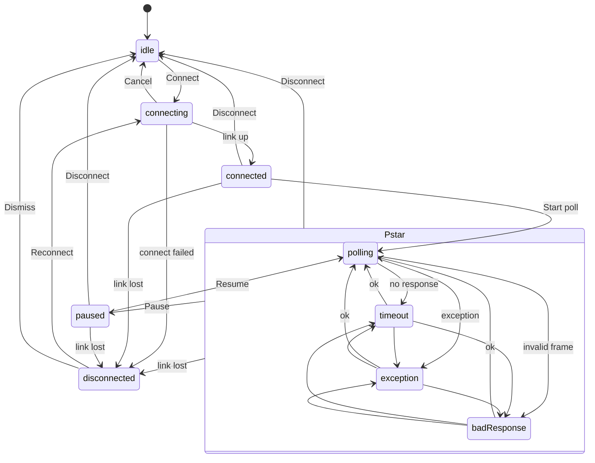

# DES-001 Modbus Master (MVP)

Upstream: `docs/requirements/REQ-001-modbus-master.md`. Downstream: `FE-001-modbus-master.md`, `CHK-001-modbus-master.md`, and BE-001, which the PM writes from the "Backend needs" section below.
Open backend and owner questions are listed in `docs/questions.md` (Q-001-xx). Where this document assumes an answer, it says **Assumption** and gives the question id.

**Revision 4 (2026-10-16)**, after `docs/qa/REPORT-002-integration.md` (finding 1 and notes) and the PM decisions:
- Traffic counter definitions now follow the BE-001 contract: bad replies count as Errors, not Responses (1, Traffic panel).
- New note on the Windows delay for refused loopback connects (3.4).
- Full toast list, including the error toasts (3.5).
- In binary value lists, whitespace always separates values (3.3, decision on open question m6).

**Revision 3 (2026-10-16)**, after `docs/qa/REPORT-001-ui-mode.md` F-3 and section 8 (PM decisions):
- The link-lost result in the Write dialog now has its own [Reconnect] button, because the banner cannot be reached while the dialog is modal (2.5). `Ctrl+L` stays disabled in modals (5.1).
- Section 7 states where focus returns when the Write dialog closes after it was opened from the data grid.

**Revision 2 (2026-10-16)**, after `docs/reviews/REV-001-backend.md`, the BE-001 "Final contract" and the PM decisions on the frontend questions:
- Unit ID 0 on Modbus TCP is a normal unicast; broadcast applies to RTU only (3.3, 2.5).
- New write result `linkLost` (2.5).
- `BadResponseKind` names and `BadResponseDetail` aligned with the backend; `shortFrame` text added (3.4).
- Traffic list uses single-frame selection (5.1, 5.2).
- No Connect button in the setup panel; `Enter` connects (1, 7).
- Save is blocked while the form is invalid (3.5).
- Dismiss goes through `mm_disconnect` (2.2).
- RTU value ranges (3.1).
- Extra profile name rules (3.4).

Users are engineers who watch dense data for hours. This design favours density, legibility, keyboard speed and states that cannot be confused with each other.

---

## 1. Screen inventory

| Id | Screen / surface | Kind | Opened by |
|---|---|---|---|
| S1 | Modbus Master window | Tool window (one per window, many windows allowed) | Launcher tile, `Ctrl+N` in an existing window |
| S2 | Write dialog | Modal inside S1 | Toolbar "Write…", `Ctrl+E`, `Enter` or double-click on a data row |
| S3 | Open profile dialog | Modal inside S1 | Toolbar "Open…", `Ctrl+O` |
| S4 | Save profile as dialog | Modal inside S1 | Toolbar "Save as…", `Ctrl+Shift+S`, `Ctrl+S` when no profile is loaded yet |
| S5 | Confirm dialogs | Small modal | Replace profile, delete profile, load while connected, close with unsaved changes |

Launcher manifest values (for the tool's `manifest.ts`): id `modbus-master`, display name `Modbus Master`, icon `activity` (lucide), route `/tools/modbus-master`, default window size 1280 x 800, minimum 960 x 600.

### S1 Modbus Master window

```
+--------------------------------------------------------------------------------------------------+
| TOOLBAR (48px, on page background)                                                               |
| [|| Setup]  Boiler-PLC  * Modified   [Open…] [Save] [Save as…]   (pill: ● Polling)                |
|                                       [Disconnect] [Pause] [Write…]                              |
+--------------------------------------------------------------------------------------------------+
| STATE BANNER (only in connecting / timeout / exception / badResponse / disconnected; 40px)       |
| (!) Timeout: slave 1 did not respond within 1000 ms. Retrying every 1000 ms (5 in a row).        |
+---------------------------+----------------------------------------------------------------------+
| SETUP PANEL (card, 320px, | DATA CARD                                                            |
| collapsible Ctrl+\)       | Slave 1 · FC03 Read holding registers · 0-9 (10)   [stale chip]      |
|                           | Format (Unsigned)(Signed)(Hex)(Binary)   Base (0)(1)                 |
| CONNECTION                | +------------------+---------------------------+                     |
|  Mode   (TCP)(RTU)        | | Address (0-based)|                     Value |                     |
|  Host   [192.168.1.10  ]  | |                0 |                      1234 |                     |
|  Port   [502]             | |                1 |                     65535 |                     |
|  Timeout[1000] ms         | |              ... |                       ... |                     |
|                           | +------------------+---------------------------+                     |
|                           |                                                                      |
| POLL                      |                                                                      |
|  Slave ID [1]             |                                                                      |
|  Function [03 Read holding registers v]                                                          |
|  Start address [0]  (protocol address 0)                                                         |
|  Quantity [10]  (1-125)   |                                                                      |
|  Scan rate [1000] ms      |                                                                      |
|  [x] Start polling when connected                                                                |
|  [Apply]                  |                                                                      |
+---------------------------+----------------------------------------------------------------------+
| ===================== resize handle (drag, or focus + Up/Down) ==================================|
| TRAFFIC (dark panel)  Requests 1204  Responses 1198  Errors 2  Timeouts 4                        |
|                       [x] Auto-scroll  [Copy] [Clear] [Reset counters]           [v collapse]    |
| #     Time          Dir   Len  Bytes                                          Info               |
| 2401  14:02:11.532  -> TX  12  00 01 00 00 00 06 01 03 00 00 00 0A             FC03 slave 1       |
| 2402  14:02:11.540  <- RX  29  00 01 00 00 00 17 01 03 14 04 D2 FF FF …        FC03 20 bytes      |
| DETAIL (selected frame, full bytes, 16 per line with offsets)                                    |
| 0000  00 01 00 00 00 17 01 03 14 04 D2 FF FF 00 00 00                                             |
+--------------------------------------------------------------------------------------------------+
| STATUS BAR (24px, dark): TCP 192.168.1.10:502 · Last OK 14:02:11.540 · Round trip 8 ms           |
+--------------------------------------------------------------------------------------------------+
```

Regions:
- **Toolbar**: setup toggle, profile name with modified marker (text "Modified" plus a dot, never the dot alone), profile actions, session state pill, and the session actions. Which actions show depends on the state (see 2.3).
- **State banner**: one fixed location for every abnormal or transient state, directly under the toolbar and across the full width. It never overlays content. It pushes content down by 40px and does not move the focus.
- **Setup panel**: Connection section, then Poll section. RTU mode replaces Host and Port with Serial port [select + Refresh], Baud, Data bits, Parity and Stop bits. Timeout appears in both modes.
  - The setup panel has **no Connect button** (PM decision). The toolbar button and `Ctrl+L` connect.
  - Pressing `Enter` in any Connection field does the same as the toolbar Connect, but only in `idle` or `disconnected`; in other states `Enter` does nothing there.
- **Data card**: header line with the poll summary and a freshness chip, the display controls, and a virtualized table with two columns, Address and Value.
- **Traffic panel**: a dark contrast panel with counters, controls, a virtualized frame list, and a detail strip for the selected frame. Collapsing it (`Ctrl+J`) leaves the 36px header with the counters visible.
  - **Counter definitions** (BE-001 Final contract; the backend computes them and the UI only displays them):

    | Counter | Counts |
    |---|---|
    | Requests | Requests written: polls and writes, including RTU broadcasts |
    | Responses | **Valid** replies, including exception replies |
    | Errors | Exception replies plus bad responses (wrong unit, wrong transaction, wrong function, truncated/short, malformed, garbage) |
    | Timeouts | Requests with no reply byte within the timeout. A partial reply at the deadline is a bad response (Errors), not a timeout |
  - An exception reply counts in both Responses and Errors. A bad reply counts in Errors only.
  - Responses therefore is **not** the number of RX rows in the list.
  - **Worked example.** 15 poll requests, of which 5 are answered normally, 3 dropped, 3 answered with exception 02, 2 answered with a wrong unit ID, and 2 truncated:

    | Counter | Value | Made up of |
    |---|---|---|
    | Requests | 15 | all requests |
    | Responses | 8 | 5 normal + 3 exception |
    | Errors | 7 | 3 exception + 2 wrong unit + 2 truncated |
    | Timeouts | 3 | 3 dropped |

    The list shows 12 RX rows (5 + 3 + 2 + 2).
- **Status bar**: connection summary, last good response time, and round trip of the last cycle. It is not focusable.

RTU setup fields:
```
 Mode        (TCP)(RTU)
 Serial port [COM3 - USB Serial Device v] [Refresh]
 Baud        [9600 v]      Data bits [8 v]
 Parity      [Even v]      Stop bits [1 v]
 Timeout     [1000] ms
```
Baud options are 1200, 2400, 4800, 9600, 19200, 38400, 57600 and 115200. Data bits are 7 or 8, parity is None, Even or Odd, and stop bits are 1 or 2. RTU defaults are 9600, 8, Even, 1, which is the Modbus serial line specification default. TCP defaults are host empty and port 502. Timeout defaults to 1000 ms (REQ).
Choosing data bits 7 shows this inline warning (not an error): "Modbus RTU uses 8 data bits. 7 may not work with most devices."
Choosing parity None with stop bits 1 shows this inline warning: "The Modbus specification uses 2 stop bits when parity is None."

### S2 Write dialog (modal, 480px wide)

```
+-- Write ----------------------------------------------------- [x] --+
| Function  [16 Write multiple registers v]                           |
| Slave ID  [1]        Start address [100]   (protocol address 100)   |
| Value format (Unsigned)(Signed)(Hex)(Binary)                        |
| Values (3)                                                          |
| +-----------------------------------------------------------------+ |
| | 10 20 30                                                        | |
| +-----------------------------------------------------------------+ |
| Separate values with spaces, commas, tabs or new lines.             |
| Writes addresses 100-102.                                           |
|                                                                     |
| RESULT AREA (fixed 40px, aria-live=polite)                          |
| (check) Write confirmed by slave 1: 3 registers at 100-102.         |
|                                                   [Close] [Send]    |
+---------------------------------------------------------------------+
```
- FC05 shows "Value (ON)(OFF)" as a two-option segmented control instead of the values box.
- FC06 shows a single "Value" input in the selected value format.
- FC15 shows the values box and accepts `0` and `1` only. The value format control is hidden.
- FC16 shows the values box in the selected value format.
- The dialog prefills from the selected data row: function 05 if the poll FC is 01, 06 if it is 03, and the last used write function otherwise. Address and slave ID come from the row and the poll, and the value is the current raw value in the table format.
- When the poll FC is 02 or 04, the dialog still opens on `Ctrl+E` with function 06, but `Enter` or double-click on a row shows the toast "Discrete inputs and input registers are read-only." instead.
- The dialog stays open after a send so the same write can be repeated. `Enter` sends, except in the values box, where `Ctrl+Enter` sends. `Esc` closes.

### S3 Open profile dialog (modal, 560px)
```
+-- Open profile ----------------------------------------------- [x] -+
| [Filter profiles…]                                                  |
| Name              Connection                  Modified              |
| > Boiler-PLC      TCP 192.168.1.10:502        2026-10-12 09:14      |
|   Pump-RTU        RTU COM3 9600 8E1           2026-10-02 16:40      |
|                                                                     |
|                       [Rename] [Delete]          [Cancel] [Open]    |
+---------------------------------------------------------------------+
```
Rename edits the name inline in the row, using the same validation as S4. If the renamed profile is the one loaded in this window, the toolbar and title switch to the new name. Delete asks for confirmation (S5). A window whose profile was renamed or deleted from another window keeps its own name, and `Ctrl+S` saves under that name, creating the profile again if needed.

### S4 Save profile as dialog (modal, 400px)
```
+-- Save profile as ------------------------------- [x] -+
| Name [Boiler-PLC                         ]              |
| Saves connection, poll and display settings.            |
|                                   [Cancel] [Save]       |
+---------------------------------------------------------+
```

### S5 Confirm dialogs (exact text)
| Trigger | Title | Body | Buttons (default focus marked *) |
|---|---|---|---|
| Save as with an existing name | Replace profile? | A profile named "{name}" already exists. Replace it? | Cancel*, Replace |
| Delete | Delete profile? | Delete "{name}"? This cannot be undone. | Cancel*, Delete |
| Load while not idle/disconnected | Disconnect and load? | Loading "{name}" will disconnect from {connectionSummary}. | Cancel*, Disconnect and load |
| Close window or load another profile with unsaved changes | Save changes? | Save changes to "{name}" before closing? (unnamed: "Save this setup as a profile before closing?") | Save*, Don't save, Cancel |

If Save is chosen in "Save changes?" while the setup form is invalid, the save is blocked as described in 3.5. The window stays open and the load does not happen.

---

## 2. State workflow

There are two layers:
1. **Session state**, owned by Rust and mirrored by the UI. It is an explicit finite set, and the UI never invents a session state.
2. **View states**, which are UI-local: invalid input, empty data and loading, applied per surface.

### 2.1 Session state set (finite)

`SessionState = idle | connecting | connected | polling | paused | timeout | exception | badResponse | disconnected`

| State | Meaning |
|---|---|
| `idle` | No link. Either never connected, or the user disconnected. |
| `connecting` | Link being opened (TCP connect or serial port open). |
| `connected` | Link up, no poll running and no poll has run since connect. |
| `polling` | Link up, poll running, last cycle got a valid response. |
| `paused` | Link up, poll stopped by the user after it ran. Last values are kept as stale. |
| `timeout` | Link up, poll running, last cycle got no response within the timeout. Polling keeps retrying. |
| `exception` | Link up, poll running, last cycle got a Modbus exception response. Polling keeps retrying. |
| `badResponse` | Link up, poll running, last cycle got an invalid frame (`BadResponseKind`: `crc`, `wrongSlave`, `wrongFunction`, `malformed`, `transactionMismatch`, `shortFrame`). Polling keeps retrying. A partial frame at the deadline is `shortFrame`, not a timeout. **Confirmed by BE-001 (Q-001-06).** |
| `disconnected` | Link lost unexpectedly, or the connect attempt failed. Carries a reason. Stays until the user acts. |

The "poll running" family is `polling | timeout | exception | badResponse`, called **P*** below. The "link up" family is `connected | paused | P*`, called **L*** below.

### 2.2 Transitions

Every transition is caused by a backend event. A user action only sends a command and sets a `pending` flag on the button. The flag clears when the matching backend event arrives or the command returns an error.

| # | From | Event (backend unless noted) | To | Notes |
|---|---|---|---|---|
| T1 | idle, disconnected | user Connect -> `connecting` | connecting | Only sent when connection input is valid |
| T2 | connecting | link up | connected | If "Start polling when connected" is on and the poll input is valid, the UI immediately sends Start poll (T5) |
| T3 | connecting | connect failed (reason) | disconnected | reason.phase = connectFailed |
| T4 | connecting | user Cancel, then cancelled | idle | |
| T5 | connected, paused | user Start/Resume, then poll started | polling | Data view goes to loading. The first cycle result may move on to timeout/exception/badResponse |
| T6 | P* | cycle ok | polling | Data view goes to live |
| T7 | P* | cycle timeout | timeout | consecutiveFailures +1 when already in timeout, otherwise set to 1 |
| T8 | P* | cycle exception (code) | exception | Same counting rule, keyed by state + code |
| T9 | P* | cycle bad response (kind) | badResponse | Same counting rule |
| T10 | P* | user Pause, then poll stopped | paused | Data view goes to stale |
| T11 | P* | user Apply (new poll definition), then poll restarted | polling | Data view goes to loading and old values are dropped |
| T12 | L* | user Disconnect, then closed | idle | Data view keeps nothing, so it shows the idle empty state |
| T13 | L* | link lost (reason) | disconnected | reason.phase = linkLost. Last values stay as stale. A write in flight returns `linkLost` and queued writes return `notConnected` (2.5) |
| T14 | disconnected | user Reconnect | connecting | Same as T1 with the current config |
| T15 | disconnected | user Dismiss (banner), then `idle` event | idle | The UI calls `mm_disconnect` and waits for the `idle` event (PM decision); it never resets locally. While pending, Dismiss shows its spinner. On `idle` the banner and stale data clear |

Apply outside P* (idle, connecting, connected, paused, disconnected) sends nothing and causes no transition. It stores the poll definition in the window config, and the next Start or Resume uses it. In `paused`, Apply with a changed definition also clears the stale values, and the data view shows the "Poll settings changed" empty text.

No other transition is valid. The UI applies backend snapshots as authoritative. An unexpected pair (for example `idle -> polling`) is applied anyway and reported as a development warning, so a backend bug is visible but the UI never disagrees with Rust.
**Assumption Q-001-01:** there is no automatic reconnect in the MVP.
**Assumption Q-001-02:** repeated timeouts on TCP do not by themselves cause `disconnected`.



### 2.3 What the user sees per session state

The pill sits in the toolbar and the banner sits under it. The pill always shows icon plus text. Icons are lucide (shadcn/ui default set).

| State | Pill (icon, label, style) | Banner (token, icon, text, action) | Toolbar session actions | Setup panel | Data view |
|---|---|---|---|---|---|
| idle | `plug` "Not connected", outline pill, border `dark/25`, text `dark` | none | Connect (primary) | All editable | Empty: idle text |
| connecting | `loader` (spins; static under reduced motion) "Connecting…", outline pill | Neutral banner (`dark/6` bg): "Connecting to {target}…" with [Cancel] | Cancel | Read-only, hint "Disconnect to change connection settings." | Empty: connecting text |
| connected | `link` "Connected", `dark` fill, `light` text | none | Disconnect, Start polling (primary), Write… | Connection read-only; Poll editable | Empty: connected text |
| polling | `activity` "Polling", `success` fill, `dark` text | none | Disconnect, Pause, Write… | Connection read-only; Poll editable, Apply restarts | Loading, then live |
| paused | `pause` "Paused", outline pill, border `dark` | none | Disconnect, Resume (primary), Write… | Connection read-only; Poll editable | Stale chip "Paused - values from {time}" |
| timeout | `timer-off` "Timeout", `warning` fill, `dark` text | `warning` banner (orange fill, dark text, `timer-off`): "Timeout: slave {id} did not respond within {timeoutMs} ms. Retrying every {scanMs} ms ({n} in a row)." | Disconnect, Pause, Write… | as polling | Stale chip "No response - values from {time}", or loading if never received |
| exception | `octagon-x` "Exception {cc}", `error-tint` bg + 1.5px `error` border, `dark` text, `error` icon | `error` banner (error-tint bg, 4px left border `error`, `octagon-x` icon in `error`, `dark` text): "Exception {cc} ({name}) from slave {id} for FC{fc} at {start}-{end}. Retrying every {scanMs} ms ({n} in a row)." | Disconnect, Pause, Write… | as polling | Stale chip "Exception - values from {time}" or empty-with-exception text |
| badResponse | `triangle-alert` "Bad response", `warning` fill, `dark` text | `warning` banner, `triangle-alert`: "Bad response from slave {id}: {kindText}. Retrying every {scanMs} ms ({n} in a row)." ({kindText} from 3.4) | Disconnect, Pause, Write… | as polling | Stale chip "Bad response - values from {time}" |
| disconnected | `unplug` "Disconnected", `error-tint` bg + `error` border, `dark` text | `error` banner, `unplug`: reason text (see 3.4) with [Reconnect] (primary) and [Dismiss] | Reconnect (primary) | All editable | Stale chip "Disconnected - values from {time}" or empty: disconnected text |

Rules:
- Timeout and badResponse share the warning color but have different icons, labels and banner text.
- Exception and disconnected share the error color but have different icons and labels, and only disconnected offers Reconnect.
- On transitions into `disconnected` or `exception`, a polite live region announces the banner text once. Repeats of the same state are not re-announced. The `{n} in a row` counter updates visually only.
- Window title: `Modbus Master - {profile name or "Untitled"}{" *" if modified} - {pill label}`.

### 2.4 View states (UI-local)

| View state | Surface | Trigger | What the user sees |
|---|---|---|---|
| **invalid input** | Setup fields, Write dialog, profile name | A field fails validation (rules in section 3) | Field border 1.5px `error`, `circle-x` icon in `error` plus message in `dark` 12px under the field, `aria-invalid`. Pressing Connect/Apply/Start/Send with invalid input sends nothing, shows all messages, and moves focus to the first invalid field. The setup panel header shows "1 field needs attention" or "{n} fields need attention" with `circle-x`. It disappears when n = 0. |
| **empty data** (data card) | Data table | No values to show | Centered text, 14px `dark/75`, plus icon: idle "Not connected. Configure a connection and press Connect (Ctrl+L)."; connecting "Connecting to {target}…"; connected "Connected. Press Start polling (Ctrl+P) to read {qty} {itemName} from slave {id}." (itemName: coils / discrete inputs / holding registers / input registers); connected with invalid poll "Fix the poll settings to start polling."; paused after Apply "Poll settings changed. Press Resume (Ctrl+P) to read with the new settings."; exception before any data "No data: the device answered with exception {cc} ({name})."; disconnected "Connection lost. Press Reconnect to continue." |
| **empty data** (traffic) | Traffic list | No frames | "No frames yet. Requests and responses appear here." After Clear: "Log cleared at {time}. New frames appear here." |
| **empty data** (profiles) | S3 list | No profiles | "No saved profiles yet. Use Save as (Ctrl+Shift+S) to create one." Filter with no match: "No profiles match "{text}"." |
| **empty data** (serial ports) | Serial port select | List returned empty | Select shows "No serial ports found", plus the inline message "No serial ports found. Connect a device and press Refresh." |
| **loading** (data card) | Data table | P* entered and no update yet for the current definition | Rows render with addresses and value "—" in `dark/75`. The chip shows `loader` "Waiting for first response…" |
| **loading** (profiles) | S3 list | Listing in progress | `loader` "Loading profiles…". Open is disabled |
| **loading** (serial ports) | Port select | Listing in progress | Select disabled with text "Loading ports…". Refresh button shows the spinner |
| **loading** (write) | S2 result area | Write sent | `loader` "Writing…". Send is disabled and Close stays enabled (closing does not cancel the write; the result is dropped) |
| **live** | Data table | Valid update for the current definition | Values in `dark`, chip `circle-check` "Updated {time}" (time from backend timestamp, HH:MM:SS.mmm) |
| **stale** | Data table | Last values exist, state is paused / timeout / exception / badResponse / disconnected | Values in `dark/75`, plus the stale chip text from 2.3 with a `clock` icon. Never color only |
| **error** (profiles, ports) | S3 list, port select | IPC call failed | `circle-x` "Could not load profiles: {message}" [Retry]; "Could not list serial ports: {message}" [Refresh] |

### 2.5 Write result states (S2 result area)

| Result | Icon / token | Text |
|---|---|---|
| sending | `loader` / dark | "Writing…" |
| success | `circle-check` on `success` fill chip, dark text | "Write confirmed by slave {id}: {n} {coils|registers} at {start}-{end}." (single: "… {coil|register} at {addr}.") |
| broadcast sent (**RTU only**) | `circle-check` outline, dark text | "Broadcast sent. Devices do not reply to slave ID 0, so the write cannot be confirmed." |
| exception | `octagon-x` in `error`, error-tint chip | "Exception {cc} ({name}). Nothing was confirmed." |
| timeout | `timer-off`, `warning` fill | "No response within {timeoutMs} ms. The write may or may not have been applied." |
| badResponse | `triangle-alert`, `warning` fill | "Bad response: {kindText}. The write may or may not have been applied." ({kindText} from 3.4) |
| link lost | `unplug` in `error`, error-tint chip with 1.5px `error` border, dark text, plus a [Reconnect] button (secondary style) at the right end of the result area | "Connection lost during the write. The write may or may not have been applied. Reconnect and check the value before sending again." |
| reconnect failed (link lost follow-up) | same style as link lost, with [Reconnect] | "Reconnect failed: {reason text from 3.4}" |
| not connected | `unplug`, error-tint | "Not connected. Connect before writing." (Send is disabled with this text when not in L*.) |

Write results by situation:
- On Modbus TCP, slave (unit) ID 0 is **not** a broadcast. Many TCP devices answer unit 0. The write waits for a reply like any other and returns ok, exception, timeout or badResponse. `broadcastSent` can occur only in RTU mode with slave ID 0.
- **link lost**: the write was in flight (already handed to the link) when the link dropped. The device may or may not have executed it.
  - The session moves to `disconnected` (T13) at the same time. The banner behind the modal shows the reason with its own [Reconnect], but it cannot be reached while the dialog is open. Send is disabled because the session is not in L*.
  - The dialog stays open with the draft intact.
  - **[Reconnect] in the result area** (PM decision, revision 3):
    - It performs the same action as the banner Reconnect: T14, `mm_connect` with this window's current connection config.
    - It keeps the dialog open and the draft unchanged.
    - While the connect is pending, the button shows the `loader` spinner and is disabled. The result text stays.
    - When the session is back in L*, the result area clears (Reconnect button included) and Send re-enables. Polling resumes on its own via T2 when "Start polling when connected" is on. Focus then moves to Send.
    - If the connect fails (session back in `disconnected`, phase `connectFailed`), the result area shows "Reconnect failed: {reason text}" with [Reconnect] enabled again. Focus stays on [Reconnect].
  - Alternative path: close the dialog (`Esc` or Close), then use the banner [Reconnect] or `Ctrl+L`. `Ctrl+L` remains disabled while any modal is open (5.1).
  - What the user should do after reconnecting: confirm the value through the poll before pressing Send again.
  - Outside the cases above, the result text stays visible until the next Send or until the dialog closes.
  - The [Reconnect] button appears **only** for link lost and reconnect failed, never for `notConnected`.
- **not connected**: the write was never transmitted, either because it was queued when the link dropped or because it was requested outside L*. The draft stays and Send re-enables in L*.

---

## 3. Field validation and messages

Validation runs on blur and on submit, then on every change once a field has shown an error. All numeric fields accept only whole decimal numbers, with surrounding whitespace trimmed. Values are rejected before anything is sent (REQ). Messages appear exactly as written; `{}` are substitutions.

### 3.1 Connection
| Field | Rule | Message |
|---|---|---|
| Host | required | "Enter a host name or IPv4 address." |
| Host | IPv4 dotted quad (each 0-255) or host name (letters, digits, `-`, `.`, max 253 chars, labels max 63) | "Enter a valid host name or IPv4 address, for example 192.168.1.10." (IPv6: Q-001-14) |
| Port | integer 1-65535 | "Port must be a whole number from 1 to 65535." |
| Timeout | integer 50-10000 (proposed, Q-001-05) | "Timeout must be a whole number from 50 to 10000 ms." |
| Serial port | required | "Select a serial port." |
| Baud | one of 1200, 2400, 4800, 9600, 19200, 38400, 57600, 115200 (backend rejects anything else) | "Choose a baud rate from the list." |
| Data bits | 7 or 8 (backend rule) | "Data bits must be 7 or 8." |
| Parity | None, Even, Odd | "Choose a parity from the list." |
| Stop bits | 1 or 2 (backend rule) | "Stop bits must be 1 or 2." |

These four fields are selects, so the user cannot enter other values directly. The messages appear only when a loaded profile holds a value outside the list (a hand-edited or older file).
- The whole setup form is re-validated after every `profiles_get`, and such a field shows the invalid input state.
- The select displays the stored value as "{value} (not supported)" until the user picks a valid one.
- These range rules apply only in RTU mode. TCP never validates them.

### 3.2 Poll
| Field | Rule | Message |
|---|---|---|
| Slave ID | integer 0-247 | "Slave ID must be a whole number from 0 to 247." |
| Slave ID | RTU mode and value 0 | "Slave ID 0 is broadcast and cannot be used for reads. Use 1 to 247." (Q-001-04) |
| Function | 01, 02, 03, 04 | (select) Labels: "01 Read coils", "02 Read discrete inputs", "03 Read holding registers", "04 Read input registers" |
| Start address | 0-based: 0-65535. 1-based: 1-65536 | "Start address must be a whole number from {min} to {max}." |
| Quantity | FC01/02: 1-2000. FC03/04: 1-125 | "Quantity for FC{fc} must be from 1 to {max}." |
| Start + quantity | protocol start + quantity - 1 <= 65535 | "This range ends after the last address ({lastDisplay}). The maximum quantity from {startDisplay} is {maxQty}." |
| Scan rate | integer 20-60000 ms (proposed, Q-001-05) | "Scan rate must be a whole number from 20 to 60000 ms." |

The address fields follow the display base. Under the field, a 12px `dark/75` helper shows "Protocol address {n}" so the 0/1 offset is never ambiguous. Changing the base converts the field value (0 <-> 1) and keeps the same protocol address. Quantity helper text: "1-{max}" for the current function.

### 3.3 Write dialog
| Field | Rule | Message |
|---|---|---|
| Slave ID | 0-247 | "Slave ID must be a whole number from 0 to 247." |
| Slave ID 0, **RTU mode only** | Broadcast. Shows the warning (not an error, Send stays enabled) "Broadcast: devices do not reply, so the result cannot be confirmed." with `triangle-alert` on `warning` fill | (warning) |
| Slave ID 0, TCP mode | Normal unit ID. No warning; the write waits for a reply (2.5) | (none) |
| Address | same as poll start address | same as poll |
| Value (Unsigned) | 0-65535 | "Value must be from 0 to 65535." |
| Value (Signed) | -32768 to 32767 | "Value must be from -32768 to 32767." |
| Value (Hex) | 1-4 hex digits, optional `0x` prefix, case-insensitive | "Enter a hex value from 0x0000 to 0xFFFF." |
| Value (Binary), single-value field (FC06) | 1-16 digits of 0/1, optional `0b` prefix, spaces between nibbles allowed | "Enter up to 16 binary digits (0 or 1)." |
| Value (Binary), in a values list (FC16) | Each value is 1-16 digits of 0/1 with an optional `0b` prefix and **no internal spaces**. Whitespace always separates values (PM decision, open question m6), so nibbles are never merged | item: "Value {i} ("{text}") is not valid: Enter up to 16 binary digits (0 or 1)." This covers a value that is too long (17+ digits), too short (`0b` with no digits), or contains a non-binary character |
| Values list (FC16) | 1-123 values, separators: space, comma, tab, newline (consecutive separators count as one). This applies in every value format, Binary included | count: "Enter from 1 to 123 values (you entered {n})." item: "Value {i} ("{text}") is not valid: {single-value message}" (first failing item only) |
| Values list (FC15) | 1-1968 values, each 0 or 1 | count: "Enter from 1 to 1968 values (you entered {n})." item: "Value {i} ("{text}") is not valid: enter 0 or 1." |
| Range (FC15/16) | address + count - 1 <= 65535 | "These values end after the last address ({lastDisplay}). At most {max} values fit from {startDisplay}." |

Binary in a values list, example: pasting `0000 0100 1101 0010` into the FC16 box in Binary format gives **four** values (0, 4, 13, 2). The box label reads "Values (4)" and the helper reads "Writes addresses {a}-{a+3}.", so the split is visible before Send. One register with that bit pattern must be entered as `0000010011010010` or `0b0000010011010010`. `0000 0100 1101 00102` fails on value 4 with "Value 4 ("00102") is not valid: Enter up to 16 binary digits (0 or 1).". No new UI text is added for this rule.

### 3.4 Profile name and backend reasons
Rules are checked in this order, and only the first failing message is shown. Names are not trimmed silently.
| Rule | Message |
|---|---|
| required (empty or spaces only) | "Enter a profile name." |
| max 64 chars | "Profile name must be at most 64 characters." |
| no leading or trailing space | "Profile name cannot start or end with a space." |
| does not start with `.` | "Profile name cannot start with a dot." |
| does not end with `.` | "Profile name cannot end with a dot." |
| none of `\ / : * ? " < > |` | "Profile name cannot contain \ / : * ? " < > |" |
| no control characters (U+0000-U+001F, U+007F) | "Profile name cannot contain control characters." |
| not a Windows reserved name, case-insensitive: CON, PRN, AUX, NUL, COM1-COM9, LPT1-LPT9, COM¹ COM² COM³, LPT¹ LPT² LPT³. This applies to the whole name and to the part before the first dot, so `con.backup` is rejected | ""{name}" is reserved by Windows and cannot be used as a profile name." |
| unique (case-insensitive) when renaming | "A profile named "{name}" already exists." (Save as uses the Replace confirm instead) |

If the backend still rejects a name with `invalidProfileName`, its message is shown under the name field in the same invalid input style.

Disconnected and connect-failed banner text, by `SessionReason.kind` (`ReasonKind` in the BE-001 contract). `SessionReason.phase` (`connectFailed` or `linkLost`) does not change the text. `SessionReason.message` is technical and is used only for `ioError`.
| Reason kind | Text |
|---|---|
| refused | "Connection refused by {host}:{port}." |
| connectTimeout | "No answer from {host}:{port} within {timeoutMs} ms." |
| hostNotFound | "Host "{host}" could not be resolved." |
| portBusy | "{port} is in use by another application or window." |
| portNotFound | "{port} is not available. Refresh the port list." |
| closedByPeer | "The device at {host}:{port} closed the connection." |
| portRemoved | "{port} was removed." |
| ioError / other | "Connection error: {message}" |

**Windows note: refused loopback connects** (REPORT-002, revision 4). On Windows, the OS reports a refused connection to a loopback port with nothing listening only after about one second. The app's connect timeout (the Timeout field) can expire first, so:

| Timeout | Valid banner (and "Reconnect failed: …" text in the Write dialog) |
|---|---|
| Below 1000 ms | Either reason text is valid: "No answer from {host}:{port} within {n} ms." (connectTimeout) or "Connection refused by {host}:{port}." (refused) |
| 1000 ms and above | "Connection refused by {host}:{port}." is expected |

Because the OS delay is only approximate, a timeout at exactly the 1000 ms default can occasionally still give the "No answer" text. QA therefore verifies the refused text with a 3000 ms timeout. The UI shows whichever reason kind the backend reports and never rewrites one into the other.

**Bad response `{kindText}`**, built from `BadResponseKind` and `BadResponseDetail { expected, got, message }`:

This comes from `StateChanged.badResponseDetail` for the banner and from `WriteResult.badResponse.detail` for the write dialog.
| `BadResponseKind` | `{kindText}` |
|---|---|
| `crc` | "CRC mismatch" |
| `wrongSlave` | "reply from slave {got}, expected {expected}" |
| `wrongFunction` | "reply for FC{got}, expected FC{expected}" (function codes as two decimal digits, e.g. FC03) |
| `transactionMismatch` | "transaction ID mismatch (got {got}, expected {expected})" |
| `malformed` | "malformed frame ({message})" |
| `shortFrame` | "short frame ({got} of {expected} bytes)". Both numbers are bytes on the wire (the whole ADU: MBAP or slave + CRC included), so they match the Len column in the traffic panel |

Fallbacks:
- If `expected` or `got` is missing for a kind that uses them, the text is the kind's leading words only ("reply from unexpected slave", "reply for unexpected function", "transaction ID mismatch", "short frame").
- If `message` is empty for `malformed`, the text is "malformed frame".

Example banner: "Bad response from slave 1: short frame (20 of 29 bytes). Retrying every 1000 ms (1 in a row)."

Exception names (from the public Modbus spec): 01 Illegal function, 02 Illegal data address, 03 Illegal data value, 04 Server device failure, 05 Acknowledge, 06 Server device busy, 08 Memory parity error, 0A Gateway path unavailable, 0B Gateway target device failed to respond. Any other code shows "Unknown exception". Codes are shown as two uppercase hex digits.

### 3.5 Saving with invalid input (PM decision)
Save is blocked while any setup field (Connection or Poll) is invalid. This covers `Ctrl+S`, `Ctrl+Shift+S`, toolbar Save and Save as…, and Save in the "Save changes?" confirm.
- Nothing is saved and no dialog opens.
- All field messages are shown, exactly as for Connect (2.4 invalid input), and focus moves to the first invalid field.
- A toast appears with the `circle-x` icon in `error`, `dark` text, on the default toast surface, for 4 s, in a polite live region: **"Fix the highlighted fields before saving."**
- Toolbar Save and Save as… stay enabled (not greyed out), so the reason is always explained by the toast.

**All toasts** (complete list, revision 4). Toasts sit bottom-right in a polite live region, with the text in `dark`. Error-tone toasts have the `circle-x` icon in `error` and never put text on a solid red fill.
| Toast text | Tone / icon | Duration | When |
|---|---|---|---|
| "Copied {n} rows." / "Copied 1 row." | neutral (default toast) | 2 s | Data table copy (5.2) |
| "Copied 1 frame." | neutral (default toast) | 2 s | Traffic frame copy (5.2) |
| "Discrete inputs and input registers are read-only." | neutral (default toast) | 2 s | Enter/double-click on an FC02/04 row (S2) |
| "Fix the highlighted fields before saving." | error, `circle-x` | 4 s | Save blocked (3.5) |
| "Could not copy to the clipboard." | error, `circle-x` | 4 s | The clipboard write was refused, for a data table copy, a traffic frame copy or "Copy bytes". No success toast is shown in that case |
| "Could not open a new window: {message}" | error, `circle-x` | 4 s | `window_open_tool` rejected (`Ctrl+N`) |
| "Could not save profile: {message}" | error, `circle-x` | 4 s | `profiles_save` or `profiles_rename` rejected for a reason other than a name rule (name rule messages go under the field, 3.4) |
| "Could not open profile: {message}" | error, `circle-x` | 4 s | `profiles_get` rejected |
| "{message}" (the `AppError.message` of the rejected command, verbatim) | error, `circle-x` | 4 s | Any other rejected command (connect, cancel, disconnect, start/stop poll, reset counters) |

`{message}` is always `AppError.message` from the backend.

---

## 4. Data presentation

- Value formats for 16-bit registers (FC03/04):
  - Unsigned: `65535`
  - Signed: `-1`
  - Hex: `0xFFFF`, 4 digits, uppercase
  - Binary: `1111 1111 1111 1111`, 16 digits in nibble groups
- One format applies to the whole table. Default Unsigned. Saved in the profile.
- FC01/02 show `1` or `0`. The format control is disabled with the tooltip "Coils and discrete inputs are shown as 0 or 1."
- Address base 0 or 1 (default 0, REQ) changes only the displayed address and the address inputs. The column header reads "Address (0-based)" or "Address (1-based)".
- All numbers, addresses, bytes and timestamps use the monospace token. Values and addresses are right-aligned. Hex bytes in the traffic panel are left-aligned, as uppercase two-digit groups separated by a single space.
- Times are local, shown as `HH:MM:SS.mmm`. The tooltip shows the full ISO date-time with offset.
- Values do not animate on change: no flash and no transitions, to keep 100 ms polling calm and cheap.

---

## 5. Interaction details

### 5.1 Keyboard shortcuts (window-scoped; disabled while a modal is open, except the modal's own keys)
| Keys | Action | Available when |
|---|---|---|
| `Ctrl+L` | Connect / Disconnect (Cancel while connecting; Reconnect when disconnected) | always, except while a modal is open (inside the Write dialog, use its [Reconnect], 2.5) |
| `Ctrl+P` | Start polling / Pause / Resume | connected, P*, paused |
| `Ctrl+E` | Open Write dialog (prefilled from the selected row) | L* |
| `Ctrl+N` | New Modbus Master window | always |
| `Ctrl+O` | Open profile | always |
| `Ctrl+S` | Save (Save as when untitled) | always |
| `Ctrl+Shift+S` | Save as | always |
| `Ctrl+1` / `2` / `3` / `4` | Format Unsigned / Signed / Hex / Binary | registers poll |
| `Ctrl+B` | Toggle address base 0/1 | always |
| `Ctrl+\` | Show/hide setup panel | always |
| `Ctrl+J` | Collapse/expand traffic panel | always |
| `Ctrl+Shift+K` | Clear traffic log | always |
| `Ctrl+C` | Copy the selected rows (data table) or the selected frame (traffic) | focus in that list |
| `Ctrl+A` | Select all rows in the data table. Not applicable in the traffic list (does nothing there) | focus in the data table |
| `Up`/`Down`, `PageUp`/`PageDown`, `Home`/`End` | Move the selection. In the data table `Shift` extends it. The traffic list always has at most one selected frame | focus in a list |
| `Enter` in a Connection field | Connect (same as the toolbar button) | idle, disconnected |
| `Enter` / double-click | Open Write dialog for the row | data table, writable FC |
| `Esc` | Close dialog. In a list, clear the selection | |

Browser defaults that conflict (`Ctrl+P` print, `Ctrl+O`, `Ctrl+S`, `Ctrl+N`, `F5` reload, `Ctrl+R` reload) are suppressed in the tool window. Shortcuts appear in button tooltips, for example "Connect (Ctrl+L)".

### 5.2 Copy / paste
- Data table `Ctrl+C`: one line per selected row, `{displayAddress}\t{value in current format}`, no header. This pastes into spreadsheets as two columns.
- The traffic list uses **single-frame selection** (PM decision). Click or arrow keys select one frame. Shift/Ctrl-click selects that one frame only (no range or multi-select).
- Traffic `Ctrl+C`: copies the selected frame as one line, `{HH:MM:SS.mmm}\t{TX|RX}\t{hex bytes}\t{info}`. With no frame selected it does nothing. The detail strip has a "Copy bytes" button that copies only the space-separated hex.
- The Write values box accepts pasted spreadsheet columns or rows: tabs and newlines are separators.
- Numeric inputs trim pasted whitespace. Pasting `0x1F` into a Hex value field is accepted.
- After a copy, a toast shows "Copied {n} rows." ("Copied 1 row." for one) or "Copied 1 frame." (2 s, bottom-right, polite live region).

### 5.3 Column resize
- Data table: Address and Value columns. Traffic: #, Time, Dir, Len, Bytes, Info.
- Each column has a 6px drag handle at the header's right edge. Double-click the handle to auto-fit to visible content. Minimum widths: Address 72px, Value 96px, Time 104px, Dir 56px, Len 40px, Bytes 160px, Info 120px.
- Bytes cells truncate with an ellipsis. Full bytes appear in the detail strip for the selected frame.
- Widths persist for the window's lifetime. Persisting across launches is a follow-up and needs a settings store (section 9, optional).
- Panel split: the handle between the data card and the traffic panel is focusable (`role=separator`, `aria-valuenow`). `Up`/`Down` move it 16px. Range 120px to 70% of window height. Double-click resets to 35%.

### 5.4 Multi-window behavior
- Each window has its own independent session, stores, profile and traffic log. Nothing is shared between windows except the profile list on disk.
- `Ctrl+N` and the launcher tile open a new window in `idle` with defaults. A new window is offset 24px from the active window. The window-state plugin restores size and position per window label.
- The same profile can be open in two windows. Saving in one does not update the other. The other window shows no change until it reloads the profile.
- If two windows open the same COM port, the second gets `disconnected` with portBusy: "COM3 is in use by another application or window."
- Closing a window with unsaved profile changes shows the S5 "Save changes?" dialog. Closing in any L* state disconnects without asking (Rust closes the session when the window is destroyed).
- The profile list in S3 is re-fetched each time S3 opens, so profiles saved in other windows appear.

---

## 6. Style list

Use only these tokens. They are defined once as CSS variables and in the Tailwind theme.

### 6.1 Color tokens
| Token | Value | Role |
|---|---|---|
| `--color-dark` | `#312f2e` (CLAUDE.md) | Body text on light surfaces; dark panels (traffic, status bar); connected pill fill |
| `--color-light` | `#edeff2` (CLAUDE.md) | Page background; text on dark panels |
| `--color-accent` | `#d7f26c` (CLAUDE.md) | Primary buttons (dark text), selected segmented option, selected row bar on dark panel, focus ring on dark panels. Never used for status |
| `--color-warning` | `#fa8130` (CLAUDE.md) | Timeout and badResponse pills/banners, write warnings. Warning only, never decorative |
| `--color-success` | `#22c55e` (**proposed** in CLAUDE.md) | Polling pill, write success chip, live chip icon on dark |
| `--color-error` | `#ef4444` (**proposed** in CLAUDE.md) | Exception/disconnected borders and icons, invalid field borders and icons |

Derived tokens. These are opacity mixes of existing tokens, not new hex values.
| Token | Definition | Role |
|---|---|---|
| `--color-text-muted` | `dark` at 75% over `light` | Helper text, stale values, empty-state text |
| `--color-border` | `dark` at 15% | Card and input borders, table grid lines |
| `--color-neutral-tint` | `dark` at 6% | Connecting banner, hovered row |
| `--color-error-tint` | `error` at 12% over the surface | Exception/disconnected banner and pill background |
| `--color-selected` | `accent` at 35% over the surface | Selected rows on light surfaces (plus a 3px `dark` left bar, so selection is not color only) |

**Proposed new tokens (need owner values, Q-001-11):**
- `--color-surface`, for the card background ("light cards on soft background"). Its value is not chosen here.
- `--font-mono`, for the data font. Proposal: the system stack `"Cascadia Mono", Consolas, ui-monospace, monospace`, so no new dependency is needed. Owner may choose a bundled font instead.

Until the owner sets `--color-surface`, implement cards with `--color-light` plus a `--color-border` border, so no hex is invented.

### 6.2 Contrast (WCAG 2.1, computed from the hex values above)
| Pair | Ratio | Use allowed |
|---|---|---|
| dark on light | 11.6:1 | all text |
| light on dark | 11.6:1 | all text on dark panels |
| dark on accent | 10.7:1 | primary button text |
| accent on dark | 10.7:1 | text, focus ring, icons on dark panels |
| dark on warning | 5.2:1 | pill/banner text and icons |
| dark on success | 5.8:1 | pill text and icons |
| success on dark | 5.8:1 | icons/text on dark panels |
| error on light | 3.3:1 | icons, borders, focus/invalid outlines only. **Not for body text** |
| dark on error | 3.5:1 | **Do not use**: no text on solid error fill |
| success on light | 2.0:1 | **Do not use** as icon or text on light |
| warning on light | 2.2:1 | **Do not use** as icon or text on light |
| accent on light | 1.1:1 | **Do not use**: an accent button on a light surface needs a 1px `--color-border` outline |
| error on dark | 3.5:1 | icons only in the traffic panel (exception/error frames), with light text beside them |

### 6.3 Typography, spacing, radius, components
- UI font Afacad (bundled via @fontsource). Sizes: 14px base UI, 12px helper/labels, 16px section headings, 18px dialog titles. Weights 400 and 600.
- Data font `--font-mono`, 13px. Table row height 24px. Traffic row height 22px.
- Spacing on a 4px scale. Card padding 12px, form field gap 8px, section gap 16px, toolbar gap 8px.
- Radius: cards 12px, inputs 8px, dialogs 16px, buttons and pills full (pill-shaped).
- Components (shadcn/ui): Button (primary = accent fill + dark text + border; secondary = outline `dark/25`; destructive confirm = outline with `error` border and icon, dark text), Input, Select, Checkbox, ToggleGroup (segmented), Dialog, AlertDialog, Tooltip, Toast (sonner), ScrollArea. The table uses TanStack Table + Virtual.
- Shared primitives to add in `shared/ui`: `StatusPill` (icon + label, a variant per session state), `StateBanner` (variant + icon + text + actions), `FieldMessage` (icon + text, error or warning), `FreshnessChip`.
- Status is never color only: every status element has an icon and a text label (CLAUDE.md).

---

## 7. Accessibility

- Focus order: toolbar (left to right) -> banner actions -> setup panel (Connection fields, Poll fields, Apply) -> data card controls (Format, Base) -> data table -> panel splitter -> traffic controls -> traffic list -> detail strip "Copy bytes". The status bar is not focusable.
- Focus ring: 2px solid `dark` with 2px offset on light surfaces, and 2px solid `accent` on dark panels. It is always visible on keyboard focus.
- Modals trap focus, return focus to the invoking control on close, and put initial focus on the first field. Confirm dialogs put initial focus on the safe button.
- Write dialog opened from the data grid (`Enter`, double-click, or `Ctrl+E` with the grid focused): on close, focus returns to the **data grid element**. The grid's `aria-activedescendant` is the row the dialog was opened for, so the screen reader lands on that row. Opened from the toolbar Write… button, focus returns to that button.
- Tables use `role=grid` with `aria-rowcount` = total rows (virtualized), `aria-rowindex` per row, `aria-selected` on rows, and `aria-activedescendant` on the grid pointing at the focused row. Value updates are **not** announced.
- Live regions:
  - polite region announces session state changes as "{pill label}. {banner text}" once per transition into a new state
  - assertive only for `disconnected`
  - the write result area is polite
- Targets are at least 24 x 24px. Icon-only buttons have `aria-label` and a tooltip with the shortcut.
- Respect `prefers-reduced-motion`: spinners become a static `loader` icon and the label text carries the meaning.
- Never color only: pills, banners, chips, invalid fields, TX/RX (arrow plus "TX"/"RX" text) and selected rows (left bar).

---

## 8. Performance requirements (from REQ: 125 registers at 100 ms without freezing)

- The data table and traffic list are virtualized. Only visible rows render.
- Poll updates replace the value array once per update. Row components select only their own value, so unchanged rows do not re-render.
- Traffic frames are appended in batches. Updates that arrive within one animation frame are coalesced into one store write. The ring buffer holds 5,000 frames (REQ). Older frames are dropped and the `#` column keeps the absolute sequence number.
- Auto-scroll follows new frames only while it is enabled. Scrolling up manually turns Auto-scroll off. Re-enabling it jumps to the newest frame.
- The UI never polls on a timer. All live data comes over the backend channel (CLAUDE.md rule 5).

---

## 9. Backend needs (proposals, names only; the PM decides in BE-001)

These are the commands, events and data the UI needs. Names and shapes are proposals. The behavior questions are in `docs/questions.md`.

> **Superseded for implementation** by the "Final contract" section of `docs/tasks/backend/BE-001-modbus-master.md`, which is authoritative. The list below is kept as the original request. Differences that matter to the UI:
> - `SessionReason` has `kind` + `phase` + `message`.
> - `BadResponseKind` uses the backend names, plus `BadResponseDetail`.
> - `WriteResult` adds `linkLost` (requested by REV-001 F9).
> - `broadcastSent` is RTU only (REV-001 F1).
> - Dismiss uses `mm_disconnect`.
> - `ProfileSummary.readable` was added. An unreadable profile is listed with `triangle-alert` and the text "Cannot be opened (newer or damaged file)", and Open is disabled for it.

**Commands** (called only from `shared/ipc`)
- `mm_open_session(channel)` attaches this window's event channel and returns a `SessionSnapshot`. Called on window load.
- `mm_list_serial_ports()` returns a `SerialPortInfo[]`.
- `mm_connect(ConnectionConfig)`
- `mm_cancel_connect()`
- `mm_disconnect()`
- `mm_start_poll(PollDefinition)`. Also used to replace a running poll (Apply) and to resume.
- `mm_stop_poll()`, used for Pause.
- `mm_write(WriteRequest)` returns a `WriteResult`.
- `mm_reset_counters()`
- `profiles_list(toolId)` returns a `ProfileSummary[]`.
- `profiles_get(toolId, name)` returns a `Profile`.
- `profiles_save(toolId, Profile, overwrite)`
- `profiles_rename(toolId, oldName, newName)`
- `profiles_delete(toolId, name)`
- `window_open_tool(toolId)` opens a new tool window.
- Optional follow-up: `ui_settings_get/set(toolId, key)`, for persisted column widths.

**Channel events** (one ordered `Channel<SessionEvent>` per window)
- `StateChanged { state: SessionState, reason?: SessionReason, consecutiveFailures, exceptionCode?, badResponseKind?, at }`
- `PollUpdate { seq, at, slaveId, function, startAddress, values (u16[] or bool[]), roundTripMs }`
- `TrafficFrames { frames: TrafficFrame[] }` (batched)
- `Counters { requests, responses, errors, timeouts }`

**Data types** (ts-rs generated)
- `ConnectionConfig`: Tcp { host, port, timeoutMs } or Rtu { port, baud, dataBits, parity, stopBits, timeoutMs }
- `PollDefinition` { slaveId, function, startAddress (protocol), quantity, scanRateMs }
- `SessionState` (the 9 values in 2.1)
- `SessionReason` { kind, message }
- `ExceptionCode`
- `BadResponseKind`
- `TrafficFrame` { seq, at, direction (tx/rx), bytes, slaveId?, function?, exceptionCode?, note? }
- `WriteRequest` { slaveId, function (05/06/15/16), address, values }
- `WriteResult`: ok, broadcastSent (RTU only), exception{code}, timeout, badResponse{kind, detail}, linkLost, or notConnected
- `Profile` { schemaVersion, name, connection, poll, display { format, addressBase }, autoStartPoll }
- `ProfileSummary` { name, modifiedAt, connectionSummary }
- `SerialPortInfo` { name, description? }
- `SessionSnapshot` { state, reason?, config?, poll?, counters }
