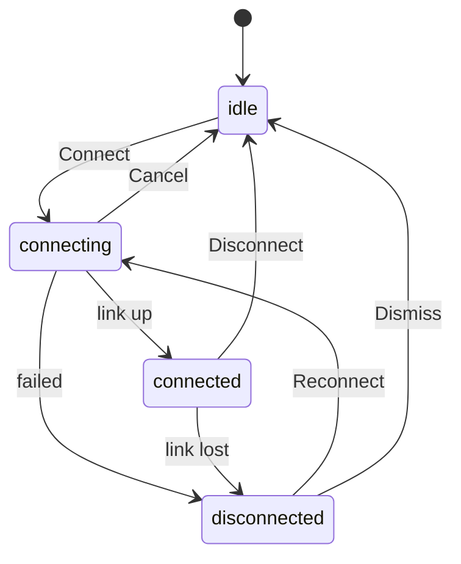
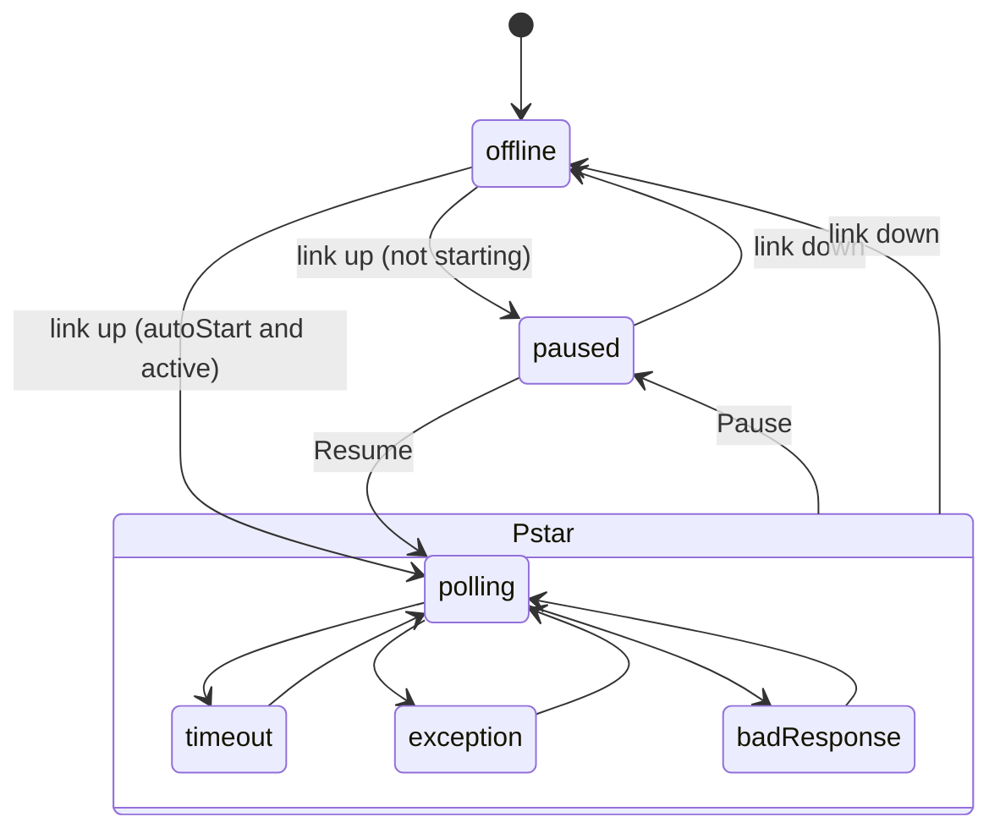
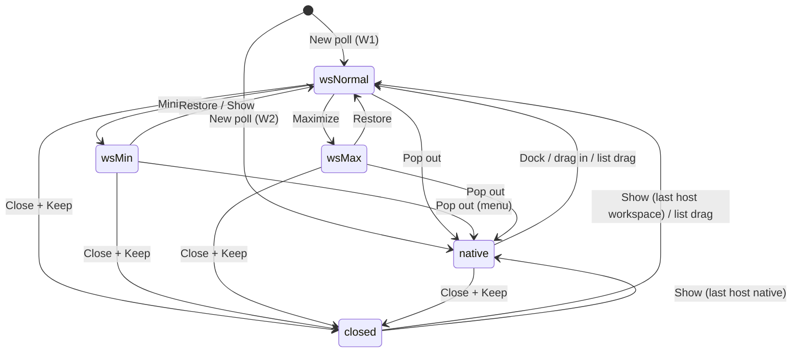

# DES-002 Multiple polls per connection: workspace sub-windows and pop-out windows

**Revision 12 (2026-10-17): PM decisions after REPORT-008 (partial targeted re-run).** Applies D-002-36 to D-002-40 (`docs/questions.md`). The backend contract (section 8) is unchanged. Q-002-19 is closed.

| # | Change | Section | Decision |
|---|---|---|---|
| R12-1 | **Squeeze at the native minimum.** At the W2 minimum (client 465.6 x 282.4 css px at 125 %) the W2 toolbar takes at most 2 rows, its buttons are icon-only below about 640 css px (full name in `title` and `aria-label`), and the data grid shows at least 2 complete data rows (3 if they fit). The same check applies to W1 at its minimum. REPORT-008 measured 3 toolbar rows and 1 grid row. | 2.6 | D-002-36 |
| R12-2 | The `effective` oracle tolerance is **1.5 ms** (was 0.5 ms). Expected `effective`: about 249 ms with the plain simulator, about 66-72 ms with the `os-timer` simulator. | 7 item 9 | D-002-37 |
| R12-3 | **`Ctrl+\` and `Ctrl+Shift+\` match the physical Backslash key** (`code` "Backslash") on every layout; AltGr is excluded. Fixes REPORT-008 D8b (Thai `Ctrl+\` arrives as `key` "+"). | 3.1 | D-002-38 |
| R12-4 | Checklist only: the focus-test harness rule (D-002-39) and the layouts not installed on the dev machine (D-002-40). | (CHK-002) | D-002-39, D-002-40 |

**Revision 11 (2026-10-17): PM decisions after REPORT-007 (integration re-run after the REPORT-006 fixes).** Applies D-002-28 to D-002-35 (`docs/questions.md`). The backend contract (section 8) gains no command or event. Four new UI rules (the REPORT-007 defects D6 to D9), three checklist corrections, one known test-tool limitation and an owner manual test list. New open questions: Q-002-18 and Q-002-19 (non-blocking, assumptions written below).

| # | Change | Section | Decision |
|---|---|---|---|
| R11-1 | The native minimum is a **user-resize** minimum. Win32 applies the minimum track size only to resizing by the user. A programmatic `SetWindowPos` can make any window smaller, and that is not a defect. The app's own placements (pop out, restore, arrange) never request less than the minimum. The real drag minimum is exact: 480 x 320 logical, which is 600 x 400 physical at 125 %. | 2.6 | D-002-28 |
| R11-2 | `Alt+Space` then `Esc`: Windows needs **two** `Esc` presses. The first closes the OS window menu, the second ends menu mode. The page must answer after the second press. This is OS behavior, not a defect. | 3.1 | D-002-29 |
| R11-3 | The CHK2-D3 oracle: `effective` equals the mean of the poll's last 10 request starts in the simulator log, within 0.5 ms. With the dev simulator's `fault delay 3`, the expected value is about 249 ms, not 50 ms (the simulator's delay is quantized to 15.6 ms). **Known limitation:** the dev simulator is a test tool. It does not hold the Windows high-resolution timer, so its own delays are quantized. | 7 | D-002-30 |
| R11-4 | **Shortcuts on every keyboard layout** (REPORT-007 defect D8). Letter and digit shortcuts match the **physical key** (`code`) when the layout produces a non-Latin character (Thai, Cyrillic, Greek, Arabic, Hebrew). Otherwise they match the layout's Latin letter (Dvorak, AZERTY). Digit shortcuts (`Ctrl+1..4`) match the digit row by `code` on every layout, so AZERTY works without Shift. AltGr never triggers a Ctrl shortcut. Text fields keep their native `Ctrl+C/V/X/A/Z`. | 3.1 | D-002-31 |
| R11-5 | **No document scrollbar in any window, down to its minimum size** (REPORT-007 defect D6). The bottom status text and the version label never wrap: they are cut with an ellipsis and a tooltip. The toolbar may wrap. Only the inner scroll regions scroll (the data grid, plus the setup panel or popover inside itself). | 2.2.6, 2.6 | D-002-32 |
| R11-6 | **"Show traffic for this poll" from a native window** brings W1 to the front, restores it if minimized, expands the traffic panel and sets the filter (REPORT-007 defect D7). | 2.2.5 | D-002-33 |
| R11-7 | **Focus after a failed pop out or dock.** Keyboard focus stays on, or returns to, the control that had it (REPORT-007 defect D9). | 2.5.2, 2.5.3, 9 | D-002-34 |
| R11-8 | Owner manual tests: REPORT-007 section 8 lists what QA could not run on its machine. CHK-002 gets a section M with steps and expected results, so the owner can tick each test. | (CHK-002 M) | D-002-35 |

**Revision 10 (2026-10-17): PM decisions after REPORT-006 (integration mode: real Tauri, WebView2, real backend, dev simulator, one monitor at 125 %).** Applies D-002-20 to D-002-27 (`docs/questions.md`). The backend contract (section 8) gains no command or event. It gains three behavior rules: scan rate accuracy, the native minimum size at every scale, and the W1 work-area clamp. The PM carries them into BE-002. New open questions: Q-002-14 to Q-002-17.

| # | Change | Section | Decision |
|---|---|---|---|
| R10-1 | **Scan rate accuracy.** On Windows, a poll with scan S on a link that is not saturated sends its requests every S ms, with a mean interval of at most S + 4 ms. The interval is never quantized to the 15.6 ms OS timer tick: REPORT-006 measured a mean of 109 ms for S = 100, which is defect D1. The `(effective {n} ms)` suffix reports real slow-down only. | 2.3.2, 7 | D-002-20 |
| R10-2 | The native window minimum 480 x 320 is the **outer** size at **every** scale factor. Its physical size is rounded up: ceil(480 s) x ceil(320 s). The client minimum is that size minus the measured frame, in physical px, with no truncation (REPORT-006 defect D3). | 2.6 | D-002-21 |
| R10-3 | **W1 is clamped to the monitor work area** at creation and at restore. Its outer rectangle fits the work area. It keeps its 960 x 600 minimum when that minimum fits (REPORT-006 defect D5). | 2.2, 2.6, 2.13 | D-002-22 |
| R10-4 | In a native window narrower than the dock threshold (PollView width < 640), clicking the setup rail opens the setup as a **popover** (360 px, `Esc` and [Done] close it). Before this change the rail did nothing (REPORT-006 O1). | 2.3.3, 2.6 | D-002-23 |
| R10-5 | Edge snap threshold: **8 px inclusive** (a candidate snaps at 8 px, not at 9). The candidate lines include each edge of another window offset by 8 px in **both** directions (`left - 8`, `left + 8`, `right - 8`, `right + 8`, and the same for top and bottom) (REPORT-006 O4). | 2.10.3 | D-002-24 |
| R10-6 | **A lone Alt key never activates the OS window menu** in any ESEfact window, including after an Alt-drag. `Alt+F4` still closes the window through the close-confirm flow. Risk R7 is closed: Alt stays the snap-off modifier (REPORT-006 defect D2). | 3.1, 2.10.11 | D-002-25 |
| R10-7 | Accepted behaviors: O2 (during a pop out the poll is shown nowhere for up to 1 s), O3 (in a real Timeout the reason text can get 0 px), O6 (native placements are stored in whole logical px, so a window can drift up to 1 px per restart at fractional scales). Text fix O7: the load flow's "Save changes?" says "before loading". | 2.3.2, 2.5.2, 2.13, 6.3 | D-002-26 |
| R10-8 | Integration coverage: CHK-002 gains items for what REPORT-006 could not run against the real backend, and [DPI]/[MON2] variants. QA also needs a dev-only window-failure hook, which the PM must decide (Q-002-14). | (CHK-002) | D-002-27 |

**Revision 9 (2026-10-17): PM decisions after REPORT-004 (UI mode re-run, measured status line widths).** Applies D-002-16 to D-002-19 (`docs/questions.md`). No change to the backend contract (section 8). Revision 8 rows R8-1 (frame width wording) and R8-7 (status line steps) are superseded by R9-1 and R9-2.

| # | Change | Section | Decision |
|---|---|---|---|
| R9-1 | Status line steps re-based on the REPORT-004 measurements: status line freshness chip text only at L ≥ 720 (live) or L ≥ 810 (stale, timeout, waiting texts), the data card header chip keeps its text at every width; reason hidden below 620; `ID`/`F` hidden below 606 (was 580); Show icon only below 500 (was 480); **new step 5**: `Err` hidden below 465. `data-step` is 0..5. The reason text takes all the leftover space (no spacer element). The D-002-13 designer additions (Show icon step, final-safety ellipsis) are confirmed. | 2.3.2, 2.3.4 | D-002-16 |
| R9-2 | Setup dock/popover threshold measured on the frame element's real width (`offsetWidth`), the same for an active or an inactive frame: 640 -> dock, 639 -> popover. No border constant is added or subtracted. | 2.3.3 | D-002-17 |
| R9-3 | S6 body text (all its sentences) is computed once when the dialog opens and does not change while it is open. | 2.11 | D-002-18 |
| R9-4 | The status line widths are estimates; QA re-measures them with real text metrics at frames 640/600/560/430. Acceptance rule: no control clips, and the counters are complete or cut only by the documented last-resort ellipsis. If a measurement disagrees, the step boundary moves (designer + PM update the number), not the acceptance rule. | 2.3.2 | D-002-19 |

**Revision 8 (2026-10-17): PM answers after REPORT-003 (UI mode, CHK-002 rev 6).** Applies D-002-07 to D-002-15 (`docs/questions.md`). Closes Q-FE2-16. No change to the backend contract (section 8).

| # | Change | Section | Decision |
|---|---|---|---|
| R8-1 | The setup dock threshold is measured on the sub-window **frame** width (its rectangle width, borders included). The default 640 x 368 sub-window shows the 300 px dock. | 2.3.3 | D-002-07 |
| R8-2 | Tab order of sub-windows is the **DOM order by poll id** (stable focus), not z-order. Sub-windows are reached with `Ctrl+F6` / `Ctrl+Shift+F6` (list order, wrapping, minimized skipped) and from the sidebar list. Focus entering a sub-window by Tab activates and raises it (the 2.3.1 definition of "active"). | 2.3.1, 2.4, 2.7, 3.1, 9 | D-002-08 |
| R8-3 | S6 sentence "A kept poll keeps polling in the background." only when the poll's **state** is polling, timeout, exception or badResponse (never when paused or offline, whatever `active` is). | 2.11 | D-002-09 |
| R8-4 | Snap tie: at equal distance, an edge that makes the windows **touch** wins over the 8 px gap line. | 2.10.3 | D-002-10 |
| R8-5 | Duplicate starts by the new-poll rule: paused unless "Start polling when connected" is on and the link is up. | 2.5.1 H3 | D-002-11 |
| R8-6 | W1 title carries " *" when the profile is Modified (2.12 unchanged; the 2.2 wireframe title is corrected). | 2.2, 2.12 | D-002-12 |
| R8-7 | Status line narrow rules: fixed width steps (freshness chip icon only, then reason hidden, then `F`/`ID` hidden), plus a designer step (Show control icon only) and a final safety (counters cut with an ellipsis). Controls never clip. | 2.3.2 | D-002-13 |
| R8-8 | Clarifications of intended behavior (REPORT-003 O-4, O-5, O-6, O-8): zones suspend edge snapping; z-order reported at the next layout action, Save flushes it; Write… with the link down does nothing; the Disconnected announcement is assertive. | 1.5, 2.10.3, 2.10.9, 3.3, 9 | D-002-14 |
| R8-9 | Performance measurement note: "0 long tasks over 50 ms" is judged on a quiet machine; one isolated 50-52 ms task under shared CPU in the browser smoke is an observation; the WebView2 run is authoritative. | 2.10.10 | D-002-15 |

**Revision 6 (2026-10-16): hybrid model, owner decision after the mockups.** Applies the owner decisions D-002-01 to D-002-06 (`docs/questions.md`). The workspace inside the connection window is now the default place for polls. Each poll can be popped out to its own native window and docked back. Adds an Alias column, Arrange and Window menus, compact mode, and drag and drop (move, resize, snap, swap, tile mode, list reorder, pop out and dock by drag). Sections 2, 3, 5, 6, 8 and 9 are rewritten. Section 4 gains alias rules. Sections 1 and 7 are unchanged. Q-002-01 ("poll data only in native poll windows") is superseded.

Upstream: `docs/requirements/REQ-002-multi-poll.md`, DES-001 revision 4, `docs/tasks/backend/BE-001-modbus-master.md` "Final contract", FE-001 "Implementation notes", and the owner-approved mockups 1-6 (connection window, poll window with scale, poll timeout, dialogs, four tiled poll windows, workspace with sub-windows).
Downstream: `FE-002-multi-poll.md`, `CHK-002-multi-poll.md`, BE-002 (the PM writes it from section 8). Value scaling inside each poll: `DES-003-value-scaling.md`.

Everything in DES-001 still applies unless this document replaces it. DES-001 still covers: validation messages (3.1-3.5), write dialog results (2.5), the style list (6), accessibility rules (7), and profile name rules.

---

## Revision 6 delta (for the PM)

| # | Change | Section |
|---|---|---|
| 1 | Default poll surface is the **workspace** (MDI) in the connection window W1. Each poll is a sub-window that can be moved, resized, minimized, maximized, closed, tiled and cascaded. | 2.1, 2.3, 2.4 |
| 2 | **Poll host model:** a poll view lives in exactly one host: the workspace, a native window (popped out), or nowhere (closed, kept). Pop out and dock back keep values, state, selection, scroll and unapplied edits. | 2.5 |
| 3 | **One shared PollView component** for both hosts. The native poll window (W2) is now a thin host around PollView. | 2.3, 2.6 |
| 4 | Sub-window **status line** `Tx {n} · Err {n} · ID {id} · F {fc} · SR {ms} ms`, with a state chip and a short reason text. | 2.3.2 |
| 5 | **Alias column** (first column, per address, max 32 characters, saved in the profile, optional in Copy). | 2.3.4, 4, DES-003 3.3-3.5 |
| 6 | W1 layout: menus (File, Connection, Window), **+ New poll** (renamed from "Add poll"), sidebar with the connection section and the poll list, workspace, minimized bar, collapsed traffic bar that expands, status bar. | 2.2 |
| 7 | **Window menu** (workspace): Tile, Tile mode, Cascade, Arrange minimized, Minimize all, Restore all, compact mode, the sub-window list. **Arrange popped-out windows** (Tile, Side by side, Stacked, Cascade; each monitor in place or one chosen display). | 2.7, 2.8 |
| 8 | **Compact mode** ("Collapse setup panels"): setup panels become rails in every host of the connection. | 2.9 |
| 9 | **Drag and drop:** move, resize, snapping (edges, other sub-windows, snap zones), swap, tile mode slot reorder, poll list reorder, drag a poll from the list into the workspace, pop out by dragging out of the workspace, and dock by dragging a native window over the workspace (Windows only, technical risk, phase 2). Full keyboard equivalents. | 2.10, 3.1, 9 |
| 10 | The poll list **can be reordered** (reverses "no reordering in the MVP"). The list order is the tile order and is saved in the profile. It does not mark the profile Modified. | 2.2.3, 2.10.6, 6.1 |
| 11 | Native poll window minimum size lowered from 640 x 420 to **480 x 320**, so the arrange layouts can fit 3 x 3 on a 1080p monitor. Sub-window minimum 320 x 180. | 2.6, 2.8 |
| 12 | Closing: sub-window close and native close both ask Keep / Delete / Cancel (S6). Closing W1 also closes its popped-out windows. | 2.11 |
| 13 | Profile schema 2 (nothing shipped yet): `PollProfile.window` is replaced by `view: PollViewPlacement`. New: `aliases`, `workspace: WorkspaceProfile`, `DisplaySettings.showAlias` and `copyAlias`. Migration rule unchanged in spirit (the v1 poll opens as a sub-window). | 6 |
| 14 | Backend contract: per-view attach and detach with a view token, pop out and dock commands, host fields, workspace layout storage, arrange command, monitor list, poll reorder. The scheduler and session are unaffected. | 8 |
| 15 | Traffic filter first entry renamed "All" -> "All polls" (mockup 1). | 2.2.5 |

---

## 1. Impact on the DES-001 state machine (unchanged in revision 6)

### 1.1 Problem
DES-001 has one flat `SessionState` with 9 values. It mixes link state (`idle, connecting, connected, disconnected`) with the state of the single poll (`polling, paused, timeout, exception, badResponse`). With up to 16 polls on one link, a timeout in poll 3 must not look like a problem of the connection or of poll 5. The two must be separate state machines.

### 1.2 Modeling decision
There are **two finite state sets**, both owned by Rust (CLAUDE.md rule 6). React only displays them.

**Connection state**, one per connection (one per connection window):

`ConnectionState = idle | connecting | connected | disconnected`

| State | Meaning |
|---|---|
| `idle` | No link. Never connected, or the user disconnected or dismissed. |
| `connecting` | Link being opened. |
| `connected` | Link up. Says nothing about polls. This replaces the DES-001 L* family (`connected, paused, polling, timeout, exception, badResponse`). |
| `disconnected` | Link lost or connect failed. Carries `SessionReason` (`kind`, `phase`, `message`) exactly as in DES-001. |

**Poll state**, one per poll, keyed by `pollId`:

`PollState = offline | paused | polling | timeout | exception | badResponse`

| State | Meaning |
|---|---|
| `offline` | The connection is not `connected`. The definition is kept. This is the only poll state while the link is down. |
| `paused` | Link up, poll not running. Covers both "never started" (old `connected`) and "paused after running" (old `paused`). The difference comes from `lastUpdate` (present or not) and only affects the data view text. |
| `polling` | Running, last cycle valid. With no data yet, the view state is `loading` (DES-001 2.4). |
| `timeout`, `exception`, `badResponse` | Running, last cycle failed. Meaning, counting (`consecutiveFailures`), banner texts and `{kindText}` are the same as DES-001 2.3 and 3.4, but they now apply to **this poll only**. |

The names are kept from DES-001 wherever the meaning is unchanged. The only new name is `offline`. The P* family keeps its meaning per poll: `polling | timeout | exception | badResponse`.

**Run intent.** Each poll has a boolean `active` (the user wants it running). It is owned by Rust and saved in the profile.
- Resume sets `active = true` and Pause sets it to false.
- When the connection becomes `connected`:
  - if the connection setting "Start polling when connected" (`autoStartPoll`, kept from REQ-001) is on, every poll with `active = true` starts;
  - if the setting is off, every poll comes up `paused` with its `active` flag unchanged. The user can then press **Resume all**.
- A new poll gets `active = autoStartPoll` (PM default: new polls start paused unless the setting is on). If the link is up and `active` is true, it starts immediately.

### 1.3 Connection transition table
| # | From | Event | To | Effect on polls | Old id (DES-001) |
|---|---|---|---|---|---|
| C1 | idle, disconnected | user Connect | connecting | stay `offline` | T1, T14 |
| C2 | connecting | link up | connected | each poll: `active && autoStartPoll` -> `polling` (PT2), else -> `paused` (PT1) | T2 (auto start now done by Rust, not the UI) |
| C3 | connecting | connect failed (reason, phase `connectFailed`) | disconnected | stay `offline` | T3 |
| C4 | connecting | user Cancel | idle | stay `offline` | T4 |
| C5 | connected | user Disconnect | idle | all -> `offline` (PT7). In-flight write -> `linkLost`, queued writes -> `notConnected` | T12 |
| C6 | connected | link lost (reason, phase `linkLost`) | disconnected | all -> `offline` (PT7). Last values kept as stale. Writes as in C5 | T13 |
| C7 | disconnected | user Dismiss (`mm_disconnect`, wait for `idle`) | idle | stay `offline`. Stale values are cleared | T15 |

Only socket or port errors and closes cause C6. A poll timeout, exception or bad response never changes the connection state (REQ-002).
**Assumption Q-001-01 still holds:** there is no auto-reconnect.

### 1.4 Poll transition table (per poll)
| # | From | Event | To | Notes |
|---|---|---|---|---|
| PT0 | (none) | poll added | `offline` if the connection is not connected; otherwise `polling` if `active`, else `paused` | Data view: empty, or loading when `polling` |
| PT1 | offline | connection C2, and the poll does not start | paused | |
| PT2 | offline | connection C2, `autoStartPoll && active` | polling | Data view: loading |
| PT3 | paused | user Resume (single, or Resume all) | polling | `active = true` |
| PT4 | P* | user Pause (single, or Pause all) | paused | `active = false`. Data view: stale |
| PT5 | P* | cycle ok / timeout / exception / badResponse | polling / timeout / exception / badResponse | Counting as in DES-001 T6-T9, per poll |
| PT6 | P* | user Apply (changed definition) | polling | Restarts. Old values are dropped and the data view goes to loading |
| PT6b | paused, offline | user Apply (changed definition) | unchanged | Definition stored in Rust. Values cleared, with the empty text "Poll settings changed. …" (DES-001 2.4) |
| PT7 | paused, P* | connection C5 or C6 | offline | `active` unchanged, so after the next connect the poll resumes if `autoStartPoll` is on |
| PT8 | any | user Delete poll | (removed) | Its view closes in whichever host it is. Its counters are removed from the per-poll list but stay in the connection totals |

Any other pair is unexpected. As in DES-001, the UI applies it anyway and records a development warning.

**Hosting never changes a poll state.** Pop out, dock, minimize, close (keep) and every drag action leave `PollState`, `active`, values and counters untouched (section 2.5).




### 1.5 How poll states affect what the connection window shows (summary rules)
1. **The connection pill shows `ConnectionState` only:**
   - `idle`: `plug` "Not connected"
   - `connecting`: `loader` "Connecting…"
   - `connected`: `link` "Connected · {target}" (dark fill, light text). `{target}` is `{host}:{port}` or `{port} {baud} {data}{parity}{stop}` (mockup 6).
   - `disconnected`: `unplug` "Disconnected" (error-tint)

   Poll failures never change it. Styles are as in DES-001 2.3 for the same labels.
2. **Poll summary chip**, next to the pill, only in `connected`.
   - **Text:** counts in this fixed order, omitting zeros, joined by " · ":
     `{n} exception` · `{n} bad response` · `{n} timeout` · `{n} live` · `{n} paused`.
     Example: "1 exception · 2 timeout · 5 live". A poll in `polling` without data yet counts as live. With no polls the chip reads "No polls".
   - **Icon and tone come from the worst state present.** Severity order: `exception` > `badResponse` > `timeout` > `polling` > `paused`.

     | Worst state present | Icon | Tone |
     |---|---|---|
     | exception | `octagon-x` | error-tint |
     | badResponse | `triangle-alert` | warning fill |
     | timeout | `timer-off` | warning fill |
     | all live | `activity` | success fill |
     | only paused | `pause` | outline |
     | no polls | none | outline |

     Text is always dark. Color is never the only signal: the text names the states.
3. **The window title** carries the same summary (section 2.12).
4. **The connection banner** (under the toolbar) is only for connection states: connecting and disconnected, with the DES-001 texts and actions. Poll failures **never** use the connection banner. They show in the poll list row, in the sub-window status line and in a native poll window banner.
5. **Live region** in the connection window:
   - Connection transitions are announced as in DES-001 7.
   - A poll's transition **into** timeout, exception or badResponse is announced once (politely) as "{poll name}: {pill label}." Repeats and recoveries are not announced. Sub-windows inside W1 do **not** announce on their own (W1 announces for every poll once).
   - When more than 3 polls fail within one second (for example, all time out together), a single message is announced instead: "{n} polls are failing."
   - (Revision 8, clarification of REPORT-003 O-8.) The transition into `disconnected` is announced once in the **assertive** live region ("Disconnected. {banner text}"), as DES-001 7 says. Every other announcement of W1 is polite. A W2 does the same for its own window.
6. **While the connection is not `connected`**, every poll row shows the `offline` chip ("Offline", `wifi-off` icon, outline, dark/75 text), and the summary chip is hidden.

### 1.6 Mapping from the old `SessionState` (for migrating the contract)
| Old `SessionState` | New `ConnectionState` | New `PollState` of the old single poll |
|---|---|---|
| idle | idle | offline |
| connecting | connecting | offline |
| connected | connected | paused (no `lastUpdate`) |
| polling | connected | polling |
| paused | connected | paused (with `lastUpdate`) |
| timeout | connected | timeout |
| exception | connected | exception |
| badResponse | connected | badResponse |
| disconnected | disconnected | offline |

---

## 2. Windows and screens (rewritten in revision 6)

### 2.1 Inventory
| Id | Window / surface | Kind | Opened by |
|---|---|---|---|
| W1 | **Connection window** | Native tool window, one per connection (many allowed, REQ-001 story 8) | Launcher tile, `Ctrl+N` |
| WS | **Workspace** | Area inside W1 that hosts sub-windows | Always present in W1 |
| SW | **Poll sub-window** | Floating frame inside WS, one per poll hosted in the workspace | New poll, list click, drag from the list, dock, profile load |
| W2 | **Poll window (native host)** | Native window, one per popped-out poll | Pop out (button, menu, `Ctrl+Shift+O`, drag out), profile load |
| PV | **PollView** | Shared component rendered by SW and by W2 | (inside a host) |
| S2 | Write dialog | Modal in the host of the poll (W1 for SW, W2 for W2) | DES-001; context added in DES-003 3.5 |
| S3/S4/S5 | Open profile / Save as / confirms | Modal in W1 | DES-001; changed confirms in 2.11 |
| S6 | Close poll dialog | Modal in the host of the poll | Closing a SW or a W2 (2.11) |
| S7 | Delete poll confirm | Modal in the host where it was invoked | Delete in the list or in the PollView `⋯` menu |
| S8 | Scale override dialog | Modal in the host of the poll | DES-003 3.2 |
| M1 | Window menu | Menu in W1 | Toolbar [Window ▾] |
| M2 | Arrange popped-out windows menu | Submenu of M1, and menu in W2 | M1, W2 `⋯` menu |

**A poll is shown in exactly one place at a time** (owner decision D-002-02): one sub-window in the workspace, or one native window, or nothing when it was closed and kept.

### 2.2 W1 Connection window
```
+------------------------------------------------------------------------------------------------------------+
| (OS title) Modbus Master - Boiler-PLC * - Connected (1 exception · 1 timeout · 2 live)                       |
+------------------------------------------------------------------------------------------------------------+
| TOOLBAR 56px                                                                                               |
| [File ▾][Connection ▾][+ New poll][Window ▾] Boiler-PLC · Modified  (link Connected · 192.168.1.10:502)      |
|   (octagon-x 1 exception · 1 timeout · 2 live)                               [Pause all] [Disconnect]      |
+------------------------------------------------------------------------------------------------------------+
| CONNECTION BANNER (connecting / disconnected only) or MIGRATION NOTICE                                       |
+----------------------------+-------------------------------------------------------------------------------+
| SIDEBAR 280px              | WORKSPACE (--color-workspace)                                                 |
| CONNECTION            [v]  | +-[Tank 1 temperatures      ⚙ ↗ – □ ✕]-+ +-[Analog inputs 4-20 mA   ⚙ ↗ – □ ✕]-+ |
|  TCP 192.168.1.10:502      | |(activity Polling) Tx 1204 · Err 0 ·   | |(activity Polling) Tx 1204 · Err 0 · | |
|  · timeout 1000 ms [Edit]  | |  ID 1 · F 03 · SR 100 ms   Show Both ▾ ⋯| |  ID 3 · F 04 · SR 200 ms  Show Both ▾ ⋯| |
|  [x] Start polling when    | | ALIAS        ADDRESS  RAW   SCALED     | | ALIAS          ADDRESS RAW   SCALED  | |
|      connected             | | Tank top           0  253   25.3 °C    | | PT-201 boiler…     0  12000 12.00 mA | |
| POLLS · 4 of 16            | | …                                      | | FT-102 outlet…     4   3600 ⚠3.60 mA | |
| ▌Tank 1 temperatures       | +----------------------------------------+ +--------------------------------------+ |
|  (Live) 1 · FC03 · 0-9     | +-[Pump 2                   ⚙ ↗ – □ ✕]-+                                         |
|  Analog inputs 4-20 mA     | |(timer-off Timeout 3) Tx … · Err 12 ·   |   (free space)                         |
|  (Live) 3 · FC04 · 0-7     | |  ID 5 · F 03 · SR 100 ms  No response  |                                         |
|  Pump 2                    | |  within 1000 ms                        |                                         |
|  (Timeout 3) 5 · FC03 ·…   | +----------------------------------------+                                         |
|  Valves  – minimized       | MINIMIZED BAR: Minimized  [(octagon-x) Valves · Exc 02]                         |
|  (Exc 02) 1 · FC01 · 0-31  |                                                                               |
|  hint text                 |                                                                               |
+----------------------------+-------------------------------------------------------------------------------+
| TRAFFIC BAR 34px (dark): Traffic  Requests 1204 · Responses 1198 · Errors 6 · Timeouts 4 · link load 72%  [Expand ▲] |
+------------------------------------------------------------------------------------------------------------+
| STATUS BAR 28px: TCP 192.168.1.10:502 · 4 polls · 1 in its own window                      ESEfact v0.1.0 |
+------------------------------------------------------------------------------------------------------------+
```
Default W1 size 1280 x 800, minimum 960 x 600. Revision 10 (D-002-22): W1 is clamped to its monitor's work area when it is created and when it is restored (rule in 2.13).
The OS title in the wireframe has " *" because the profile is Modified (toolbar "· Modified"); the title format is in 2.12 (revision 8, D-002-12).

#### 2.2.1 Toolbar and menus
| Control | Content |
|---|---|
| [File ▾] | Open profile… `Ctrl+O` · Save `Ctrl+S` · Save as… `Ctrl+Shift+S` · separator · New connection window `Ctrl+N` · Close window `Alt+F4` |
| [Connection ▾] | Connect / Cancel / Disconnect / Reconnect `Ctrl+L` (label by state, DES-001) · Dismiss (only when disconnected) · separator · Edit connection settings (expands the sidebar CONNECTION section and focuses its first field) · Start polling when connected (checkbox) · separator · Reset all counters · Show traffic `Ctrl+J` |
| [+ New poll] | Primary button. `Ctrl+Shift+N`. Disabled at 16 polls, title "A connection can have at most 16 polls." |
| [Window ▾] | M1, section 2.7 |
| Profile label | "{name}" or "Untitled", 14px 600, plus " · Modified" in `--color-text-muted` when dirty |
| Connection pill, summary chip | 1.5 rules 1 and 2 |
| Right side by connection state | idle: [Connect] (primary). connecting: [Cancel]. connected: [Pause all] or [Resume all] (Pause all when at least one poll is in P*, otherwise Resume all when at least one poll is paused), [Disconnect]. disconnected: [Reconnect] (primary) |

Below 1100 px of window width the profile label is hidden (it stays in the title) and the summary chip shows only its icon and the worst count, for example "1 exception +3" with the full text as accessible name and tooltip.

#### 2.2.2 Sidebar: CONNECTION section
- Collapsible section header "CONNECTION" with a chevron button (`aria-expanded`).
- **Expanded** (default while idle or disconnected): the DES-001 3.1 connection form, unchanged rules, plus the checkbox "Start polling when connected". `Enter` in a field connects (DES-001 rev 2).
- **Collapsed** (automatic on entering `connected`, and when the user collapses it): one summary line in `--font-mono` 12px: "TCP 192.168.1.10:502 · timeout 1000 ms" or "RTU COM3 9600 8E1 · timeout 1000 ms", plus [Edit] (link button) that expands it. While connected or connecting the fields are read-only with the DES-001 hint "Disconnect to change connection settings."
- The section re-expands automatically on entering `disconnected` with a reason of kind `portBusy`, `notFound` or `refused` (so the user can fix the target). Other transitions keep the user's choice.

#### 2.2.3 Sidebar: POLLS list
- Header "POLLS · {n} of 16" (12px 600 uppercase, `--color-text-muted`).
- `role=listbox`, single selection, in **list order** (creation order until the user reorders, 2.10.6). The selected row is the poll of the active sub-window, or the last row the user selected.
- **Row** (2 lines, 48px high, padding 8px 10px, radius 10px):
  - line 1: name (14px 600, truncated with ellipsis), then the host marker:
    | Host | Marker (icon + text, 12px `--color-text-muted`) |
    |---|---|
    | workspace, normal or maximized | none |
    | workspace, minimized | `minus` "minimized" |
    | native | `square-arrow-out-up-right` "own window" |
    | closed (kept) | `eye-off` "closed" |
  - line 2: compact state chip, then `--font-mono` 11.5px "{slave} · FC{fc} · {start}-{end}" in the display base.
  - Compact chip labels: "Live" (`activity`), "Paused" (`pause`), "Timeout {n}" (`timer-off`), "Exc {cc}" (`octagon-x`), "Bad response" (`triangle-alert`), "Offline" (`wifi-off`), "Waiting" (`loader`, polling without data yet). The chip's accessible name is the full pill label ("Exception 02").
  - Tooltip (500 ms delay): "{name} · Slave {id} · FC{fc} · {start}-{end} ({qty}) · {scan} ms · Last update {HH:MM:SS.mmm or —} · Errors {n}".
- **Click, `Enter`, double-click:** *show* the poll (2.5, H-show). A drag starting on a row (4 px threshold) is a drag, not a click (2.10.6, 2.10.7).
- **Context menu** (right click, `Shift+F10`, menu key, or the row's `⋯` button shown on hover and focus): Show · Pop out to own window (or "Dock to workspace" when native) · Pause / Resume `Ctrl+P` · Rename `F2` · Duplicate · Move up `Alt+Up` · Move down `Alt+Down` · Show traffic for this poll · separator · Delete… `Delete`.
- Rename is inline in line 1, same rules as section 4.
- **Empty list:** "No polls yet. Press New poll (Ctrl+Shift+N) to read registers from this connection." (14px, `--color-text-muted`, centered in the list area).
- **Hint** at the bottom of the sidebar (12.5px, `--color-text-muted`): "Click a poll to bring it to the front. Drag a poll into the workspace to place it. Pop out (Ctrl+Shift+O) opens it in its own window, for another monitor."
- Sidebar width 280px, resizable 220-400px with a 6px handle (`role=separator`, `Left`/`Right` 16px). Collapsed to a rail by `Ctrl+\` (focus outside sub-windows) or by compact mode (2.9).

#### 2.2.4 Workspace (WS)
- Fills the space between the sidebar, toolbar and traffic bar. Background `--color-workspace`. Inner padding 8px (the tile area excludes it).
- Hosts up to 16 sub-windows. It never scrolls: sub-windows are clamped (2.10.1).
- **Minimized bar**: shown only when at least one sub-window is minimized. 44px, inset 12px from the left, right and bottom of the workspace, `--color-light` background with `--color-border`, radius 10px. Content: the label "Minimized" (13px 600), then one pill per minimized sub-window: state icon + "{name} · {compact chip label}" (white surface, state border per the chip tone). Click or `Enter` restores it. Order: minimize order, until "Arrange minimized" sorts it by list order. When the pills do not fit, the bar scrolls horizontally (scroll buttons `chevron-left`, `chevron-right`). The tile area excludes the bar (its height + 8px).
- **Empty workspace texts** (centered, 14px, `--color-text-muted`):
  | Case | Text | Action |
  |---|---|---|
  | No polls at all | "No polls yet. Press New poll (Ctrl+Shift+N) to read registers from this connection." | [+ New poll] primary |
  | Polls exist, none shown in the workspace | "No poll is shown in the workspace. Click a poll in the list, or drag it here." plus, when n > 0 polls are popped out, a second line "{n} polls are open in their own windows." | none |
  | Only minimized sub-windows | no text (the minimized bar is visible) | |

#### 2.2.5 Traffic bar and panel
- **Collapsed (default):** a 34px dark bar (`--color-dark`, `--color-light` text): "Traffic" (600), then `--font-mono` 12px "Requests {n} · Responses {n} · Errors {n} · Timeouts {n} · link load {p}%", then [Expand] (`chevron-up`). At link load 90% or more the last part reads "link load {p}% - polls are slowed down" with the `gauge` icon in `--color-accent` on dark. The counters follow the current filter (DES-002 rev 5 rule).
- **Expanded** (`Ctrl+J`, [Expand], or "Show traffic for this poll"): the DES-001 traffic panel with the revision 5 additions (Poll column, Filter select "All polls", "Writes", then one entry per poll in list order; filtered counters; "No frames for {filter} yet."). Default height 35% of W1 height, splitter as DES-001 5.3 (range 120px to 70%). The header shows [Collapse] (`chevron-down`).
- Expanded state and height are saved in the profile workspace settings (not Modified).
- **"Show traffic for this poll" (revision 11, D-002-33; REPORT-007 defect D7).** The entry is in the sub-window `⋯` menu, the W2 `⋯` menu and the sidebar context menu. It does the same from every host:
  1. If W1 is minimized, it is restored to its previous rectangle (normal or maximized).
  2. W1 is brought to the front and becomes the foreground window. This applies when W1 is behind another window, behind the W2 that asked, or on another monitor.
  3. The traffic panel expands. If it is already expanded, it keeps its height.
  4. The filter is set to that poll ("{poll name}").
  5. Focus:
     - from a W2 (native window), the focus goes to the traffic panel's **Filter** select in W1, so the next keyboard input lands in W1;
     - from a sub-window or the sidebar, the focus stays where it was (no change from revision 6).
  - If a modal dialog is open in W1, W1 is still restored and brought to the front, and the dialog keeps the focus. The panel and the filter are set behind the dialog.
  - The W2 that asked stays open and keeps polling. It loses the foreground (normal OS behavior).
  - Who raises W1 (the backend in `mm_show_traffic`, or the frontend through the existing "focus the connection window" call used by `Ctrl+Shift+M`) is Q-002-18. The user-visible result above is the same either way.

#### 2.2.6 Status bar
"{transport summary} · {n} polls" plus " · {k} in their own windows" when k > 0 ("1 in its own window" for k = 1). Right side: app version (`shared/ui/app-version`). Not focusable.
- **One line, always (revision 11, D-002-32; REPORT-007 defect D6).** The rule applies to the W1 and W2 status bars, which share the layout below.
  - The bar has a fixed height of 28 px.
  - The status text never wraps: `white-space: nowrap`, `flex: 1 1 0`, `min-width: 0`, `overflow: hidden`, `text-overflow: ellipsis`. When it is cut, its `title` tooltip holds the complete text. The DOM always holds the complete text, so screen readers read it whole.
  - The version label ("ESEfact v{version}") never wraps (`white-space: nowrap`, `flex-shrink: 0`). The status text shrinks first. If the label ever gets less than its natural width, it is cut with an ellipsis and its `title` holds the complete text.
  - The bar never grows taller than 28 px and never adds a second line at any window width.

### 2.3 Poll sub-window (SW) and the shared PollView (PV)

#### 2.3.1 Frame
```
+-----------------------------------------------------------------------------+
| Tank 1 temperatures                              [⚙] [↗] [–] [□] [✕]        |  title bar 30px
+-----------------------------------------------------------------------------+
| (activity Polling) Tx 1204 · Err 0 · ID 1 · F 03 · SR 100 ms   Show Both ▾ ⋯ |  status line 28px (PV)
+-------------------+---------------------------------------------------------+
| SETUP DOCK 300px  | ALIAS         ADDRESS (0-BASED)   RAW (UNSIGNED)  SCALED |  data card (PV)
| (only when open)  | Tank top                     0             253  25.3 °C |
|                   | …                                                       |
+-------------------+---------------------------------------------------------+
```
- Default size 640 x 368. Minimum 320 x 180. Radius 12px, 1.5px border `dark` at 55%, shadow `--shadow-subwindow`.
- **Title bar** (30px). Left: poll name (13.5px 600, truncated). Right: icon buttons, 24 x 24 each, `aria-label` and tooltip:
  | Icon | Label (tooltip) | Action |
  |---|---|---|
  | `settings-2` | "Poll setup (Ctrl+\)" | toggle the setup dock or popover (2.3.3). Pressed state `aria-pressed` |
  | `square-arrow-out-up-right` | "Open in its own window (Ctrl+Shift+O)" | pop out (2.5) |
  | `minus` | "Minimize" | minimize |
  | `square` / `copy` | "Maximize" / "Restore" | maximize or restore |
  | `x` | "Close (Ctrl+F4)" | S6 (2.11) |
- **Active sub-window** (the one with focus or last focused; revision 8: focus entering a sub-window by any means, Tab included, makes it active and raises it, so a focused control is never covered by another sub-window): title bar `--color-dark` with `--color-light` text and icons, 2px `--color-dark` border. **Inactive:** title bar `--color-light` with `--color-dark` text and icons, 1.5px border at 55%. The difference is also carried by `aria-current="true"` on the active frame and its selected row in the sidebar (never color only: the sidebar row has the 3px dark bar).
- Double-click on the title bar toggles maximize/restore. Right click or `Shift+F10` on the title bar opens the **title bar menu**: Restore · Move · Size · Minimize · Maximize · Move to ▸ (2.10.8) · Pop out to own window · separator · Snap while moving (checkbox, on by default, W1 lifetime) · separator · Close `Ctrl+F4`.
- **Maximized:** fills the workspace tile area (minus the minimized bar). The title bar stays. While a sub-window is maximized, activating another sub-window (sidebar click, `Ctrl+F6`, Window menu) shows the newly activated one maximized and returns the previous one to its normal rectangle.

#### 2.3.2 Status line (PV, both hosts)
One line, 28px, padding 6px 12px, bottom border `--color-border`. Content, left to right:
1. **State chip** (compact pill, DES-001 2.3 icon and full label): "Polling", "Paused", "Timeout", "Exception {cc}", "Bad response", "Offline", or "Waiting…" (polling, no data yet, `loader`).
2. **Counters text**, `--font-mono` 12.5px, exact format:
   `Tx {requests} · Err {errors + timeouts} · ID {slaveId} · F {fc as 2 digits} · SR {scanMs} ms`
   Example: `Tx 1204 · Err 0 · ID 1 · F 03 · SR 100 ms`. Counters are this poll's `PollCounters` (writes are not included). When the effective rate rule fires (mean interval of the last 10 cycles > 1.5 x scan rate), `SR {scanMs} ms` becomes `SR {scanMs} ms (effective {n} ms)`.
   **Effective rate semantics (revision 10, D-002-20):**
   - `n` is the mean interval between the starts of this poll's last 10 requests, rounded to whole ms.
   - The suffix is shown while n > 1.5 x scanMs and disappears as soon as the rule no longer holds. There is no hysteresis.
   - The suffix reports **real slow-down only**: a saturated link (section 7), timeouts (a cycle lasts at least the timeout), or a slow device. It never reports timer granularity. Because the accuracy rule of section 7 item 8 holds, a lone poll at 20 ms on a free link never shows the suffix (mean ≤ 24 ms < 30 ms). REPORT-006 showed "SR 20 ms (effective 31 ms)" for a lone poll; that is defect D1.
3. **Reason text** (13px 500, truncated with ellipsis; full text in the tooltip and in `aria-describedby`):
   | Situation | Text | Line background |
   |---|---|---|
   | polling, paused | none | surface |
   | timeout | "No response within {timeoutMs} ms" | `--color-warning` fill (chip on white with dark border, mockup 6) |
   | badResponse | "Bad response: {kindText}" | `--color-warning` fill |
   | exception | "Exception {cc} ({name})" | `--color-error-tint` |
   | offline, connection idle | "No connection" | `--color-neutral-tint` |
   | offline, connection connecting | "Connecting…" | `--color-neutral-tint` |
   | offline, connection disconnected | "No connection: link lost" | `--color-error-tint` |
   The tooltip carries the full DES-001 2.3 banner text for the state ("Timeout: slave 5 did not respond within 1000 ms. Retrying every 100 ms (3 in a row).").
   Revision 9 (D-002-16): the reason text is the **only growing item** of the line (`flex: 1 1 0`, `min-width: 0`). It takes all the space between the counters and the right group, and is cut with "…" only when that whole space is too short.
4. **No spacer element** (revision 9, replaces "Spacer"). The right group (freshness chip when it is in the line, Show control, `⋯`) has `margin-left: auto`, so it stays right-aligned when there is no reason text (polling, paused) or when the reason is hidden by step 2.
5. **Show control** (2.3.4) and the **`⋯` menu** (24 x 24, "Poll actions"): Pause / Resume `Ctrl+P` · Write… `Ctrl+E` · Rename `F2` (on the title) · Duplicate · Show traffic for this poll · Reset counters for this poll · separator · Pop out to own window `Ctrl+Shift+O` (SW) or Dock to workspace `Ctrl+Shift+D` (W2) · Close `Ctrl+F4` · Delete….

**Narrow status line (revision 9, D-002-16 and D-002-19; replaces the revision 8 table).** The steps depend on the **status line width L**, measured on the status line element itself (= the PollView width; in W2 the window's client width). For reference only: in a sub-window L = frame width - 4 px when the frame is active (2 px border each side); an inactive frame has 1.5 px borders by design, which the engine may render as 1 px (REPORT-004), so L = frame width - 2 to - 3 px. No step uses a border constant: the measured L decides. They are fixed width steps, not a measured fit: the same L (and, for step 1 only, the same freshness text kind) always shows the same elements, whatever the counter values.

**Every boundary is "strictly below = on":** a step is on when L < its threshold, off when L ≥ its threshold. The status line carries `data-step` = the number of the highest step that is on (0..5). Steps are cumulative: when step n is on, every step below n is on too (the thresholds are ordered so that this always holds).

Threshold T1 of step 1 depends on the **freshness text kind**:
- **live** ("Updated {HH:MM:SS.mmm}"), or no freshness chip at all (offline without values): T1 = **720**;
- **long** (every other freshness text: the stale texts "{Paused|No response|Exception|Bad response|Offline|Disconnected} - values from {time}" and "Waiting for first response…"): T1 = **810**.

| Step (`data-step`) | On when | What hides (in this order as L shrinks) | Active frame width | Inactive frame (1.5 px border, for reference) |
|---|---|---|---|---|
| 0 | L ≥ T1 | nothing (a status line freshness chip would show its text) | ≥ 724 live / ≥ 814 long | ≥ 723 / ≥ 813 |
| 1 | L < T1 (720 live, 810 long) | the **status line freshness chip shows its icon only** (`circle-check` live, the DES-001 stale icon, or `loader` for waiting). Its full text ("Updated 12:03:04.123", "No response - values from 12:03:04.123") becomes its tooltip and accessible name. The data card header chip is not affected. | ≤ 723 live / ≤ 813 long | ≤ 722 / ≤ 812 |
| 2 | L < 620 | the **reason text** is hidden. The chip's tooltip already carries the full banner text; the line keeps its tint (warning fill, error tint, neutral tint), and the line's `aria-describedby` still references the hidden reason element (a hidden element still provides the description). | ≤ 623 | ≤ 622 |
| 3 | L < 606 | the **`ID` and `F` segments**: counters read `Tx {n} · Err {n} · SR {ms} ms`. | ≤ 609 | ≤ 608 |
| 4 | L < 500 | the **Show control's text**: icon only, `columns-3` + `chevron-down`, 24 px high, accessible name and tooltip "Show {Both}" (the same text as before). Its menu is unchanged. | ≤ 503 | ≤ 502 |
| 5 | L < 465 | the **`Err {n}` segment**: counters read `Tx {n} · SR {ms} ms`. | ≤ 468 | ≤ 467 |

- **Where the freshness chip is.** The wide layout threshold (2.3.4) is unchanged: at L ≥ 720 the freshness chip and the Show segmented controls are in the data card header; at L < 720 they are in the status line. Step 1 applies **only to the freshness chip inside the status line** (revision 9, PM clarification of D-002-16). The freshness chip in the **data card header keeps its full text at every width**; step 1 never changes it. Consequences: (a) inside the status line the freshness chip is **always icon only** (it is there only when L < 720, and then step 1 is on for both kinds); (b) at 720 ≤ L < 810 with a long freshness text, `data-step` is 1 but **nothing visible changes** (the chip is in the header, with its text).
- **Counters tooltip.** From step 3 on, and whenever the final safety cuts the text, the counters element has the **complete** text `Tx {n} · Err {n} · ID {id} · F {fc} · SR {ms} ms` (plus ` (effective {n} ms)` when shown) as its tooltip and accessible name. At steps 0-2 the visible text is already complete.
- **Reason text.** At steps 0-1 it takes all the leftover space (item 3) and is cut with "…" only when that space is too short; the full text stays in its tooltip.
- **Controls never clip.** The state chip, the freshness chip, the Show control and the `⋯` button never shrink and always stay fully inside the line, right-aligned, with the 12 px right padding.
- **Final safety (last-resort ellipsis)** (any width): when the content still does not fit after the steps, the **counters text** is cut at its end with "…" (tooltip as above). `Tx` and `SR` are never removed by the steps; `Err` only by step 5, `ID`/`F` only by step 3. The cut is **documented only** for: counters longer than the reference content below (`Tx` with 5 digits or more, `Err` with 2 digits or more, `ID` above 9, the ` (effective {n} ms)` suffix), and frames narrower than the step-5 fit width (estimate with the reference content: active frame < 393 Polling, < 400 Timeout; the 320 px minimum frame always cuts). With the reference content at any wider frame, a cut counters text is a defect.
- **Reference content** (the content the thresholds are tuned for; QA uses it in CHK2-E16 to E19 and the boundary items, with the counters frozen by the fake): active frame, FC03, slave 1, scan 100 ms, `Tx 1234` (4 digits); Polling: `Err 0`, live values; Timeout: `Err 3` (3 in a row), stale values (long freshness text "No response - values from {time}"), timeout 1000 ms; no effective-rate suffix; Show reads "Show Raw".

**What is visible at each step (reference content).** Status line items left to right. "fresh-icon" = freshness chip icon only; "Show text" = "Show Raw ▾"; "Show icon" = `columns-3` + `chevron-down`.

| Step | L range (active frame) | Polling case | Timeout case |
|---|---|---|---|
| 0 | Polling L ≥ 720 (frame ≥ 724); Timeout L ≥ 810 (frame ≥ 814) | line: chip "Polling", `Tx 1234 · Err 0 · ID 1 · F 03 · SR 100 ms`, `⋯`. Header: summary, segmented controls, freshness chip with text "Updated {time}" | line (warning fill): chip "Timeout", `Tx 1234 · Err 3 · ID 1 · F 03 · SR 100 ms`, reason "No response within 1000 ms" (all leftover space), `⋯`. Header: freshness chip with text "No response - values from {time}" |
| 1 | Polling 620-719 (frame 624-723); Timeout 620-809 (frame 624-813) | chip, full counters, fresh-icon, Show text, `⋯` | 720-809 (frame 724-813): exactly as step 0 (header chip keeps its text; only `data-step` differs). 620-719 (frame 624-723): chip, full counters, reason, fresh-icon, Show text, `⋯` |
| 2 | 606-619 (frame 610-623) | same visible items as step 1 (Polling has no reason text) | chip, full counters, fresh-icon, Show text, `⋯`; no reason, warning fill kept |
| 3 | 500-605 (frame 504-609) | chip, `Tx 1234 · Err 0 · SR 100 ms`, fresh-icon, Show text, `⋯` | chip, `Tx 1234 · Err 3 · SR 100 ms`, fresh-icon, Show text, `⋯` |
| 4 | 465-499 (frame 469-503) | as step 3 with Show icon | as step 3 with Show icon |
| 5 | < 465 (frame ≤ 468) | chip, `Tx 1234 · SR 100 ms`, fresh-icon, Show icon, `⋯` | chip, `Tx 1234 · SR 100 ms`, fresh-icon, Show icon, `⋯` |

- QA reference frames: 640 (L 636) = step 1; 600 (L 596) = step 3; 560 (L 556) = step 3; 430 (L 426) = step 5 (CHK2-E16 to E19).
- **Real Timeout content (revision 10, D-002-26, REPORT-006 O3; accepted behavior).** With the real backend, a poll in Timeout always shows the ` (effective {n} ms)` suffix, because each cycle lasts at least the timeout. So the reference content never occurs in a real Timeout. Example from REPORT-006 at 125 %, active frame 640 (L 636.8): `Tx 1409 · Err 3 · ID 1 · F 03 · SR 100 ms (effective 1580 ms)` needs 457.4 px and gets 342.1 px.
  - The counters are cut at their end with "…". This is the documented last resort, because the suffix is listed there. The tooltip and accessible name carry the complete text.
  - The reason text may get **0 px**. In REPORT-006 it got 0 px at every frame from 624 to 723. This is accepted. The full reason stays available in the state chip tooltip (the DES-001 banner text) and through the line's `aria-describedby`. The warning fill stays.
  - Controls never clip. This rule is unchanged and still a defect if broken.
  - The counters are complete from active frame 724 in a real Timeout and from 384 in Polling (REPORT-006 measurements at 125 %).
- **Width estimates (D-002-19).** The thresholds come from the REPORT-004 measurements at 100% scale: counters 7.5 px per character (12.5 px mono; full 307.5 px, without `ID`/`F` 202.5 px, without `Err` 142.5 px), Show text 88.9 px, Show icon 46 px, freshness icon 36 px, `⋯` 24 px, stale freshness text about 290 px. They are **estimates**. QA re-measures them with real text metrics at frames 640, 600, 560 and 430 (and the boundary frames). **Acceptance rule:** at every width, no control clips, and the counters are complete or cut only by the documented last-resort ellipsis. If a measurement disagrees with this rule, the **step threshold moves** (designer + PM update the number here and in CHK-002), the rule does not.

#### 2.3.3 Setup presentation (PV)
The setup content is one component (PollSetup): the POLL section (Name, Slave ID, Function, Start, Quantity, Scan rate, [Apply], DES-001 3.2 rules), the SCALE section and OVERRIDES (DES-003 3.1). Drafts live in the PollView store, so changing the presentation never loses an edit.

| Host | Presentation | Toggle |
|---|---|---|
| W2 native, PollView width ≥ 640px | **Panel** 340px on the left (mockup 2), or **rail** 30px (vertical "Setup" label, `chevron-right`) in compact mode; in compact mode a rail click opens the panel (local override, 2.9) | `Ctrl+\`, rail click |
| W2 native, PollView width < 640px (revision 10, D-002-23) | **Rail** 30px always; the setup opens as a **popover** 360px wide (rules below) | `Ctrl+\`, rail click; [Done] and `Esc` close |
| SW, frame width ≥ 640px | **Dock** 300px inside the sub-window body, left of the data card, scrollable | `⚙` button, `Ctrl+\` with focus in the sub-window |
| SW, frame width < 640px | **Popover** 360px wide, anchored under the `⚙` button, max height = workspace height - 48px, scrollable, non-modal. Closes on `Esc`, on `⚙`, or on the [Done] button at its bottom. It does **not** close on an outside click (to protect edits). | same |

- **Frame width (revision 9, D-002-17; refines revision 8, D-002-07):** the threshold is measured on the sub-window **frame element's real width**, its `offsetWidth` (the layout rectangle width, borders included; equal to the layout `w` stored in the layout and shown by the resize announcement). It is **never** derived from the PollView body width plus a border constant: the border is 2 px active and 1.5 px inactive by design, and the engine may render 1.5 px as 1 px, so a body-plus-constant rule gives the wrong answer at the boundary (REPORT-004 failure 1). The result is the same whether the frame is **active or inactive**: 640 -> dock, 639 -> popover, in both border styles. Activating or deactivating a sub-window never changes its presentation by itself. A maximized sub-window uses its maximized width. The presentation is re-evaluated whenever the frame width changes (live resize included); the draft is kept because it lives in the PollView store.
- **Native window below the threshold (revision 10, D-002-23, REPORT-006 O1).** In W2 the width that decides is the **PollView root element's `offsetWidth`**, which equals the W2 client width in logical px. 640 -> panel, 639 -> rail with popover. Any compact mode applies on top. Example: the default pop out gives a W2 of outer 640 x 368, which is a client width of about 626, so it shows the rail. Before revision 10 its setup could not be opened there.
  - **Rail click** (or `Ctrl+\`, or `Enter`/`Space` on the focused rail button "Poll setup (Ctrl+\)") opens the **popover**. It is 360px wide, anchored to the right edge of the rail, with its top level with the top of the PollView body (under the status line). Its max height is the W2 client height - its top offset - 8px, and it scrolls inside. It uses the same PollSetup content, [Done] button, style and non-modal behavior as the sub-window popover: it does **not** close on an outside click. Its left edge is at 30px and its right edge at 390px, so it fits inside the narrowest client width (about 466px at 125 %) with no horizontal clipping.
  - **Close:** `Esc` (focus inside the popover), [Done], a second rail click, or `Ctrl+\`. Focus then returns to the rail button. On open, focus moves to the first invalid field when there is one, otherwise to Name.
  - The rail button carries `aria-expanded` (true while the popover is open) and `aria-controls` pointing to the popover. The popover has `role="dialog"`, `aria-modal="false"` and the label "Poll setup".
  - **Live width changes** follow the sub-window rule: the presentation is re-evaluated on every width change. An open popover becomes the open panel at ≥ 640, and an open panel becomes the open popover below 640. The draft (including invalid fields and their messages) is kept because it lives in the PollView store.
  - The unapplied-edits dot is shown on the rail button, as on `⚙`.
  - Arriving by pop out with the setup open (handoff "setup open"): below 640 the popover opens at once. Compact mode rules apply on arrival (2.9).
- A new poll created in the workspace opens with the setup open and focus in Name with the text selected. At the default size (640 x 368) that is the **dock**; the popover only appears when the new sub-window was clamped below 640 px (small workspace).
- The dock closes by default for existing polls. Its open state is per poll and travels with pop out and dock (2.5).
- Unapplied edits show a dot on the `⚙` button and the text "Unapplied changes" (12px `--color-text-muted`) under [Apply], and set `hasUnappliedEdits` (section 8).

#### 2.3.4 Data card (PV)
- **Header** (container query on the PV width):
  - width ≥ 720px: "Slave {id} · FC{fc} · {start}-{end} ({qty}) · {scan} ms" (15px 600), then segmented controls "Show (Raw)(Scaled)(Both)", "Raw format (Unsigned)(Signed)(Hex)(Binary)", base toggle "Address (0)(1)", and the freshness chip (DES-001 2.4). This is the mockup 2 layout and the default in W2.
  - width < 720px: no header row. The freshness chip moves to the end of the status line (before Show; revision 9: always icon only in the status line, step 1 of 2.3.2). The header freshness chip (width ≥ 720) always shows its full text; the status line steps never change it, and the status line shows a compact **"Show {Both} ▾"** menu button containing: Show (Raw / Scaled / Both, radio), Raw format (4 radios), Address base (0-based / 1-based), separator, "Alias column" (checkbox), "Include alias in copy" (checkbox).
- **Columns:** Alias | Address | Raw ({format}) | Scaled (DES-003 3.3). Alias is shown when `display.showAlias` is on (default on). Widths: Alias default 160px (min 96px), Address min 72px, Raw min 96px, Scaled min 120px. Resizable per DES-001 5.3.
- **Alias column**: `--font-ui` (Afacad) 13.5px `--color-dark`, left-aligned, truncated with ellipsis, full alias in the tooltip. An empty alias shows nothing, except on the focused row where "Alias…" is shown in `--color-text-muted`. Editing rules: section 2.3.5.
- **Empty, loading, live, stale texts:** DES-001 2.4 and DES-002 revision 5 rules, with the offline texts:
  - SW (workspace): "Not connected. Connect from the toolbar (Ctrl+L)."
  - W2: "Not connected. Connect from the connection window (Ctrl+Shift+M)."
  - stale chip "Offline - values from {time}" (both).
- **Before the attach snapshot arrives** (normally under 50 ms): the data card shows `loader` "Loading poll…" (14px `--color-text-muted`) and the status line shows only the poll name's chip area as "Loading…". This is the PV **loading (attach)** state.

#### 2.3.5 Alias editing
- **Start editing:** double-click the alias cell; or `F2` with focus in the data grid (edits the focused row's alias); or the row context menu "Edit alias (F2)". Typing does not start editing (avoids accidental edits during monitoring).
- **Editor:** an inline text input in the cell, 1.5px `--color-dark` border, radius 8px, max length not enforced by the input (so the message can show).
- **Keys:** `Enter` commits and opens the next row's alias editor (spreadsheet style; on the last row it commits and ends editing); `Shift+Enter` commits and opens the previous row's editor; `Tab` commits and ends editing; `Esc` cancels and ends editing; blur commits when valid, otherwise reverts silently.
- **Validation** (section 4): on each keystroke; the message appears in a floating FieldMessage under the cell (`circle-x` in `--color-error`, dark 12px text), `aria-invalid`, and `Enter` does nothing while invalid.
- **Commit:** a trimmed empty value removes the alias. A valid value is stored by address in the poll's alias map through `mm_set_poll_view` (section 8) and marks the profile Modified.
- **Clear:** row context menu "Clear alias" (on all selected rows), no confirm.
- **Paste aliases:** `Ctrl+V` with focus in the grid (not in an editor), or the context menu "Paste aliases". The clipboard is split by line (`\r\n` or `\n`; a trailing empty line is ignored); each line uses its text up to the first tab. Lines are assigned to consecutive addresses starting at the first selected row. Empty lines clear that alias. Lines beyond the end of the poll range are dropped. Invalid lines are skipped. Toast (neutral, 2 s): "Pasted {n} aliases." plus " Skipped {m} invalid lines." when m > 0 plus " {k} lines were beyond the poll range." when k > 0.
- **Aliases follow the address**, not the row position: changing Start or Quantity keeps every alias on its protocol address. Aliases whose address is outside the current range are kept and reappear when the range covers them again. Changing the function code keeps the aliases (same poll, same addresses).

#### 2.3.6 Sub-window in compact mode
Compact mode (2.9) closes every setup dock and popover in the workspace and keeps them closed until the user opens one with `⚙` (a per-poll override until compact mode is toggled again).

### 2.4 Workspace operations
| Operation | Trigger | Result |
|---|---|---|
| Activate | press anywhere in a SW, focus entering it (Tab, revision 8), sidebar click, Window menu entry, `Ctrl+F6` / `Ctrl+Shift+F6` (list order, 2.7) | brought to the top of the z-order, becomes active, focus moves to its data grid (sidebar click, menu, `Ctrl+F6`) or stays where pressed or tabbed to. Raising never moves the sub-window in the DOM, so the focused element keeps the focus (section 9) |
| Minimize | `–`, title bar menu, Window > Minimize all | frame hidden; pill on the minimized bar; next sub-window by z-order becomes active |
| Maximize / Restore | `□`, double-click title, title bar menu, Window > Restore all | 2.3.1 |
| Close | `✕`, `Ctrl+F4`, menus | S6 (2.11) |
| Tile | Window > Tile, `Ctrl+Shift+T` | algorithm WT (2.8) once, and turns **tile mode** on (2.10.5) |
| Cascade | Window > Cascade, `Ctrl+Shift+C` | algorithm WC (2.8); turns tile mode off |
| Arrange minimized | Window > Arrange minimized | minimized bar sorted by list order |
| Minimize all / Restore all | Window menu | all workspace sub-windows minimized / all restored to normal (z-order kept) |
| New sub-window placement | New poll, Show of a closed poll without a saved rectangle, dock without a saved rectangle | free mode: rectangle at the next cascade slot, `(8 + 24k, 8 + 24k)` where k = number of visible non-minimized sub-windows mod 10, default size clamped to the tile area. Tile mode: appended to the tiles and the tiles are recomputed |
| W1 resize | OS | maximized follows the area; tile mode re-tiles; free mode clamps each rectangle (2.10.1) without moving rectangles that are still valid |

### 2.5 Poll host model

#### 2.5.1 Host states (per poll)
`PollHostState = workspace.normal | workspace.minimized | workspace.maximized | native | closed`

Stored in Rust as `host: 'workspace' | 'native'` (the last host kind) plus `open: boolean`, and for the workspace the sub-window state (`normal | minimized | maximized`). `closed` = `open: false`.

| # | From | Event | To | What the user sees |
|---|---|---|---|---|
| H1 | (none) | New poll from W1 | workspace.normal | SW at the next slot, active, setup open, focus in Name |
| H2 | (none) | New poll from a W2 (`Ctrl+Shift+N` there) | native | new W2 cascaded 24px from the invoking W2, focus in Name |
| H3 | (none) | Duplicate | same host kind as the source (workspace when the source is closed) | as H1 or H2, name "{name} copy". **Poll state (revision 8, D-002-11):** the new-poll rule PT0 with `active = autoStartPoll` (Q-BE2-02), whatever the source's state: connected and "Start polling when connected" on -> polling ("Waiting…" until the first reply); connected and off -> paused; not connected -> offline |
| H4 | workspace.* | Pop out (button, menu, `Ctrl+Shift+O`, drag out) | native | SW disappears; W2 appears (2.5.2) and gets focus |
| H5 | native | Dock (button, menu, `Ctrl+Shift+D`, drag in) | workspace.normal | W2 closes; SW appears at its last workspace rectangle (or next slot), active; W1 comes to the front (restored if minimized) |
| H6 | workspace.normal | Minimize | workspace.minimized | 2.4 |
| H7 | workspace.minimized | Restore (bar pill, sidebar click, Window menu) | workspace.normal (or .maximized when another SW is maximized) | |
| H8 | workspace.normal | Maximize | workspace.maximized | |
| H9 | workspace.maximized | Restore | workspace.normal | previous rectangle |
| H10 | workspace.*, native | Close -> S6 Keep poll | closed | view gone; poll keeps running; sidebar marker "closed" |
| H11 | workspace.*, native | Close -> S6 Delete poll, or Delete -> S7 | (removed) | PT8 |
| H12 | closed | Show (sidebar click, `Enter`, Window menu, drag from list) | the last host kind: workspace.normal or native | native: restored at its saved placement (2.6 restore rule). Drag from the list always shows it in the workspace at the drop point |
| H13 | native | Show (sidebar click) | native | the W2 is restored if minimized and focused |
| H14 | workspace.* | Show (sidebar click) | workspace.normal or maximized (H7 rule) | activated |
| H15 | native | drag a list row into the workspace | workspace.normal | as H5, at the drop point |
| H16 | any | profile load | from the profile | 6.3 |
| H17 | any | W1 closes | (session gone) | every W2 of this connection closes (2.11) |



#### 2.5.2 Pop out
1. The SW builds a **handoff** (2.5.4) and its anchor: for the button, menu and shortcut, its rectangle in W1 client coordinates; for drag out, the pointer grab offset inside the title bar (2.10.7).
2. The SW calls `mm_pop_out_poll`. The SW stays visible, with its pop out button showing a spinner, until the command resolves.
3. **Native placement:** if the poll has a saved native placement that passes the 2.6 restore rule, it is used. Otherwise the anchor: same logical size as the sub-window (at least 480 x 320) at the sub-window's screen position (button) or with its title bar under the cursor (drag). The window is kept inside the work area of the monitor that holds the anchor point.
4. On success Rust detaches the SW's view (`ViewDetached { reason: "poppedOut" }`), the SW unmounts, the W2 attaches, applies the handoff and takes focus. The workspace rectangle is kept for a later dock. In tile mode the remaining tiles are recomputed.
5. On failure the SW stays and shows the toast "Could not open the poll window: {message}" (error, 4 s).
   - **Focus after the failure (revision 11, D-002-34; REPORT-007 defect D9).** Keyboard focus stays on, or returns to, the control that had it when the pop out started. It never falls to the document body. The control depends on how the pop out started:

     | Started from | Focus after the failure |
     |---|---|
     | the pop out button in the SW title bar | that button |
     | `Ctrl+Shift+O` | the element that was focused when the key was pressed (for example the data grid, with the same focused row) |
     | the SW `⋯` menu ("Pop out to own window") | the SW `⋯` button (the menu is closed, DES-001 7 return rule) |
     | the sidebar context menu | that sidebar row |
     | the title bar menu ("Own window") | the SW title bar |
     | drag out of the workspace (2.10.7) | the SW title bar |

   - The button keeps its focusability while it shows the spinner: it uses `aria-busy="true"` and `aria-disabled="true"`, not the `disabled` attribute, because a disabled element drops the focus.
   - The error toast does not take the focus. If the element that had the focus no longer exists, the focus goes to the SW title bar.
6. **Timeline with the real backend (revision 10, D-002-26, REPORT-006 O2; accepted behavior).** Between steps 4 and 5 the poll is visible in **no** host for a short time. REPORT-006 measured this sequence:
   - click;
   - the pop out button shows its spinner;
   - the SW is removed when Rust detaches it (204 ms);
   - the W2 is listed by the OS (679 ms);
   - the W2 PollView is ready with live values (705 ms).

   The poll was shown nowhere for about 0.5 s. This gap is accepted up to **1 s**, measured from the click to the W2 being visible on screen with values. A longer gap is a defect. Values must appear in the W2 at once, with no "Waiting for first response…".

#### 2.5.3 Dock back
1. W2 builds the handoff and calls `mm_dock_poll`.
2. Rust saves the W2 placement, destroys the W2 (no close request, no S6), sets the host to workspace and sends `RevealPoll { pollId }` to W1, then brings W1 to the front (restoring it if minimized).
3. W1 mounts the SW at its saved workspace rectangle (clamped), or the next slot, or the drop rectangle (drag in), or the tile slot (tile mode). It attaches, applies the handoff, activates the SW and focuses its data grid.
4. On failure: toast in W2 "Could not dock the poll: {message}" (error, 4 s); the W2 stays.
   - **Focus after the failure (revision 11, D-002-34).** The W2 keeps the foreground, and W1 is not raised. Keyboard focus stays on, or returns to, the control that had it:
     - after [Dock to workspace], focus is on that button;
     - after `Ctrl+Shift+D`, focus is on the element that was focused when the key was pressed;
     - after the W2 `⋯` menu, focus is on the `⋯` button;
     - after the sidebar context menu in W1, focus is on that sidebar row. W1 stays where it is in the z-order.
   - The same busy and toast rules as 2.5.2 step 5 apply. If the element no longer exists, the focus goes to the W2 toolbar's poll name.

#### 2.5.4 What moves between hosts (handoff)
| Item | Pop out / dock |
|---|---|
| Poll state, values, last update, counters, `active` | Kept. They live in Rust; the new host gets them in the attach snapshot, so there is no loading flash. |
| Display settings, scale, overrides, value columns, aliases | Kept (Rust, `PollConfig`). |
| Selection | Kept, as address ranges (not row indexes). The focused row is kept by address. |
| Scroll | Kept as the first visible address; restored so that address is the top row (clamped). |
| Unapplied setup draft (POLL section) | Kept, including invalid fields and their messages. `hasUnappliedEdits` is unchanged. |
| Unapplied scale draft | Kept, same as above. |
| Setup open/closed | Kept (dock or popover open in SW maps to panel open in W2 and back; compact rules apply on arrival). |
| Column widths | Kept. |
| Inline editors (alias, rename) | Pressing the pop out or dock control blurs them first: blur commits when valid, otherwise reverts (2.3.5). |
| Open modal (S2, S6, S7, S8) | Pop out and dock are unavailable while a modal is open in that host (the modal blocks the controls and shortcuts are off in modals, DES-001 5.1). |
| Traffic filter | Not affected (it lives in W1). |

The handoff is a JSON string owned by the frontend (schema `PollViewHandoffV1`, validated with zod on arrival; an invalid or missing handoff is ignored without a message). Rust stores it opaquely and delivers it once in the next attach snapshot for that poll, then drops it. A handoff older than 10 s is dropped.

### 2.6 W2 Poll window (native host)
```
+------------------------------------------------------------------------------------------+
| (OS title) Analog inputs 4-20 mA - Boiler-PLC - Polling                                  |
+------------------------------------------------------------------------------------------+
| TOOLBAR 60px  Analog inputs 4-20 mA [✎] (activity Polling) [Pause] [Write…]               |
|               (link Connected) [Connection window] [Dock to workspace] [⋯]                |
+------------------------------------------------------------------------------------------+
| BANNER: connection banner (not connected) or poll banner (DES-001 texts). Never both.     |
+------------------------------------------------------------------------------------------+
| PV: status line                                                                           |
| PV: setup panel 340px (or rail 30px) | data card (mockup 2)                               |
+------------------------------------------------------------------------------------------+
| STATUS BAR 28px: Last OK 14:02:11.510 · Round trip 8 ms · Resp 1198 · Timeouts 0   ESEfact v0.1.0 |
+------------------------------------------------------------------------------------------+
```
- Revision 5 rules still hold: banner precedence (connection banner wins; idle text "Not connected. Connect from the connection window." [Connection window]; connecting "Connecting to {target}…"; disconnected reason text with [Reconnect] and [Connection window]); no Disconnect action; connection mini-pill; inline rename with `✎` or `F2` on the toolbar; not an owned window (own taskbar entry, keeps working when W1 is minimized).
- New: **[Dock to workspace]** (`square-arrow-down-left` + text, `Ctrl+Shift+D`); the `⋯` menu adds "Arrange poll windows ▸" (M2) and "Collapse setup panels" (compact mode).
- The status bar no longer repeats `Tx`, `ID`, `F` and `SR` (they are in the status line). It shows "Last OK {time} · Round trip {n} ms · Resp {n} · Timeouts {n}" and the version.
- Default size 900 x 640. **Minimum 480 x 320** (was 640 x 420). Below 640px width the setup panel is forced to the rail. Revision 10 (D-002-23): in that case the rail opens the setup as a popover (2.3.3).
- **Minimum size at every scale factor (revision 10, D-002-21; REPORT-006 defect D3).** 480 x 320 is the **outer** size in logical px (title bar and borders included, Q-002-10) at **every** scale factor s.
  - The minimum outer size in physical px is **ceil(480 x s) x ceil(320 x s)**. The client minimum is that outer size minus the window's **measured** frame, computed in physical px. It is never computed in logical px and then truncated.
  - Expected minimum outer sizes in physical px:

    | Scale | Minimum outer (physical px) | Example client minimum (frame measured by REPORT-006 at 125 %: 18 x 47 physical) |
    |---|---|---|
    | 100 % | 480 x 320 | 480 - frame |
    | 125 % | **600 x 400** | 582 x 353 (465.6 x 282.4 logical) |
    | 150 % | **720 x 480** | 720 - frame |
    | 175 % | **840 x 560** | 840 - frame |
    | 200 % | 960 x 640 | 960 - frame |

  - REPORT-006 measured 599 x 400 at 125 %. The client minimum 465 x 1.25 = 581.25 was truncated to 581, which is defect D3.
  - When a W2 moves to a monitor with another scale factor, the minimum is recomputed for the new scale.
  - **A user-resize minimum (revision 11, D-002-28; REPORT-007 section 3).** Win32 applies the minimum track size (`WM_GETMINMAXINFO`) only when the user resizes the window: an edge or corner drag, or the window menu's Size. A programmatic `SetWindowPos` can make any window smaller, down to 1 x 1, and the OS does not stop it. This is not a defect, and no check expects the OS to keep the minimum in that case. The product's own placements (pop out anchor 2.5.2, restore 2.13, arrange 2.8) never request a size below the minimum. REPORT-007 measured the real drag minimum at 125 % as exactly 600 x 400 physical (480 x 320 logical), client 582 x 353 physical.
- **No document scrollbar (revision 11, D-002-32; REPORT-007 defect D6).** The rule holds in every ESEfact window (W2, W1 and the launcher) at every size down to that window's minimum.
  - The document never scrolls in either axis: `document.documentElement.scrollHeight` equals `clientHeight`, and `scrollWidth` equals `clientWidth`. No classic scrollbar appears, and the window content is never 15 px narrower than the client area.
  - At the W2 minimum at 125 % (client 582 x 353 physical, 465.6 x 282.4 css px) the PollView `offsetWidth` equals the client width (466 css px after rounding).
  - The window is a column whose height is exactly the viewport: toolbar, banner, PollView, status bar. Only these regions scroll, each inside itself:
    - the data grid (the region that absorbs any height loss);
    - the setup panel and the setup popover (2.3.3, they already scroll inside);
    - in W1, also the sidebar list and the traffic list.
  - **Toolbar:** it may wrap at narrow widths, to **at most 2 rows** (revision 12, D-002-36). The second row is taken from the data grid's height, never from the document.
  - **Status bar:** one line, 28 px (2.2.6): the status text and the version label never wrap; they use the ellipsis with a tooltip.
  - **Data grid at the minimum:** see the squeeze rule below. (Revision 11 asked for 3 rows; revision 12 replaces it.)
- **Squeeze at the minimum (revision 12, D-002-36; REPORT-008 result 1, open item D10).** REPORT-008 measured, at outer 600 x 400 physical at 125 %: the toolbar wrapped to 3 rows and the grid was 65 px high, showing 1 complete data row. That fails. The rule:
  - **Condition of the check:** connected, the poll polling, no banner, setup closed (rail), FC03 qty 10.
  - **W2 toolbar, at most 2 rows** at every width down to the minimum (465.6 css px at 125 %). Rows are counted by the distinct `offsetTop` values of the toolbar's direct children (tolerance 4 px).
  - **Icon-only buttons below about 640 css px** of window width (the same threshold as the setup rail, measured on the document `clientWidth`). At 640 and above, the buttons keep icon + text as today.
    | Button | Icon (lucide) | `aria-label` and `title` (exact) |
    |---|---|---|
    | [Pause] / [Resume] | `pause` / `play` | "Pause" / "Resume" |
    | [Write…] | `file-pen-line` | "Write…" |
    | [Connection window] | `app-window` | "Connection window" |
    | [Dock to workspace] | `square-arrow-down-left` | "Dock to workspace" |
    | [⋯] | `ellipsis` (already icon-only) | unchanged (its current accessible name) |
    - If a button already has an icon, it keeps that icon (the table names the icon only where none is defined yet).
    - Icon-only buttons are 32 x 32 px, pill radius, icon 16 px, same tones and focus ring as the labelled buttons. They stay in the same DOM and Tab order. The text is removed from the visual layout, not from the accessible name.
    - The status pills (poll state, connection mini-pill) keep their icon **and** text: status is never icon-only or color-only here. The poll name is cut with an ellipsis first (min 80 px), with the complete name in its `title`.
    - Intended rows at the minimum: row 1 poll name, `✎`, poll state pill; row 2 connection mini-pill, the icon-only buttons, `⋯`.
  - **Data grid: at least 2 complete data rows** (header not counted) at the W2 minimum, and 3 if they fit. "Complete" means the row's whole box is inside the grid's visible area. The grid still scrolls inside itself to the last address.
  - **W1 at its minimum** (960 x 600 css inner, client 1200 x 750 physical at 125 %), the same squeeze check: the W1 toolbar takes at most 2 rows (W1 is never below 640 css px, so its buttons keep their labels; the 1100 px rule of 2.2.1 still hides the profile label), the traffic bar collapsed, and one sub-window maximized in the workspace shows at least 2 complete data rows (3 if they fit). No document scrollbar (REPORT-008: pass).
  - **With a banner** (not connected, poll banner), the grid may show fewer rows. The document still never scrolls; the grid absorbs the loss and keeps scrolling inside itself.
  - **Acceptance (as D-002-19):** "about 640" is an estimate. QA measures the real widths. If 2 toolbar rows or 2 grid rows are not reached at a width, QA reports the measured toolbar and grid heights; the layout or the icon-only threshold moves, and the rule is not relaxed.
- **Placement clamp.** W2 creation and restore keep the window inside the work area of its monitor (2.5.2 step 3, 2.13; verified in REPORT-006). The W1 clamp of revision 10 (2.13) uses the same work-area rule.

### 2.7 M1 Window menu (W1)
| Item | Shortcut | Enabled when |
|---|---|---|
| Tile | `Ctrl+Shift+T` | at least 1 visible sub-window |
| Tile mode (checkbox) | — | checked while tile mode is on; unchecking returns to free layout (rectangles stay where they are) |
| Cascade | `Ctrl+Shift+C` | at least 1 visible sub-window |
| Arrange minimized | — | at least 1 minimized |
| Minimize all | — | at least 1 visible |
| Restore all | — | at least 1 minimized or maximized |
| separator | | |
| Collapse setup panels (checkbox) | `Ctrl+Shift+\` | always |
| separator | | |
| Popped-out windows ▸ (M2) | | at least 1 poll in its own window; otherwise the item is disabled with the title "No poll is open in its own window." |
| Bring popped-out windows to front | `Ctrl+Shift+A` | same |
| separator | | |
| Next sub-window / Previous sub-window | `Ctrl+F6` / `Ctrl+Shift+F6` | at least 2 visible (not minimized) workspace sub-windows. Revision 8 (D-002-08): the cycle follows the **poll list order**, not the z-order: Next activates the next visible workspace sub-window after the active one in list order, wrapping from the last to the first; Previous goes the other way. Minimized, native and closed polls are skipped. The activated sub-window comes to the front and its data grid gets the focus |
| Poll entries 1-16 | — | one per poll in list order: "{i} {name}" with a check mark on the active sub-window and the host marker text ("minimized", "own window", "closed"). Selecting = Show (H12-H14) |

### 2.8 Arrange algorithms (deterministic)
Shared definitions. **Area** A = (x, y, w, h). **Gap** g. **Minimum** (mw, mh). **Windows** S = the windows to arrange, sorted by **list order**. n = |S|.

| | Workspace (WT, WC) | Native (NT, NS, NK, NC) |
|---|---|---|
| A | workspace minus 8px padding on each side, minus (minimized bar height + 8px) when the bar is shown | the monitor work area (taskbar excluded), logical px |
| g | 8 | 0 |
| (mw, mh) | (320, 180) | (480, 320) |
| Default size (dw, dh) | (640, 368) | (900, 640) |
| S | open, non-minimized sub-windows (maximized ones are restored first) | the connection's native poll windows on the target (2.8.5); minimized ones are restored first |

**2.8.1 Tile (WT, NT).**
1. If n = 0, do nothing.
2. maxCols = max(1, floor((A.w + g) / (mw + g))). maxRows = max(1, floor((A.h + g) / (mh + g))).
3. cols = min(maxCols, ceil(sqrt(n))). rows = ceil(n / cols). If rows > maxRows: cols = maxCols, rows = min(maxRows, ceil(n / cols)).
4. tiled = min(n, cols x rows). cellW = floor((A.w - (cols - 1) g) / cols). cellH = floor((A.h - (rows - 1) g) / rows).
5. Window i (0-based, i < tiled) goes to row r = floor(i / cols), column c = i mod cols, at (A.x + c (cellW + g), A.y + r (cellH + g)), size cellW x cellH.
6. **Last row:** if it holds k < cols windows, those k windows share the full width: w = floor((A.w - (k - 1) g) / k).
7. **Remainder pixels** (from the floors) are added to the last column's width and the last row's height so the outer edges line up with A.
8. **Overflow:** windows tiled..n-1 are cascaded (2.8.4) from A's top-left with size cellW x cellH, on top of the tiles. The app shows the toast "{m} windows did not fit and were cascaded." (neutral, 3 s) where m = n - tiled.
9. Z-order: list order; then the active window is raised to the top.

**Test vectors** (FE and BE use them):
| Case | A (w x h) | n | Result |
|---|---|---|---|
| WT-1 | 1316 x 700, g 8, min 320 x 180 | 4 | 2 x 2; (8,8,654,346) (670,8,654,346) (8,362,654,346) (670,362,654,346) (positions in workspace coordinates, A.x = A.y = 8) |
| WT-2 | same | 3 | (8,8,654,346) (670,8,654,346) (8,362,1316,346) |
| WT-3 | same | 13 | maxCols 4, maxRows 3: 4 x 3 = 12 tiled at 323 x 228 (no remainder pixels); window 13 cascaded at (8,8) 323 x 228; toast "1 window did not fit and was cascaded." |
| WT-4 | 600 x 300 | 1 | (8,8,600,300) |
| NT-1 | 1920 x 1032 at (0,0), g 0, min 480 x 320 | 4 | (0,0,960,516) (960,0,960,516) (0,516,960,516) (960,516,960,516) |
| NT-2 | same | 9 | 3 x 3; 640 x 344 each |
| NT-3 | same | 13 | maxCols 4, maxRows 3 -> 12 tiled at 480 x 344; 1 cascaded |

**2.8.2 Side by side (NS, native only).** cols = min(n, maxCols), rows = 1, then steps 4-9 with these values.
**2.8.3 Stacked (NK, native only).** rows = min(n, maxRows), cols = 1, then steps 4-9.
**2.8.4 Cascade (WC, NC).** s = 24. m = min(n, 10). Size w = max(mw, min(dw, A.w - s (m - 1))), h = max(mh, min(dh, A.h - s (m - 1))). Window i at (A.x + s (i mod 10) + 240 floor(i / 10), A.y + s (i mod 10)). Z-order: list order (the last is on top); the active window keeps focus but is not raised. WC turns tile mode off.
**2.8.5 Native target (M2).**
- "Each monitor (in place)" (default): windows are grouped by the monitor that contains their center; each group is arranged in its own monitor's work area.
- "Display {k}" (one entry per monitor, the primary marked " (primary)"): all the connection's native poll windows are moved to that monitor and arranged there.
- The target choice is remembered for the W1 lifetime (not saved). If the chosen display disappears, the arrange shows the toast "That display is no longer connected." (error, 4 s) and the target resets to "Each monitor".

M2 content: Tile `Ctrl+Shift+T` (in W2) · Side by side · Stacked · Cascade · separator · "Arrange on:" radio group: Each monitor (in place) · Display 1 (primary) · Display 2 · … · separator · Collapse setup panels `Ctrl+Shift+\`.
In W1, M2 is disabled when there is no native window (2.7). If no native window exists when an arrange command runs (for example the last one was docked meanwhile), the toast "No poll is open in its own window." (neutral, 2 s) shows. A single native window is arranged as one cell (Tile fills the work area).

### 2.9 Compact mode ("Collapse setup panels")
- One flag per connection (`compact`), stored in Rust, mirrored to every host, saved in the profile (not Modified). Toggled by `Ctrl+Shift+\` in any host, Window menu (W1), or the W2 `⋯` menu.
- **On:** W1 sidebar becomes a 44px rail: a `chevron-right` button "Show sidebar (Ctrl+\)", then one 28px state icon per poll in list order (tooltip and accessible name "{name}: {pill label}"; click = Show). Every W2 setup panel becomes the 30px rail (mockup 5). Every SW setup dock or popover closes.
- **Off:** all return to their previous presentation.
- Inside compact mode a single host can still open its own setup (`Ctrl+\`, rail click, `⚙`). That override is local and ends when compact mode is toggled.

### 2.10 Drag and drop (owner addition, revision 6)
Pointer input is mouse and pen-as-mouse. Touch is not required. A drag starts after the pointer moves **4 px** with the primary button held; a shorter movement is a click.

#### 2.10.1 Move (free layout)
- **Grip:** the title bar, except its buttons. Cursor `move` on hover.
- **Press:** activates and raises the sub-window at once (before the drag threshold).
- **Live feedback:** the frame follows the pointer through a CSS transform on that frame only (2.10.10). The rectangle is committed on release.
- **Constraint** (workspace inner size W x H, sub-window size w x h): at least 80 x 30 px of the title bar stays inside the workspace:
  `x ∈ [80 - w, W - 80]`, `y ∈ [0, H - 30]`. The same rule clamps restored and resized rectangles.
- **Esc** during a drag cancels it and returns the frame to the rectangle it had at press. Losing the pointer capture (for example a system dialog) also cancels.
- **Release** commits the rectangle; `mm_set_workspace_layout` is sent (2.10.9).
- Dragging a maximized sub-window first restores it to its normal size, placed so that the pointer keeps the same relative x position on the title bar (Windows behavior).

#### 2.10.2 Resize
- **Handles:** edges 6px wide and corners 12 x 12 px, on the frame border, with the matching resize cursors. A maximized sub-window has no handles.
- **Live feedback:** the frame size updates once per animation frame; only that sub-window's table re-measures.
- **Minimum** 320 x 180; the constraint of 2.10.1 applies; the opposite edge stays fixed.
- **Esc** cancels and restores the previous rectangle. Snapping (2.10.3) applies to the moving edges.

#### 2.10.3 Snapping
Active while moving or resizing, unless **Alt** is held (Alt disables both edge snapping and snap zones while it is held; releasing Alt re-enables them during the same drag).
- **Edge snap:** threshold **8 px**. Candidate lines are the workspace tile-area edges and, for every other visible sub-window, its left, right, top and bottom edges and the same edges offset by the 8px gap (so windows sit next to each other with the tile gap). For each axis the nearest candidate within the threshold wins.
  - **Threshold inclusive (revision 10, D-002-24, REPORT-006 O4):** a candidate snaps when its distance d satisfies **d ≤ 8** px (4, 7 and 8 snap; 9, 10 and 14 do not). Distances are in CSS px of the workspace, whatever the OS scale factor.
  - **Gap offsets in both directions (revision 10, D-002-24):** for another sub-window B, the vertical candidate lines are `B.left - 8`, `B.left`, `B.left + 8`, `B.right - 8`, `B.right` and `B.right + 8`. The horizontal lines are the same for `B.top` and `B.bottom`. The outer offsets (`left - 8`, `right + 8`) place A next to B with the tile gap. The inner offsets (`left + 8`, `right - 8`) align A 8 px inside B's edge, for example under or over B. Each line draws its own guide. The tie order is unchanged (a touching edge, offset 0, beats any offset line at equal distance).
  - **Ties** (revision 8, D-002-10): when two or more candidates are at the same distance, the winner is, in this order: (1) a workspace tile-area edge; (2) an edge of another sub-window itself (the windows **touch**) before a gap line (that edge offset by 8 px); (3) the line of the sub-window higher in z-order. The rule only breaks exact ties: a nearer candidate always wins, so a gap line nearer than the touching edge still gives the 8 px gap.
  - Example (tile area at x 8-1324): B at (700, 200, 400, 300). A (320 wide) is moved so that, unsnapped, A.right = 696. B.left = 700 and the gap line B.left - 8 = 692 are both 4 px away: A snaps to touch B (A.right = 700, A.x = 380), with the guide at x = 700. Unsnapped A.right = 695 (3 px from 692, 5 px from 700) gives the gap: A.right = 692, A.x = 372, guide at x = 692. (CHK2-I22.)
- **Guide line:** while a snap is active, a 1px dashed `--color-dark` line is drawn along the full length of the snapped candidate line within the workspace (at most one vertical and one horizontal guide).
- **Snap zones (move only):** when the **pointer** (not the frame) is within **24 px** of the workspace tile-area border:
  | Pointer near | Zone | Target rectangle (from A, gap 8) |
  |---|---|---|
  | left edge | left half | (A.x, A.y, floor((A.w - 8) / 2), A.h) |
  | right edge | right half | (A.x + ceil((A.w + 8) / 2), A.y, floor((A.w - 8) / 2), A.h) |
  | top edge (not a corner) | full area | A (state stays `normal`; not maximized) |
  | top-left / top-right / bottom-left / bottom-right corner (within 24 px of both edges) | quarter | half width x half height with the same gap rule |
  | bottom edge (not a corner) | none | |
  A zone shows a **preview**: the target rectangle filled with `--color-accent` at 25% and a 2px dashed `--color-dark` border, radius 12px, under the dragged frame. Releasing inside a zone sets the sub-window to the target rectangle. Edge snapping is suspended while a zone is shown.
- Zones are evaluated before edge snapping. Zones are not used in tile mode.
- **Clarification (revision 8, REPORT-003 O-4, D-002-14; intended behavior):** while the pointer is within 24 px of the tile-area border and the zones are armed, the zone preview is shown and **edge snapping is suspended**: no guide line is drawn and the frame follows the pointer without edge snap. Releasing there uses the zone rectangle. Arming (Q-FE2-04, as implemented in FE-002 B2a): a press that starts inside the 24 px band does not arm the zones; the first pointer position outside the band arms them for the rest of that drag. Before arming, edge snapping works normally inside the band. A list drag (2.10.7) starts outside the workspace and is armed from the start.

#### 2.10.4 Swap (free layout)
- Hold **Ctrl** while dragging a sub-window and release over **another sub-window's title bar**: the two exchange rectangles (and states; a maximized target is restored first).
- While Ctrl is held and the pointer is over a title bar, that title bar shows a `--color-selected` overlay with the text "Swap" (`arrow-left-right` icon, 13px 600) and no snapping or zones apply.
- Releasing Ctrl before release returns to a normal move.

#### 2.10.5 Tile mode
- **Starts:** Window > Tile or `Ctrl+Shift+T` (tiles once and turns the mode on), or Window > Tile mode checked. The Window menu shows the check mark and the workspace shows a 12px `layout-grid` icon with "Tile mode" in the top-right corner of the tile area (`--color-text-muted`, not focusable; its meaning is also in the Window menu).
- **While on:**
  - Tile slots are computed by WT from the **list order** of the visible non-minimized sub-windows. Any change re-tiles: new poll, show, dock, pop out, minimize, restore, close, delete, list reorder, W1 resize.
  - Resize handles are hidden. Maximize still works (restore returns to the slot).
  - **Dragging a title bar reorders slots:** the frame follows the pointer (transform) and a slot indicator (the target slot outline with `--color-accent` 25% fill and a 2px dashed dark border) shows the slot under the pointer. Release inserts the sub-window at that slot index: it moves to that position **in the poll list order** among the tiled windows, and the others shift. Releasing over its own slot does nothing.
  - Ctrl-drag over a title bar swaps the two slots (exchanges their positions in the list order).
  - Alt has no effect (no snapping in tile mode).
- **Ends:** Window > Cascade; unchecking Window > Tile mode; a free move is impossible while on, so the user ends it explicitly. Ending keeps the current rectangles.
- **New poll in tile mode:** appended at the end of the list order and re-tiled. **Removed, closed, popped-out or minimized poll:** its slot disappears and the rest re-tile. **Restored, docked or shown poll:** takes its list-order position.
- Tile mode is saved in the profile (`workspace.tileMode`, not Modified).

#### 2.10.6 Reorder the poll list (sidebar)
- Drag a row vertically inside the list. The dragged row is shown as a ghost (row snapshot at 80% opacity following the pointer); the original stays in place at 40% opacity.
- **Drop indicator:** a 2px `--color-dark` line between rows with an 8px filled circle at its left end, at the insertion gap nearest to the pointer's y. The list auto-scrolls when the pointer is within 24 px of its top or bottom edge (8 px per frame).
- Release inserts the poll at the gap. The new order is sent with `mm_reorder_polls` (section 8). It applies everywhere the list order is used: sidebar, Window menu entries, traffic filter entries, tile order, arrange order, profile order.
- Reorder does **not** mark the profile Modified (owner rule 7). Esc cancels.
- Keyboard: `Alt+Up` / `Alt+Down` on a focused row moves it one place (2.10.8).

#### 2.10.7 Drag between the list, the workspace and native windows
**From the sidebar into the workspace** (drag a row and release over the workspace):
- During the drag over the workspace, a placement preview (accent 25% fill, 2px dashed dark border) shows the rectangle the sub-window will take: default size (640 x 368) with its title bar centered under the pointer, clamped by 2.10.1; or a snap-zone rectangle when the pointer is in a zone (2.10.3); or, in tile mode, the slot indicator at the insertion slot.
- Release: the poll is shown in the workspace at that rectangle (H12, H14, H15). A workspace sub-window that already exists (normal or minimized) is moved there, restored and activated. A closed poll is reopened there. A native poll is docked there with the rule below.
- **Native poll dragged from the list:** W1 sends `mm_dock_poll` on behalf of the W2 with `requestHandoff: true`; Rust asks that W2 for its handoff (`HandoffRequested` event) and waits up to 1 s; if the W2 answers, the handoff is used; if not (for example a modal is open there), the dock is refused and W1 shows the toast "Close the dialog in the "{name}" window first." (neutral, 3 s).
- Releasing outside the workspace and the list cancels the drag. Esc cancels.

**Pop out by drag (SW title bar out of the workspace):**
- While moving a sub-window, if the pointer leaves the workspace rectangle by more than **48 px**, or leaves the W1 client area, the drag enters **pop-out mode**: the frame returns to its press rectangle at 40% opacity, a small ghost card (240 x 56 px: the title bar and the state chip) follows the pointer, and a tooltip-style label reads "Release to open in its own window".
- Moving back inside the threshold leaves pop-out mode.
- Release in pop-out mode pops the poll out (2.5.2) with the window's title bar placed under the cursor at the same grab offset. The new native window does **not** keep following the pointer after release: the user grabs its title bar again to keep moving it (technical limit, R2).
- Esc cancels pop-out mode and the drag.
- Technical risk **R1** (section 2.10.11): the webview must keep receiving pointer events outside its window during the drag. If it does not on a platform, pop out by drag is disabled there and the label is never shown; the buttons stay.

**Dock by drag (W2 moved over the W1 workspace), Windows only, phase 2:**
- While a W2 is moved by its OS title bar, the Tauri layer observes the move and the OS cursor. When the cursor is over the W1 workspace of the same connection and W1 is not minimized, W1 shows a **dock preview**: the whole tile area outlined (2px dashed dark, accent 25% fill) with the centered label "Release to dock in the workspace" and, in free layout, the placement preview at the cursor; in tile mode, the slot indicator.
- Releasing the W2 there docks the poll (2.5.3) at the previewed rectangle, using the handoff requested from the W2.
- Leaving the workspace hides the preview. A W2 dragged over a W1 of **another** connection shows nothing (polls never move between connections).
- Technical risks **R3-R5**. The [Dock to workspace] button, `Ctrl+Shift+D` and the drag of the list row (above) are the supported non-drag ways and ship in phase 1.

#### 2.10.8 Keyboard equivalents
All apply to the **active sub-window** when focus is inside it or on the workspace, and never while focus is in a text input (inputs keep their text-editing keys).
| Keys | Action | Step |
|---|---|---|
| `Alt+Arrow` | move the active sub-window | 16 px; `Alt+Shift+Arrow` 1 px |
| `Ctrl+Alt+Arrow` | resize: Right/Down grow, Left/Up shrink (right and bottom edges move) | 16 px; with `Shift` 1 px |
| `Ctrl+Shift+Arrow` | swap with the neighbor in that direction. Free layout: the nearest sub-window whose center lies within a 90° cone in that direction (smallest center distance). Tile mode: the adjacent slot (row-major) in that direction | — |
| `Ctrl+Shift+T`, `Ctrl+Shift+C` | Tile (and tile mode on), Cascade | — |
| `Alt+Up` / `Alt+Down` on a sidebar row | move the poll one place in the list | — |
| `Ctrl+Shift+O` / `Ctrl+Shift+D` | pop out / dock | — |
| Title bar menu > **Move** | keyboard move mode: arrows 16 px (`Shift` 1 px), `Enter` commits, `Esc` cancels; a 2px dashed outline shows the rectangle | — |
| Title bar menu > **Size** | keyboard size mode: arrows move the right and bottom edges, same keys | — |
| Title bar menu > **Move to ▸** | Left half · Right half · Top-left quarter · Top-right quarter · Bottom-left quarter · Bottom-right quarter · Full workspace · separator · Own window (pop out). In tile mode the zone entries are replaced by "Slot 1 … Slot n" (move to that slot) | — |
| Sidebar row context menu | Move up · Move down · Show in workspace (H12 in the workspace even when the last host was native) | — |

Snapping applies to keyboard moves and resizes (edge snap only, threshold 8 px); holding Alt is already part of the move keys, so keyboard snapping is turned off with the title bar menu checkbox "Snap while moving" (on by default, W1 lifetime).

**Technical risk R6:** `Ctrl+Alt+Arrow` rotates the screen on some Intel graphics drivers with hotkeys enabled. The title bar menu Size mode is the fallback; the QA report notes the machine's driver.

**Announcements** (polite live region in W1, once per completed action, pointer or keyboard):
| Action | Message |
|---|---|
| move or resize ends | "{name} moved." / "{name} resized to {w} by {h}." |
| snap zone drop | "{name} moved to the {zone}." (zone texts: "left half", "right half", "top-left quarter", "top-right quarter", "bottom-left quarter", "bottom-right quarter", "full workspace") |
| swap | "{name} swapped with {other}." |
| tile slot reorder | "{name} moved to slot {i} of {n}." |
| list reorder | "{name} moved to position {i} of {n}." |
| pop out | "{name} opened in its own window." |
| dock | "{name} docked in the workspace." |
| drag cancelled with Esc | "Move cancelled." |

#### 2.10.9 Persistence of layout
Saved in the profile, never marking it Modified (owner rule 7): sub-window rectangles, states, z-order, tile mode, minimized order, list order, sidebar width and collapse, traffic expanded and height, compact mode, native placements, host kinds. W1 reports workspace changes with `mm_set_workspace_layout` **only at the end** of an action (release, keyboard commit, tile, cascade, minimize, restore, maximize, close, W1 resize end debounced 300 ms), never during a drag.

**Clarification (revision 8, REPORT-003 O-5, D-002-14; intended behavior):** activation alone (a pointer press that only raises a sub-window, focus entering it by Tab) changes the z-order in W1 but sends no `mm_set_workspace_layout`. The new z-order is reported with the **next** layout action of the list above. **Save** (`Ctrl+S`, Save as, Save in "Save changes?", and a W2 `Ctrl+S` relayed to W1) first flushes the pending layout and then saves, so the saved profile always has the z-order shown on screen. A layout equal to the one Rust already has is not sent again.

#### 2.10.10 Performance during drag
- The dragged frame moves by `transform: translate()` on its own element; its React props do not change during the drag. The committed rectangle is written to the store once, on release.
- Drag state (pointer, preview, guides, zone) lives in a separate store that only the dragged frame and the overlay layer subscribe to. Other sub-windows and their tables do not re-render during a drag.
- Snap computation runs at most once per animation frame (pointermove coalesced by `requestAnimationFrame`), over at most 16 rectangles.
- No layout reads (`getBoundingClientRect`) of other frames during the drag: rectangles come from the store.
- Live resize re-measures only the resized sub-window's virtualizer, once per animation frame.
- Criterion: 8 sub-windows polling at 100 ms while dragging and resizing continuously for 30 s: 0 long tasks over 50 ms (browser smoke and WebView2).
- **Measurement note (revision 8, D-002-15):** the criterion "0 long tasks over 50 ms" (CHK2-Q1 to Q3) is evaluated on a **quiet machine** (no test runner, build or other heavy process running alongside). In the browser smoke, when the CPU is shared, **one isolated** long task of 50-52 ms in a run is recorded as an observation, not a failure; two or more long tasks, or any task over 52 ms, is a failure. The **WebView2 run (CHK2-Q4) is the authoritative one** and applies the criterion strictly.

#### 2.10.11 Technical risks (for the PM)
| Id | Risk | Impact | Mitigation / decision needed |
|---|---|---|---|
| R1 | Pointer events outside the webview during a title-bar drag (pointer capture beyond the window, WebView2 and other OS webviews). | Pop out by drag may not detect the release outside W1. | `setPointerCapture` keeps events in Chromium/WebView2 on Windows. Spike in FE-002 task 24. If it fails on a platform, disable drag-out there. |
| R2 | The new native window cannot continue the same drag (the OS move loop needs a button press inside that window). | The user releases, then grabs the new window again. | Accepted behavior in this design; documented in CHK. |
| R3 | No "move ended" event for native windows in Tauri/tao; `Moved` events arrive during the move but the release is not reported. | Dock by drag cannot know when to dock. | Windows-only hook on `WM_EXITSIZEMOVE` behind a platform trait (`#[cfg(windows)]`, CLAUDE.md rule 4). Other OSes: no dock by drag. |
| R4 | Mixed-DPI monitors: comparing the OS cursor (physical px) with W1's workspace rectangle (logical px) across monitors. | Wrong preview position near monitor borders. | Rust converts everything to physical px using each window's scale factor; W1 reports its workspace rectangle in its client logical px. |
| R5 | The dragged W2 covers most of the dock preview in W1. | Weak feedback. | Preview outlines the whole tile area plus the label; acceptable. |
| R6 | `Ctrl+Alt+Arrow` captured by graphics drivers. | Resize keys do nothing. | Title bar menu Size mode. |
| R7 | Alt as the snap-off modifier: pressing and releasing Alt alone can focus the system menu of a decorated window. | Focus jumps to the OS menu after a drag. | `preventDefault` on Alt keydown/keyup during a drag. If it still leaks on WebView2, switch the modifier to Shift (PM decision). **Revision 10 (D-002-25): closed by a rule, not by a modifier change.** REPORT-006 defect D2 showed that one Alt tap with hardware input, with or without a drag, puts the window into OS menu mode and freezes the page. Alt stays the snap-off modifier. A lone Alt must never activate the OS window menu in any ESEfact window (rule in 3.1). |

### 2.11 Closing behavior
**Closing a poll view** (SW `✕`, `Ctrl+F4`, title bar menu, `⋯` > Close; W2 OS close or `Alt+F4`) opens **S6** in that host:

| Title | Body | Buttons (default focus *) |
|---|---|---|
| Close poll window? | "Keep "{name}" on this connection, or delete it?" + if the setup has unapplied edits: "Unapplied changes in the poll setup will be lost." + if the poll's **state** is polling (including "Waiting…"), timeout, exception or badResponse: "A kept poll keeps polling in the background." | Keep poll*, Delete poll, Cancel |

- **Keeps-polling sentence (revision 8, D-002-09):** it depends on the poll's current `PollState`, not on `active`. It is **not** shown when the state is `paused` or `offline`, even when `active` is true (for example a poll with the run intent on that is paused because "Start polling when connected" is off, or any poll while the connection is idle, connecting or disconnected).
- **Body is a snapshot (revision 9, D-002-18):** the whole S6 body (the "Keep …" sentence with the name, the unapplied-edits sentence and the keeps-polling sentence) is **computed once when the dialog opens** and does not change while it is open, whatever happens meanwhile (state change, pause or resume from another host, connection lost, setup applied, rename). Example: S6 opened while Polling shows the keeps-polling sentence; the poll becomes Paused while S6 is open; the sentence stays. The buttons act on the poll's **current** state when pressed (Keep poll keeps it as it is then). The next opening of S6 computes a new body.

- **Keep poll:** the view closes (H10). The poll keeps its state and keeps running if it was running. The sidebar shows "closed". Unapplied drafts are discarded and `hasUnappliedEdits` becomes false.
- **Delete poll:** PT8, H11.
- **Cancel:** nothing.
- Checkbox **"Don't ask again for this connection window"** (off by default): later closes in any host of this connection act as Keep poll. It lasts until W1 closes and is not saved.
- **Delete** (S7) is unchanged: "Delete poll?" / "Delete "{name}"? Its window closes and its settings are removed from this connection." Cancel*, Delete.

**Closing W1** closes the whole connection: the link (DES-001 5.4), every sub-window, and **every popped-out W2 of this connection**.
- With unsaved changes (profile modified, or any poll with unapplied edits in any host) it asks first:

  | Title | Body | Buttons |
  |---|---|---|
  | Save changes? | "Save changes to "{name}" before closing?" + when k > 0 popped-out windows: " This also closes {k} poll windows." ("1 poll window" for k = 1) + when relevant: " Unapplied edits in: {poll names in list order, comma-separated}." Unnamed profile: "Save this setup as a profile before closing?" + the same sentences. | Save*, Don't save, Cancel |

  Save follows DES-001 3.5 (blocked with "Fix the highlighted fields before saving." when the connection form is invalid). Unapplied poll edits are not saved.
- Without unsaved changes, W1 closes at once with all its W2. No extra confirm, even with popped-out windows (owner confirmation of revision 5).
- Closing W1 while connected disconnects without asking (DES-001).
- **Minimizing W1** never affects W2 windows (REQ-002).

### 2.12 Window titles
| Window | Format | Example |
|---|---|---|
| W1 | `Modbus Master - {profile or "Untitled"}{" *" if modified} - {connection label}{" (" + poll summary + ")" when connected and polls exist}` | "Modbus Master - Boiler-PLC * - Connected (1 exception · 2 timeout · 5 live)". Revision 8 (D-002-12): an untitled window becomes Modified as soon as the connection is typed or a poll is added, so it reads "Modbus Master - Untitled * - Connected (…)"; a new, untouched window reads "Modbus Master - Untitled - Not connected" |
| W2 | `{poll name} - {profile or "Untitled"} - {pill label}`; "… - Offline" while the connection is not connected | "Pump 2 - Boiler-PLC - Timeout" |
| SW (title bar text) | `{poll name}` | "Tank 1 temperatures". Accessible name of the frame: "{poll name}, {pill label}, sub-window" |

### 2.13 Multi-monitor
- The workspace and its sub-windows always stay inside W1. Only W1 and W2 windows are placed on monitors.
- W1 and W2 rectangles are stored in **logical pixels** with the monitor name (`WindowPlacement`).
- **Restore rule (unchanged):** the saved monitor must exist and the rectangle must intersect its work area by at least 100 x 60 px; otherwise the window is placed by the cascade rule on W1's monitor (24 px steps from W1's top-left, wrapping to the work area's top-left + 24 px). Maximized restores maximized.
- **W1 work-area clamp (revision 10, D-002-22; REPORT-006 defect D5).** Every time a W1 is **created** and every time it is **restored**, its **outer** rectangle (title bar and borders included) is clamped to the work area A (taskbar excluded, logical px) of the monitor that holds its placement. Creation covers the launcher tile, `Ctrl+N`, and the cascade 24 px from the invoking window. Restore covers saved window state and the 2.13 restore rule. The steps:
  1. Start from the requested rectangle: the default 1280 x 800, or the saved size.
  2. **Size:** the outer width becomes min(requested outer width, A.w) and the outer height min(requested outer height, A.h).
  3. **Minimum:** the size never goes below the W1 minimum of 960 x 600 when that minimum fits in A. If A is too small for the minimum in an axis, the outer size in that axis equals A, so the window still fits entirely. Q-002-15 asks whether 960 x 600 is inner or outer, and how the OS minimum behaves in that case.
  4. **Position:** x = clamp(x, A.x, A.x + A.w - outer width), y = clamp(y, A.y, A.y + A.h - outer height). The cascade offset is applied before the clamp.
  5. A maximized W1 restores maximized; no clamp is needed.

  The result fits the work area entirely: no edge is under the taskbar or off the screen.

  Vector (REPORT-006 machine, 1536 x 816 logical work area at (0, 0), frame 14.4 x 37.6 logical): a default W1 with inner 1280 x 800 has an outer size of 1294.4 x 837.6. The outer height is clamped to 816, so the inner height is about 778.4, and the width stays 1294.4. A cascade position of (203.2, 130.4) logical becomes (203.2, 0). In physical px at 125 %, the outer rectangle lies within (0, 0)-(1920, 1020). REPORT-006 measured a bottom edge at 1210 physical, which is the defect.
- **Placement precision (revision 10, D-002-26, REPORT-006 O6; accepted behavior):** native and W1 placements are stored in **whole logical px**.
  - At a fractional scale factor (125 %, 150 %, 175 %) a restored window may differ from its saved physical position by the rounding. REPORT-006 measured physical y 111 reopening at 110 at 125 %. A drift of at most **1 logical px per axis per save/restore cycle** is accepted.
  - At 100 % and 200 % the position and size must restore exactly.
  - The work-area clamp and the 100 x 60 intersection rule are applied after the rounding.
- Arrange per monitor: 2.8.5.

---

## 3. Interaction details

### 3.1 Keyboard map per host
DES-001 5.1 rules hold: shortcuts are window-scoped and off while a modal is open; browser defaults are suppressed (also `Ctrl+Shift+T`, `Ctrl+Shift+C`, `Ctrl+Shift+O`, `Ctrl+Shift+A`, `Ctrl+Shift+D`, `Ctrl+F4`, `Ctrl+F6`, `Alt+Left`, `Alt+Right`).
**Scope "SW"** = the active sub-window, when focus is inside it (or on the workspace background, which forwards to the active one).

**Lone Alt (revision 10, D-002-25; REPORT-006 defect D2).** This rule applies to keyboard users in **every ESEfact window**: W1, W2, and the launcher.
- **What it covers:** pressing and releasing **Alt alone** must never activate the OS window menu or the menu-bar mode. "Alone" means no other key is pressed between Alt down and Alt up. A mouse drag or click in between does not count as a key, so Alt-drag is covered.
- **What the user observes after the Alt release:**
  - the page keeps answering;
  - the focused element keeps the focus, and its focus ring is still drawn;
  - the next shortcut acts at once (for example `Ctrl+P` pauses the poll);
  - no OS menu opens, and no window-menu or title-bar highlight appears.
- **Not covered:** `Alt+Space` keeps the OS behavior (it opens the window menu on purpose). Revision 11 (D-002-29): to leave it with the keyboard, Windows needs **two** `Esc` presses. The first closes the menu popup, and the second ends menu mode. After the second `Esc` the page answers at once: focus is unchanged and the next shortcut acts. After only one `Esc` the page may not answer yet, and that is not a defect. The Alt combinations of this table (`Alt+Arrow`, `Alt+Shift+Arrow`, `Alt+Up/Down`, Alt held during a drag, 2.10.3) are unchanged.
- **Where it must hold:** the rule must hold with **hardware input** (a real keyboard, or `SendInput`), not only with synthetic browser key events (CDP key events never reach the OS). It must hold in debug and release builds.
- **`Alt+F4` still closes the window** through the close-confirm flow:
  - in W1, "Save changes?" when there are unsaved changes (2.11), otherwise W1 closes at once with its W2 windows;
  - in W2, S6 "Close poll window?" (or Keep at once when "Don't ask again" is on);
  - in the launcher, its normal close.
  - While a modal is open, `Alt+F4` follows DES-001 5.1 (no change).
- **Implementation (proposal, not a design decision):** prevent the default of the lone Alt keyup in the webview. If WebView2 still forwards it, handle `WM_SYSKEYUP` / `SC_KEYMENU` in the window layer behind the platform trait (CLAUDE.md rule 4). Q-002-17 asks who owns that.

**Shortcuts on every keyboard layout (revision 11, D-002-31; REPORT-007 defect D8).** Every shortcut in this table and in DES-001 5.1 / DES-003 that is defined by a Latin letter or a digit works on every Windows input language, in every ESEfact window. REPORT-007 found every letter shortcut dead with the Thai layout active: the page received `key = "ย"`, `code = "KeyP"` for `Ctrl+P`.
- **Letters (`Ctrl+P`, `Ctrl+E`, `Ctrl+J`, `Ctrl+S`, `Ctrl+L`, `Ctrl+N`, `Ctrl+O`, `Ctrl+B`, `Ctrl+A`, `Ctrl+C`, `Ctrl+V`, and the `Ctrl+Shift+` letters):**
  - **Latin layouts** (US, UK, German QWERTZ, French AZERTY, Dvorak, Colemak, and similar): the shortcut matches the **letter the layout produces** (`key`, case-insensitive). On Dvorak, `Ctrl+P` is the key labelled P in Dvorak, which is physical `KeyR`. On AZERTY, `Ctrl+A` is physical `KeyQ`. Users of these layouts press the letter they see.
  - **Non-Latin layouts** (Thai, Cyrillic, Greek, Arabic, Hebrew): the shortcut matches the **physical key** (`code` `KeyA` to `KeyZ`). This applies whenever `key` is one character outside ASCII and not a Latin-script letter (Unicode `Script=Latin`). That includes the combining marks and symbols that Thai and Arabic produce with Shift. With the Thai layout, `Ctrl+P` is the key at the US P position, which types "ย". With Russian, it types "з".
  - **Neither case** (`key` is ASCII punctuation, a Latin letter with a diacritic such as "ü" or "é", `"Dead"`, `"Process"` or `"Unidentified"`): no letter shortcut fires. The physical key is not used as a fallback here, so a Dvorak or AZERTY punctuation key never triggers a second, unexpected shortcut.
- **Digits (`Ctrl+1` to `Ctrl+4`, formats Unsigned / Signed / Hex / Binary, DES-001 5.1):** a digit shortcut matches the physical digit-row key (`code` `Digit1` to `Digit4`) on **every** layout, and also `key` "1" to "4" (the numeric keypad with Num Lock on). On AZERTY the digit row types "&", "é", """ and "'" without Shift. `Ctrl` plus those keys still selects the formats.
- **Named keys** (`F2`, `F6`, `Delete`, `Enter`, `Esc`, `Tab`, arrows, `Ctrl+F4`, `Ctrl+F6`) match by `key` name. Their names do not depend on the layout.
- **AltGr never triggers a Ctrl shortcut.** Windows reports AltGr as Ctrl+Alt. A key event with `getModifierState("AltGraph")`, or with Ctrl and Alt both held, never fires a letter or digit shortcut. German AltGr+Q (@) and AltGr+E (€) type their characters in text fields and do nothing else. The non-character combinations `Ctrl+Alt+Arrow` (2.10.8) are unchanged.
- **IME composition:** while an IME composes (`isComposing`, or `key` "Process"), no shortcut fires.
- **Text fields keep their native editing keys.** In a text input, a number input, a textarea or a contenteditable (poll name, setup fields, alias editor, dialog fields, profile name), the app does not handle and does not `preventDefault` `Ctrl+C`, `Ctrl+V`, `Ctrl+X`, `Ctrl+A`, `Ctrl+Z`, `Ctrl+Y` and `Ctrl+Shift+Z`. The browser's native copy, paste, cut, select all, undo and redo apply, on every layout. The grid's `Ctrl+C` (copy rows) and `Ctrl+V` (paste aliases) are app shortcuts, so the layout rule above applies to them.
- **Backslash shortcuts** (`Ctrl+\`, `Ctrl+Shift+\`) (revision 12, D-002-38; REPORT-008 defect D8b; closes Q-002-19). They match the **physical Backslash key** (`code` "Backslash", the key above Enter on US keyboards) on **every** layout, whatever character the layout produces there. REPORT-008 found that under the Thai layout hardware `Ctrl+\` arrives as `key` "+" with `code` "Backslash", so a rule that trusts an ASCII `key` missed it; `Ctrl+Shift+\` arrives as `key` "ฅ".
  - **Match:** Ctrl held, no Meta, no AltGr, and `code` "Backslash". Without Shift: `Ctrl+\`; with Shift: `Ctrl+Shift+\`. The `key` value is ignored for this key ("\", "|", "+", "ฅ", "#", "*", "/" all match).
  - **Also match:** the layout's own backslash typed **without** AltGr on another key (`key` "\" without Shift, or `key` "|" with Shift, any `code`), for example UK `IntlBackslash`. This keeps the revision 11 behavior for Latin layouts.
  - **AltGr is excluded:** an event with `getModifierState("AltGraph")`, or with Ctrl and Alt both held, never matches, also on `code` "Backslash". German types `\` with AltGr+ß (`key` "\", `code` "Minus", Ctrl+Alt): no shortcut, the character is typed in text fields. A lone `Ctrl` + the German physical Backslash key (`key` "#") **is** `Ctrl+\`. On AZERTY, AltGr+8 types `\` (no shortcut), and `Ctrl` + the physical Backslash key (`key` "*") is `Ctrl+\`.
  - The Backslash rule is checked before the letter rule. No common layout produces an ASCII letter on that key.
  - IME composition: no shortcut while composing, as for the letters. Behavior in text fields is unchanged from revision 11.
- **Where it must hold:** with hardware input (a real keyboard, or `SendInput` with scan codes). CDP key events carry whatever `key` and `code` the test sets, so they only check the matching logic.

| Keys | W1 (outside sub-windows) | W1, scope SW | W2 native |
|---|---|---|---|
| `Ctrl+L` | Connect / Cancel / Disconnect / Reconnect | same as W1 | Connect or Reconnect only (idle, disconnected); nothing otherwise |
| `Ctrl+P` | Pause / Resume the selected poll (sidebar) | Pause / Resume this poll | Pause / Resume this poll |
| `Ctrl+Shift+P` | Pause all if any running, else Resume all | same | — |
| `Ctrl+Shift+N` | New poll (workspace) | New poll (workspace) | New poll (own window, H2) |
| `Ctrl+E` | — | Write… (prefilled from the selected row) | Write… |
| `F2` | Rename the selected poll (sidebar) | in the data grid: edit the focused row's alias; on the title bar: rename the poll | in the data grid: alias; in the toolbar: rename |
| `Delete` | Delete the selected poll (S7) | — | — |
| `Enter` / double-click | sidebar row: Show | data grid row: Write dialog (DES-001) | same |
| `Ctrl+C` | sidebar: copy the poll row; traffic: copy the frame | copy rows (DES-003 3.4) | same |
| `Ctrl+V` | — | paste aliases (grid focused) | same |
| `Ctrl+A`, arrows, `Ctrl+1..4`, `Ctrl+B`, `Ctrl+Shift+V`, `Ctrl+Shift+E` | — | DES-001 / DES-003 | same |
| `Ctrl+\` | toggle the sidebar | toggle this sub-window's setup | toggle this window's setup panel |
| `Ctrl+Shift+\` | compact mode | compact mode | compact mode |
| `Ctrl+Shift+O` | pop out the selected poll | pop out this poll | — |
| `Ctrl+Shift+D` | — | — | dock this poll |
| `Ctrl+F4` | — | close this sub-window (S6) | — (use `Alt+F4`) |
| `Ctrl+F6` / `Ctrl+Shift+F6` | next / previous sub-window in poll list order, wrapping, minimized skipped (2.7) | same | — |
| `Ctrl+Shift+T` | Tile workspace (tile mode on) | same | Tile popped-out windows (current target) |
| `Ctrl+Shift+C` | Cascade workspace | same | — |
| `Alt+Arrow`, `Ctrl+Alt+Arrow`, `Ctrl+Shift+Arrow` | — | move, resize, swap (2.10.8) | — (OS handles native windows) |
| `Alt+Up` / `Alt+Down` | sidebar row: reorder | — | — |
| `Ctrl+Shift+A` | bring popped-out windows to front | same | same |
| `Ctrl+Shift+M` | — | — | focus the connection window |
| `Ctrl+S`, `Ctrl+Shift+S` | Save / Save as (whole profile) | same | same, through `mm_request_save` |
| `Ctrl+O` | Open profile | same | — |
| `Ctrl+N` | New connection window | same | same |
| `Ctrl+J`, `Ctrl+Shift+K` | traffic expand/collapse, clear | same | — |
| `F6` / `Shift+F6` | cycle regions: toolbar, sidebar, workspace (active SW), minimized bar, traffic | same | cycle: toolbar, banner, setup, data card |
| `Esc` | close menu; cancel drag | cancel drag, cancel alias edit, close popover | as DES-001 |

### 3.2 Copy / paste and selection
- Data table copy: DES-003 3.4, with the alias option (DES-003 3.4 revision 6).
- Sidebar `Ctrl+C` copies the selected poll as `{name}\t{slave}\tFC{fc}\t{range}\t{scan} ms\t{state label}`, toast "Copied 1 row.".
- Traffic copy is unchanged, plus the Poll column at the end.
- Alias paste: 2.3.5.

### 3.3 Write from a poll view
- The Write dialog (DES-001 S2) opens in the poll's host (W1 for a SW, W2 for a native poll). Title "Write · {poll name}" (mockup 4). Prefilled from that poll's slave ID and selected row. Alias context: DES-003 3.5.
- The request carries the poll ID (traffic "Write: {poll name}"). Queue rule unchanged (section 7). Writes from all hosts of one connection share one FIFO queue.
- The link-lost [Reconnect] does the same as the connection banner's Reconnect.
- **Link down (revision 8, clarification of REPORT-003 O-6, D-002-14; intended behavior):** while the connection is not `connected` (idle, connecting, disconnected), Write… from the `⋯` menu or the W2 toolbar, `Ctrl+E`, and `Enter` or double-click on a data row **do nothing**: no dialog, no toast, no announcement, no command sent (DES-001 2.3 offers Write… only in connected states). A Write dialog that is already open when the link drops stays open with the DES-001 results (D-001-01, D-001-09).

---

## 4. Validation and messages
| Field / action | Rule | Message |
|---|---|---|
| Poll name | required (not empty or spaces only) | "Enter a poll name." |
| Poll name | at most 48 characters | "Poll name must be at most 48 characters." |
| Poll name | no leading or trailing space | "Poll name cannot start or end with a space." |
| Poll name | no control characters | "Poll name cannot contain control characters." |
| Poll name | unique on this connection, case-insensitive | "A poll named "{name}" already exists on this connection." |
| Alias | optional; empty or spaces only = no alias | (no message; the alias is removed) |
| Alias | at most 32 characters | "Alias must be at most 32 characters." |
| Alias | no leading or trailing space | "Alias cannot start or end with a space." |
| Alias | no control characters (tab, newline included) | "Alias cannot contain control characters." |
| Alias count | at most 2000 per poll (including kept aliases outside the range) | "A poll can have at most 2000 aliases." (field message; on paste, the toast "Pasted {n} aliases. The poll has reached 2000 aliases.") |
| New poll at 16 | limit | Button title and toast: "A connection can have at most 16 polls." (neutral toast, 2 s) |

Aliases are not unique (the same tag may appear in two polls or twice in one poll). Poll definition fields keep the DES-001 3.2 rules. Only the first failing rule's message shows.

New toasts (added to DES-001 3.5 and the revision 5 list):
| Toast | Tone | When |
|---|---|---|
| "Could not open the poll window: {message}" | error, 4 s | pop out or Show of a native poll failed |
| "Could not dock the poll: {message}" | error, 4 s | dock failed |
| "No poll is open in its own window." | neutral, 2 s | an M2 arrange with no W2 |
| "{m} windows did not fit and were cascaded." / "1 window did not fit and was cascaded." | neutral, 3 s | tile, side by side or stacked overflow |
| "That display is no longer connected." | error, 4 s | arrange on a missing display |
| "Close the dialog in the "{name}" window first." | neutral, 3 s | list drag of a native poll refused (2.10.7) |
| "Pasted {n} aliases." (+ " Skipped {m} invalid lines." + " {k} lines were beyond the poll range.") | neutral, 2 s | alias paste |
| "A connection can have at most 16 polls." | neutral, 2 s | New poll at the limit |

---

## 5. Style list (additions in revision 6)
Use only DES-001 6 tokens and the derived tokens below. No new hex values.

| Token (new, derived) | Definition | Role |
|---|---|---|
| `--color-workspace` | `dark` at 18% over `light` | workspace background (mockup 6 shows a grey-blue; this derived value replaces it so no hex is invented) |
| `--shadow-subwindow` | `0 4px 14px` `dark` at 18% | sub-window frame shadow |
| `--color-drop-preview` | `accent` at 25% over the surface, with a 2px dashed `dark` border | snap-zone preview, tile slot indicator, list-to-workspace preview, dock preview (selection-like use of accent; never a status) |
| `--color-warning-tint` | from DES-003 1.4 | unchanged |

| Element | Tokens |
|---|---|
| SW title bar, active | bg `--color-dark`, text and icons `--color-light` (11.6:1) |
| SW title bar, inactive | bg `--color-light`, text and icons `--color-dark` |
| SW frame | bg surface (`--color-light` + border until `--color-surface` is set), radius 12px, border 1.5px dark at 55% (active: 2px dark) |
| Status line | 2.3.2 table; text always `--color-dark`; on the warning fill the chip is white with a dark border (5.2:1 for dark on warning) |
| Counters text | `--font-mono` 12.5px |
| Alias cells | Afacad 13.5px dark; placeholder "Alias…" `--color-text-muted` |
| Sidebar rows | selected: `--color-selected` + 3px dark left bar; names Afacad 14px 600; meta `--font-mono` 11.5px |
| Minimized bar | bg `--color-light`, `--color-border`, radius 10px; pills per state tone, white surface inside |
| Traffic bar | `--color-dark` bg, `--color-light` text, `--font-mono` counters, gauge icon `--color-accent` |
| Guide line | 1px dashed `--color-dark` |
| Drop indicator (list) | 2px `--color-dark` line + 8px dark circle |
| Swap overlay | `--color-selected` + "Swap" text dark + `arrow-left-right` |
| Icon buttons | 24 x 24 min target, radius 6px, hover `--color-neutral-tint` (light title bar) or light at 12% (dark title bar), focus ring per DES-001 7 (accent on dark title bar) |
| Radius | cards and sub-windows 12px, sidebar rows and minimized bar 10px, inputs 8px, pills full |
| Spacing | 4px scale; workspace padding 8px; tile gap 8px |

Icons (lucide): `settings-2` setup, `square-arrow-out-up-right` pop out, `square-arrow-down-left` dock, `minus` minimize, `square` maximize, `copy` restore, `x` close, `layout-grid` tile / tile mode, `layers` cascade, `columns-2` side by side, `rows-2` stacked, `arrow-left-right` swap, `eye-off` closed, `grip-vertical` list drag handle (shown on row hover/focus at the left edge), `monitor` displays, `columns-3` icon-only Show control in a narrow status line (revision 8, 2.3.2 step 4; same pill border, radius and focus ring as the text version; no new token).

---

## 6. Profiles (schema version 2) and migration
Schema 2 has not shipped, so revision 6 changes it in place (no version bump).

### 6.1 Content
```
Profile (schemaVersion 2) {
  schemaVersion: 2, name,
  connection: ConnectionConfig, autoStartPoll: boolean,
  connectionWindow: WindowPlacement | null,
  workspace: WorkspaceProfile,
  polls: PollProfile[]                 // 0..16, in LIST ORDER (also the tile order)
}
WorkspaceProfile {
  tileMode: boolean,                   // default false
  compact: boolean,                    // default false
  sidebarWidth: number,                // 220..400, default 280
  sidebarCollapsed: boolean,           // default false
  trafficExpanded: boolean,            // default false
  trafficHeight: number | null,        // px, null = 35% default
  minimizedOrder: number[]             // indexes into polls, order of the minimized bar
}
PollProfile {
  name, definition: PollDefinition, active: boolean,
  display: DisplaySettings,            // + showAlias: boolean (default true), copyAlias: boolean (default false)
  scale: ScaleSettings | null, scaleOverrides: ScaleOverride[], valueColumns: 'raw'|'scaled'|'both',   // DES-003
  aliases: AliasEntry[],               // { address: 0..65535 (protocol), alias: string }, sorted by address, unique address, max 2000
  view: PollViewPlacement
}
PollViewPlacement {
  host: 'workspace' | 'native',        // last host kind (where Show reopens a closed poll)
  open: boolean,                       // false = closed (kept)
  workspace: WorkspaceRect | null,     // last sub-window rectangle, null = next slot
  native: WindowPlacement | null       // last native placement, null = anchor/cascade rule
}
WorkspaceRect { x, y, width, height,   // logical px, relative to the workspace inner area
                z: number,             // integer, higher = in front, unique among the polls
                state: 'normal' | 'minimized' | 'maximized',
                restore: { x, y, width, height } | null }   // the normal rectangle while maximized
WindowPlacement { x, y, width, height, maximized: boolean, monitor: string }   // logical px (the 'open' field is removed)
```
- Poll IDs are runtime-only and are not saved.
- **What marks the profile "Modified":**
  - Yes: connection config, `autoStartPoll`, adding, duplicating, deleting or renaming a poll, an applied poll definition, display settings (including `showAlias` and `copyAlias`), applied scale settings and overrides, value columns, **aliases**.
  - No: every layout and host value (list order, rectangles, z-order, states, tile mode, compact, sidebar, traffic panel, minimized order, host kind, open, native placements), Pause and Resume (`active`), traffic filter.
  - The "No" values are still written on the next Save.

### 6.2 Migration from schema 1
Rust migrates in `profiles_get` and returns schema 2 with `migratedFrom: 1`:
- `polls = [{ name: "Poll 1", definition: v1.poll, active: true, display: v1.display + { showAlias: true, copyAlias: false }, scale: null, scaleOverrides: [], valueColumns: 'raw', aliases: [], view: { host: 'workspace', open: true, workspace: null, native: null } }]`
- `workspace` = all defaults; `connection`, `autoStartPoll`, `name` unchanged; `connectionWindow: null`.
- UI after loading a migrated profile: unchanged from revision 5 (neutral notice in W1 "This profile was saved by an earlier version. Its poll is now "Poll 1". Saving stores it in the new format, which earlier versions cannot open." [Dismiss]; not Modified; the file stays version 1 until saved).
- Unsupported: schema 3 or higher, or schema 2 with more than 16 polls, an invalid poll, an invalid alias list (over 2000, duplicate address, invalid text) or an invalid `minimizedOrder` index: listed as "Cannot be opened (newer or damaged file)".

### 6.3 Loading a profile into a connection window
- "Disconnect and load?" and "Save changes?" as revision 5.
- **"Save changes?" wording in the load flow (revision 10, D-002-26, REPORT-006 O7).** The load flow's prompt says **loading**, not closing:
  - named profile: "Save changes to "{name}" before loading?";
  - untitled: "Save this setup as a profile before loading?".

  It takes the same additional sentences as the close variant (2.11): " This also closes {k} poll windows." ("1 poll window" for k = 1) when k > 0 popped-out windows will close, and " Unapplied edits in: {poll names in list order, comma-separated}." when relevant. The buttons are Save*, Don't save, Cancel. Cancel keeps the current setup and does not load. REPORT-006 showed "Save this setup as a profile before closing?" here, which is a text defect.
- The poll list is replaced. All current sub-windows and W2 windows close **without** S6.
- After loading: workspace settings applied; sub-windows mounted for polls with `host: workspace, open: true` at their rectangles (clamped by 2.10.1; tile mode re-tiles); W2 windows opened for `host: native, open: true` at their placements (2.13 restore rule). z-order restored. Duplicated or missing `z` values are re-numbered by list order.

---

## 7. Scheduling and write queue (unchanged in revision 6)
1. **One request in flight per link**, always. Requests never overlap on the wire (REQ-002). The RTU silence rules from BE-001 still apply between requests.
2. **Writes first:** when the link becomes free, a queued write goes before any poll request. Writes from all hosts of the connection form one FIFO queue.
3. **Polls by earliest deadline.** Each poll has `nextDue = lastStart + scanRateMs`. When the link is free and no write is queued, the backend sends the poll with the **earliest `nextDue` that is not in the future**. Ties go to the poll served least recently (round robin).
4. **No catch-up bursts:** after a poll is served, `nextDue = max(lastStart + scanRateMs, now)`.
5. **No starvation:** an overdue poll keeps its old `nextDue`. Every running poll is served within one pass over the other running polls (at most 15 other requests plus queued writes).
6. **Write flooding:** not capped; the Write dialog sends one request at a time.
7. **Timeouts are per request.** The effective rate is shown in the status line and the link load in the W1 traffic bar.
8. **Scan rate accuracy (revision 10, D-002-20; REPORT-006 defect D1).**
   - **The rule:** on Windows (and on every other supported OS), a running poll with scan rate S sends its requests every S ms with a **mean interval ≤ S + 4 ms**, as long as the link is not saturated. "Not saturated" means the requests of all running polls plus queued writes fit in S, so rules 3-5 never delay this poll.
   - **How it is measured:** the mean is taken over at least 60 s and at least 100 intervals, from the request start times in the simulator log. The rule holds for every S from 20 to 60000 ms. It does not depend on the number of running polls, as long as the link is not saturated.
   - **No early requests:** no interval is shorter than S - 2 ms. The 2 ms allow for the log resolution; rules 3 and 4 never send before `nextDue`.
   - **Never quantized:** intervals must not be quantized to the OS timer tick (15.6 ms on Windows). REPORT-006 measured these lone-poll means: 31.2 ms for S = 20, 62.4 for 50, 109.1 for 100, 260.4 for 250 and 508.6 for 500 (that is, 2, 4, 7, 17 and 33 ticks). They all fail. The backend needs a high-resolution timer; the BE task chooses how.
   - **When the link is saturated:** rules 3-5 decide, and the slow-down is reported by the effective rate suffix (2.3.2) and by link load ≥ 90 % in the traffic bar. The accuracy rule does not apply then.
9. **The `effective` oracle and the dev simulator (revision 11, D-002-30; REPORT-007 sections 3, 5.1, 7).**
   - **Oracle:** the `n` shown in `SR {S} ms (effective {n} ms)` equals the mean interval between the poll's last 10 request starts in the simulator log, within **1.5 ms** (revision 12, D-002-37; was 0.5 ms). The tolerance covers the integer display of `n` and the lag between the log and the display (REPORT-008: 4 of 20 reads were 0.56-1.11 ms off). The log mean is computed from the 10 requests of that poll logged just before `n` is read. The check is this equality, not a fixed value of `n`.
   - **Expected values (revision 12, D-002-37), 16 polls at 20 ms, `fault delay 3`:** about **249 ms** with the plain simulator; about **66-72 ms** with the `os-timer` simulator build (`docs/SETUP.md`; reply delay about 4 ms, so 16 x about 4.3 ms). REPORT-008 with `os-timer`: 14,080 requests in 60 s, round robin 14,065 windows with 0 missing, 0 `OVERLAP`, longest gap of one poll 83 ms, link load 94-96 %, after `clear` the suffix gone in 265-356 ms and the load 84 %.
   - **Known limitation, not a product defect:** `dev-sim-slave` is a test tool. It does not hold the Windows high-resolution timer, so its own waits (`fault delay {ms}`) are quantized to the 15.6 ms OS tick. `fault delay 3` therefore delays each reply by about 15.6 ms. With 16 polls at 20 ms, one request runs about every 15.6 ms, so each poll's `effective` is about 16 x 15.6 = **249 ms**, not about 50 ms. REPORT-007 measured 249.0-249.1. The product's accuracy rule (item 8) is measured on the simulator's no-fault path, which answers at once and is not quantized. The simulator does not need a fix for this.
   - **Saturated-link criteria (CHK2-D3):**
     - round robin: every running poll appears in every window of 16 consecutive poll requests;
     - no `OVERLAP` line in the simulator log;
     - the longest gap between two requests of one poll is ≤ 2 s;
     - the traffic bar shows "link load {p}% - polls are slowed down" with p ≥ 90;
     - after the fault is cleared, the `effective` suffix disappears from every status line within **1 s**, and the link load falls **below 90 %**.

**The list order does not affect scheduling** (reordering never changes `nextDue` or the round-robin tie rule, which uses "least recently served").

---

## 8. Backend needs (rewritten in revision 6; proposals, names only; the PM writes BE-002)

### 8.1 Routing model (decision)
**One event stream per poll view.** A poll view (a SW in W1, or a W2) attaches its own Tauri `Channel` with `mm_attach_poll_view(pollId, host, channel)`. Rust keeps a routing table `pollId -> { viewToken, channel, host }` with **at most one attached view per poll**. W1 attaches one channel per workspace sub-window; a W2 attaches one. Each view gets its own coalescing (PollUpdate at most once per 50 ms, latest wins, flushed before the next PollStateChanged, as BE-001).

Why not one demultiplexed W1 stream: per-view channels keep the same code path for both hosts, keep coalescing per view, make pop out and dock a pure routing change, and need no frontend demultiplexer. The W1 session channel still carries the poll summary events for the sidebar.

**The scheduler and the session are unaffected:** attach, detach, pop out, dock, minimize, close (keep), reorder and every layout command only change routing and stored UI fields. They never start, stop or reschedule a poll, never touch the link, and never change counters. A poll with no attached view keeps running (as for a closed poll in revision 5).

### 8.2 Commands
| Command | Status vs revision 5 | Contract |
|---|---|---|
| `mm_open_session(channel)` | kept, snapshot extended | `SessionSnapshot` v2 adds `workspaceLayout: WorkspaceLayout`, `compact`, `askOnPollClose`, and `PollSummary.host/open/workspace` |
| `mm_connect`, `mm_cancel_connect`, `mm_disconnect`, `mm_list_serial_ports`, `mm_set_auto_start_poll` | unchanged | |
| `mm_add_poll(input: PollConfigInput, host: PollHostKind)` | **changed** (adds `host`) | `'workspace'` from W1, `'native'` from a W2 (Rust opens the W2, H2). Returns `PollId` |
| `mm_duplicate_poll(pollId)` | changed behavior | the copy gets the source's host kind (workspace when the source is closed) and is inserted right after the source in list order |
| `mm_remove_poll`, `mm_update_poll`, `mm_rename_poll`, `mm_set_poll_active`, `mm_set_all_polls_active`, `mm_write` (`pollId?`), `mm_reset_counters(pollId?)` | unchanged | |
| `mm_set_poll_view(pollId, { display, scale, scaleOverrides, valueColumns, aliases, hasUnappliedEdits })` | **changed** (adds `aliases`; `display` gains `showAlias`, `copyAlias`) | Rust validates aliases (section 4 rules, max 2000, unique address) -> `validation` with `field: "aliases"` |
| `mm_open_poll_view(pollId, channel)` | **replaced** by `mm_attach_poll_view` | |
| `mm_attach_poll_view(pollId, host: PollHostKind, channel)` | **new** | Returns `PollViewSnapshot` + `viewToken`. Rejects with `validation`, `field: "host"`, when `host` is not the poll's current host or the poll is closed. Replaces an existing attachment for the same poll (the old channel gets `ViewDetached { reason: "replaced" }`) |
| `mm_detach_poll_view(pollId, viewToken)` | **new** | No-op when the token is not the current one (late detach after a move cannot remove the new view) |
| `mm_open_poll_window(pollId)` | **replaced** by `mm_show_poll` | |
| `mm_show_poll(pollId, placement?: { workspaceRect })` | **new** | workspace host: sets `open`, state normal (or the given rect), sends `RevealPoll` to W1, focuses W1. Native host: creates or focuses/restores the W2. Closed: reopens in the last host kind. With `placement` (list drag), always the workspace (docks a native poll, see `mm_dock_poll` handoff request) |
| `mm_pop_out_poll(pollId, anchor: PopOutAnchor, handoff: string \| null)` | **new** | Thin Tauri layer. `PopOutAnchor = { kind: "rect", rect: LogicalRect /* W1 client coords */ } \| { kind: "cursor", grabOffset: { x, y } }`. Placement rule 2.5.2 step 3. Creates the W2 first; on success sets host native, stores the handoff, sends `ViewDetached { reason: "poppedOut" }` to the SW's channel and `PollListChanged` to W1. On failure nothing changes and the error is returned |
| `mm_dock_poll(pollId, handoff: string \| null, requestHandoff: boolean, workspaceRect?: WorkspaceRect)` | **new** | Called by the W2 (with its handoff) or by W1 for list drags (`requestHandoff: true`: Rust sends `HandoffRequested` to the W2 and waits up to 1 s for `mm_provide_handoff`; on timeout returns `validation`, `field: "handoff"`). Saves the W2 placement, destroys the W2 without a close request, sets host workspace (and the rect when given), sends `RevealPoll` to W1, brings W1 to front (unminimize) |
| `mm_provide_handoff(pollId, handoff: string \| null)` | **new** | W2 answer to `HandoffRequested`; `null` with a modal open means "refuse" |
| `mm_close_poll_window(pollId, keep)` | **replaced** by `mm_close_poll_view(pollId, keep)` | Works for both hosts after S6. Keep: `open = false`, clears `hasUnappliedEdits`, destroys the W2 if native. Delete: as `mm_remove_poll` |
| `mm_show_poll_windows()` | kept (native windows only) | brings every W2 of the connection to front |
| `mm_focus_connection_window()` | unchanged | |
| `mm_reorder_polls(order: PollId[])` | **new** | Full permutation of the current poll IDs, else `validation`, `field: "order"`. Emits `PollListChanged`. Never marks anything modified (UI rule) |
| `mm_set_workspace_layout(layout: WorkspaceLayout)` | **new** | W1 only, sent at action end (2.10.9). Stored for export and for W1 reload |
| `mm_set_compact_mode(enabled)` | **new** | Emits `PrefsChanged` to W1 and every view |
| `mm_set_ask_on_poll_close(boolean)` | unchanged (now delivered to W1 and all views) | |
| `mm_arrange_poll_windows(layout: ArrangeLayout, target: ArrangeTarget)` | **new**, thin Tauri layer | Implements 2.8 NT/NS/NK/NC with the test vectors. Unminimizes, unmaximizes, then sets outer positions and sizes. Returns `ArrangeResult { arranged, overflow }`. Missing monitor -> `validation`, `field: "monitor"` |
| `app_list_monitors()` | **new**, app-level (shared `shared/ipc/window.ts`) | Returns `MonitorInfo[]` |
| `mm_set_profile_name`, `mm_request_save`, `mm_show_traffic`, `mm_apply_profile`, `mm_export_profile` | kept; apply/export handle the new profile fields | `mm_apply_profile` restores hosts, rects, z-order, workspace settings and opens W2 windows. `mm_export_profile` fills native placements from the Tauri layer and workspace fields from the stored `WorkspaceLayout` |
| `profiles_get`, `profiles_save` | changed validation | migration 6.2; save validates poll count, unique names, alias rules, `minimizedOrder` |
| Phase 2: `WindowMoveObserver` | **new platform trait** (`#[cfg(windows)]` implementation, others no-op) | reports native window move start, cursor position during the move and move end (`WM_ENTERSIZEMOVE`, `WM_MOVING`, `WM_EXITSIZEMOVE`) for dock by drag (R3). W1 receives `DockPreview { pollId, cursor: LogicalPoint /* W1 client coords */ } \| null` and, on release over the workspace, Rust calls the dock path with the handoff request |
| Phase 2: `mm_set_workspace_bounds(rect: LogicalRect)` | **new** | W1 reports its workspace rectangle in client logical px (on resize end) so Rust can hit-test the cursor for dock by drag (R4) |

### 8.3 Events
**W1 session channel (`SessionEvent` v2):**
- `ConnectionStateChanged`, `PollStateChanged` (all polls), `TrafficFrames`, `Counters`, `SaveRequested`, `ShowTraffic`: unchanged.
- `PollListChanged { polls: PollSummary[] }` (in list order): now also on host, `open`, workspace state and reorder changes.
- **New** `RevealPoll { pollId, workspaceRect: WorkspaceRect | null }`: mount (if needed), place, activate and focus that sub-window.
- **New** `PrefsChanged { askOnPollClose, compact }` (now also to W1).
- **New (phase 2)** `DockPreview { pollId, cursor } | { pollId: null }`.

**Poll view channel (`PollViewEvent`), one per attached view:**
- `ConnectionStateChanged`, `PollStateChanged` (own poll), `PollUpdate` (own poll, coalesced 50 ms), `PollConfigChanged`, `PollCounters`, `PollRemoved`, `ProfileNameChanged`: unchanged.
- `PrefsChanged { askOnPollClose, compact }`: adds `compact`.
- **New** `ViewDetached { reason: "poppedOut" | "docked" | "replaced" | "closed" }`: the view must unmount (SW) or the window is being destroyed (W2). No further events follow on that channel.
- **New** `HandoffRequested`: W2 only; answer with `mm_provide_handoff`.

### 8.4 DTOs
- **New:** `PollHostKind = "workspace" | "native"`; `SubWindowState = "normal" | "minimized" | "maximized"`; `WorkspaceRect`; `PollViewPlacement`; `WorkspaceLayout { items: { pollId, rect: WorkspaceRect }[], minimizedOrder: PollId[], tileMode, compact, sidebarWidth, sidebarCollapsed, trafficExpanded, trafficHeight }`; `WorkspaceProfile` (6.1); `AliasEntry { address: u16, alias: String }`; `LogicalRect { x, y, width, height }`; `LogicalPoint { x, y }`; `PopOutAnchor`; `ViewToken` (u64); `DetachReason`; `ArrangeLayout = "tile" | "sideBySide" | "stacked" | "cascade"`; `ArrangeTarget = { kind: "eachMonitor" } | { kind: "monitor", monitorId: String }`; `ArrangeResult { arranged: u32, overflow: u32 }`; `MonitorInfo { id: String, label: String /* "Display 1" */, name: String, primary: bool, workArea: LogicalRect, scaleFactor: f64 }`.
- **Changed:** `PollConfig` / `PollConfigInput` + `aliases: AliasEntry[]`; `DisplaySettings` + `showAlias`, `copyAlias`; `PollSummary`: `windowOpen` removed, + `host`, `open`, `workspace: WorkspaceRect | null`; `PollViewSnapshot` + `viewToken`, `host`, `handoff: String | null`, `compact`, and an explicit `lastUpdate: PollUpdate | null` (values for a flash-free move); `SessionSnapshot` + `workspaceLayout`, `compact`, `askOnPollClose`; `PollProfile`: `window` replaced by `view: PollViewPlacement`, + `aliases`; `Profile` + `workspace: WorkspaceProfile`; `WindowPlacement`: `open` removed.
- **Removed (vs revision 5):** `PollSummary.windowOpen`, `WindowPlacement.open`, commands `mm_open_poll_view`, `mm_open_poll_window`, `mm_close_poll_window`.

### 8.5 Exact diff vs the revision 5 section 8 (for the backend agent)
1. Rename `mm_open_poll_view` -> `mm_attach_poll_view` and add the `host` argument and `viewToken` result. Add `mm_detach_poll_view`.
2. Replace `mm_open_poll_window` with `mm_show_poll` (optional workspace placement).
3. Replace `mm_close_poll_window` with `mm_close_poll_view` (both hosts).
4. Add `mm_pop_out_poll`, `mm_dock_poll`, `mm_provide_handoff`, event `HandoffRequested`.
5. Add `host` to `mm_add_poll`; change `mm_duplicate_poll` host and insertion rule.
6. Add `aliases` to `mm_set_poll_view`, `PollConfig`, `PollConfigInput`, `PollProfile`; add `showAlias`, `copyAlias` to `DisplaySettings`.
7. Add `mm_reorder_polls`; list order is now meaningful in `PollListChanged`, export and apply.
8. Add `mm_set_workspace_layout`, `mm_set_compact_mode`; `SessionSnapshot` and `PrefsChanged` extended.
9. Add `mm_arrange_poll_windows` and `app_list_monitors` (thin Tauri layer).
10. Add events `RevealPoll` (W1) and `ViewDetached` (view).
11. Profile schema 2 changed in place (6.1); migration output changed (6.2); validation of aliases and `minimizedOrder`.
12. Native poll window minimum size 480 x 320 (was 640 x 420); creation placement from `PopOutAnchor`.
13. Phase 2 only: `WindowMoveObserver` platform trait, `mm_set_workspace_bounds`, event `DockPreview`.
14. Unchanged: scheduler, write queue, counters semantics, connection commands, traffic, profile name and save relay.

**Counter semantics** are the BE-001 definitions applied per poll. Writes count in `total` and `writes`, never in a poll's counters. Discarded bytes count nowhere.

---

## 9. Accessibility
- **W1 focus order (revision 8, D-002-08; closes Q-FE2-16):** toolbar (menus, New poll, pill, chip, actions) -> banner actions -> sidebar (connection section, poll list) -> workspace -> minimized bar -> traffic bar/panel -> traffic list. `F6` / `Shift+F6` cycle the regions (toolbar, sidebar, workspace (active sub-window), minimized bar, traffic).
  - **Inside the workspace, Tab follows the DOM order of the sub-windows, which is ascending poll id**, independent of the z-order and of the list order. Each visible (not minimized) sub-window contributes, in order: title bar and its buttons -> status line controls -> setup dock (when open) -> data grid. Minimized sub-windows are reached through the minimized bar; native and closed polls have no stop here.
  - Raising or activating a sub-window never moves it in the DOM, so the focused element keeps the focus (stable focus). This is why the order is not "front first".
  - **Routes to a given sub-window:** `Ctrl+F6` / `Ctrl+Shift+F6` (poll list order, 2.7) and the sidebar poll list (click or `Enter`; also the Window menu entries). Each of these activates it and focuses its data grid.
  - Focus entering a sub-window by Tab activates it and raises it (2.3.1), so the focused control is never hidden behind another sub-window. With another sub-window maximized, the 2.3.1 maximized rule applies.
- **Sub-window semantics:** `role="region"`, `aria-roledescription="sub-window"`, `aria-label="{poll name}, {pill label}"`, `aria-current="true"` on the active one. The title bar is focusable (`tabindex=0`) so the title bar menu and keyboard move are reachable; its context menu opens with `Shift+F10` or the menu key.
- **W2 focus order:** toolbar (name, pill, Pause, Write…, connection mini-pill, Connection window, Dock to workspace, `⋯`) -> banner actions -> status line controls -> setup panel -> data card.
- **Sidebar:** `role="listbox"`, rows `role="option"` with `aria-selected`; accessible name "{name}, {full pill label}, {host marker text or 'in workspace'}". Reorder by `Alt+Up/Down` announces "{name} moved to position {i} of {n}.".
- **Drag and drop:** every pointer drag has a keyboard path (2.10.8) and every completed action is announced (2.10.8 table). Previews and guides are `aria-hidden`.
- **Live regions:** 1.5 rule 5 for W1 (sub-windows never announce poll state on their own in W1); each W2 announces its own poll and connection transitions as DES-001 7. The `disconnected` transition is the only assertive announcement, in both window kinds (revision 8, O-8); everything else is polite.
- **Alias editor:** labelled "Alias for address {address}"; its message is linked with `aria-describedby`.
- **Contrast:** dark on warning 5.2:1 (status line on warning fill), light on dark 11.6:1 (active title bar), dark on accent 10.7:1 (drop previews have no text except labels drawn on white chips). Error color only for icons and borders.
- **Never color only:** status chips (icon + label), active sub-window (border width + `aria-current` + sidebar bar), host markers (icon + text), out-of-range cells (DES-003), drop previews (dashed border + label where meaningful).
- Every dialog follows DES-001 7: focus trap, safe default button, focus returns to the invoking control (for a SW, to the control inside that SW).
- **Focus is never dropped to the document body (revision 11, D-002-34).** A failed pop out or dock leaves the focus on the control that had it (2.5.2 step 5, 2.5.3 step 4). A control showing a busy state stays focusable (`aria-busy`, `aria-disabled`, never the `disabled` attribute while it has the focus).
- **Keyboard layouts (revision 11, D-002-31):** every letter and digit shortcut works with non-Latin input languages (3.1). AltGr never triggers a Ctrl shortcut, and text fields keep their native editing keys.
